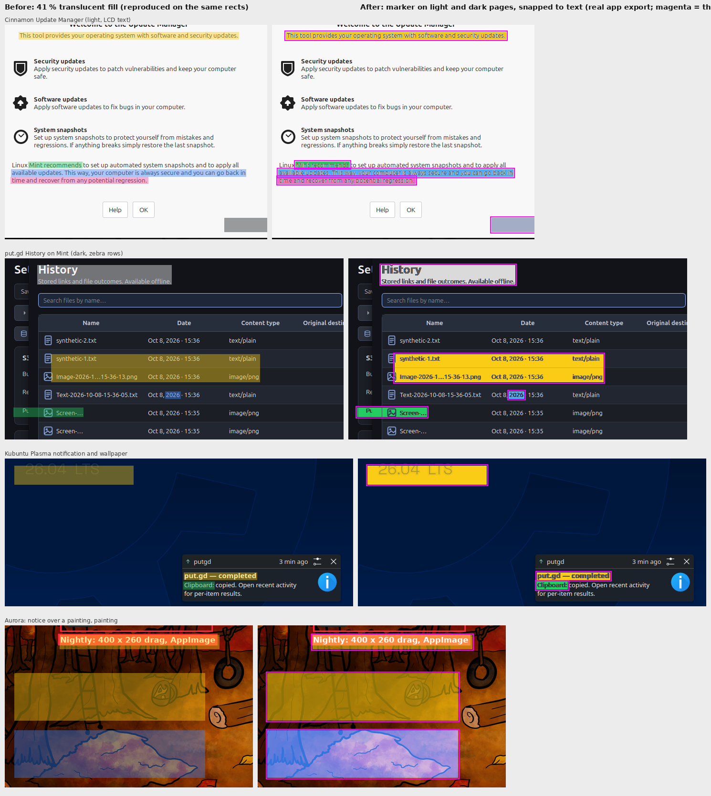

# Highlight acceptance, round 2: a marker on dark pages

Round 1 (`2026-11-06-highlight-acceptance`) tinted dark backgrounds to a
mid-luminance amber that kept white text at 4.5:1. Patrick tried it live on
f44 and found the text hard to read (`live-try-before-rework.png`: a green
box over the put.gd History table). That rule is gone. On a dark background
the box now takes the marker colour itself, as on paper, and the ink is
unmixed by its coverage and darkened (hue kept) until it reads at 5:1 on the
marker; the darkened ink is laid with gamma-corrected coverage so the
strokes do not look heavier than the light ones they replace. Light pages are
unchanged (multiply, ink untouched). Marker colours are lifted to luminance
0.45 to 0.7 so dark ink reads on every palette pick.

Same driver and captures as round 1 (`headless_editor.sh`, real app
offscreen on f44 built from PR #1238 head `e8e8af4` plus the gamma commit),
same commands. `zoom-dark-rows.png` compares the first marker pass (top)
with the gamma-corrected lay (bottom) at 3×.

`test_editor`: 50 passed. Release-build cost unchanged in kind (the dark
branch adds a table lookup per ink pixel).
