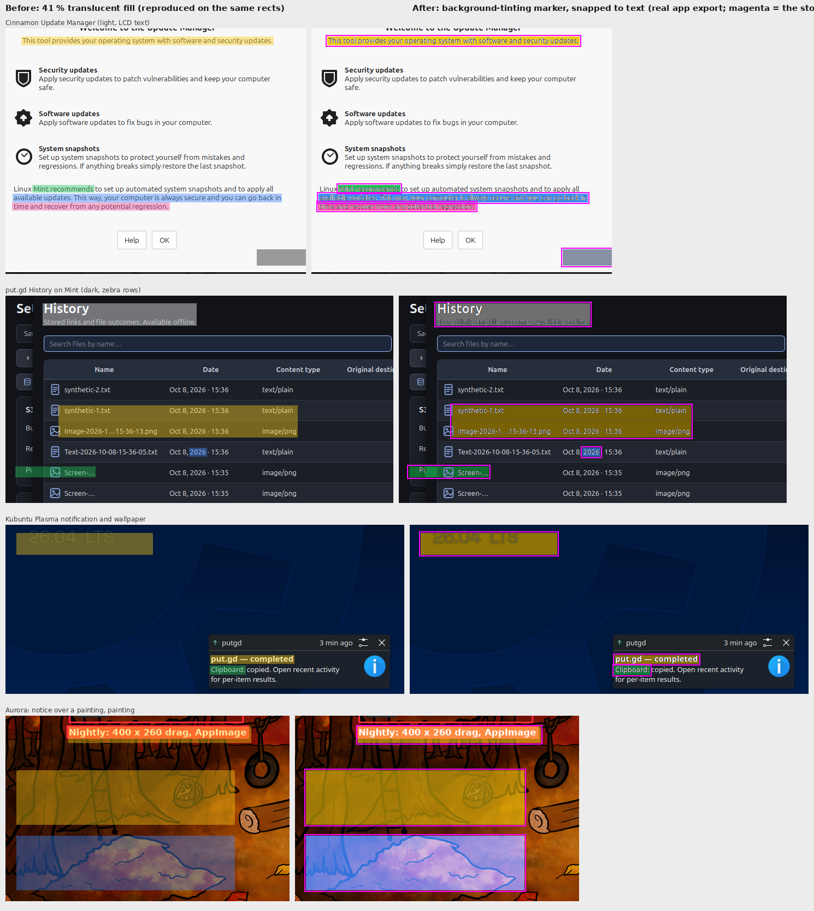

# Highlight acceptance: real app, headless, four real captures

Acceptance for put.gd-desktop PR #1238 (issue #1237): the background-tinting,
text-snapping Highlight mark, driven through the real application without a
desktop. The resident (`putgd --background`) and the editor ran under
`dbus-run-session` with `QT_QPA_PLATFORM=offscreen` and private XDG roots on
f44 (Fedora 44), built from the PR head with the dev preset. Every edit went
through `putgd-cli editor.open` / `editor.apply` / `editor.inspect` /
`editor.saveCopy`, the same path the MCP helper uses.

Left: the old 41 % translucent fill, reproduced with Pillow on the rects the
new build snapped to (the old build is no longer installed on f44; the fill is
`fillRect` at alpha 105/255, which this reproduction matches exactly). Right:
the real app's saved copy, with the stored rect outlined in magenta.

## What was exercised

| Capture | Commands | Result |
| --- | --- | --- |
| Mint Cinnamon Update Manager (light grey dialog, LCD subpixel text) | `rect` + `snap: text` on an 8 px drag through a sentence; `at` + `snap: word` (green); `at` + `snap: line` (blue); a 6 px drag with `snap: text` (pink); a free `rect` with the near-black palette colour | The drags grew to full line height (16 px) and trimmed to the ink; the word box is "Mint recommends"; the line box is the whole second line; black text stays byte-identical; the near-black marker shows as a visible grey tint |
| put.gd History on Cinnamon (dark, zebra rows, icons) | `snap: text` across two rows; `snap: word` in a date cell (blue); `snap: line` on a file name (green); `snap: text` with the white palette colour on the heading | Two rows tinted amber with white text untouched; "2026" alone; "Screen-…" alone (the row's cells are separate columns); the white marker shows as a neutral grey |
| Kubuntu Plasma notification over the wallpaper | `snap: line` on the bold title; `snap: word` (green); a free `rect` on the low-contrast "26.04 LTS" lettering | Title and word snapped; the wallpaper box takes the amber and the faint lettering, being close to the background, tints with it |
| Aurora notice over a painting | `snap: line` on the notice text; two free rects on the painting (yellow, blue); a free rect on a red label | The painting boxes take the screen fallback and stay visible where multiply would vanish; the red label keeps its white text. `snap: line` on the notice returned `No text at that point`: the 400×80 window around the point is mostly painting, so there is no dominant background to segment. Known limit; a drag with `snap: text` or a free box still works there |

`exports/*-after.png` are the saved copies, `exports/*.inspect.json` the
stored shapes (rects as the app snapped them), `exports/*-source.png` the
inputs. `headless_editor.sh` is the driver (`dbus-run-session -- bash
headless_editor.sh BUILD_DIR CAPS_DIR OUT_DIR`); `before_after.py` draws the
figure.

## Cost

`test_editor highlightCostOnA4kBoxIsBounded` on f44 (4 cores):

| Build | Full-frame 4K export | 1.5 MP display tile | Snap of a 1400×120 drag |
| --- | --- | --- | --- |
| Debug | 1068 ms | 291 ms | 75 ms |
| Release | 173 ms | 53 ms | 6 ms |

## Tests

`test_editor`: 50 passed (ten new highlight cases). `editor_job_integration`
and `gui_editor_window`: passed. All on f44 from the PR head.
