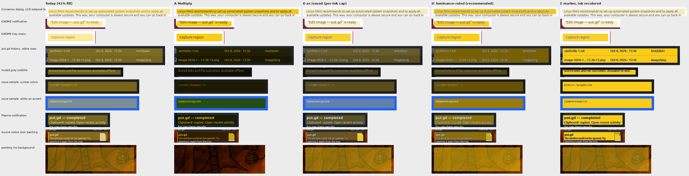
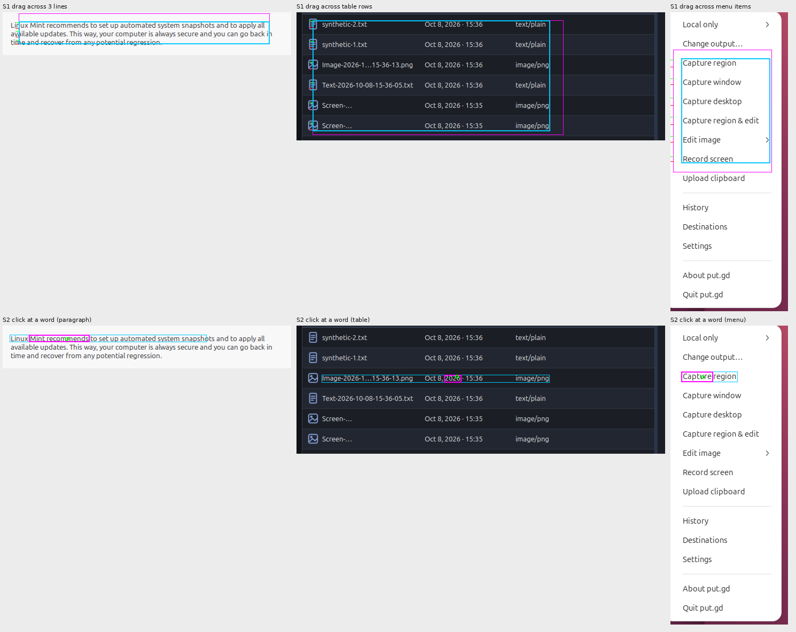

# Highlight compositing and text snapping on real captures

Follow-up research for put.gd-desktop issue #1237 (editor highlight: keep text
contrast; smart text-snapping highlight). The first record,
`2026-11-06-highlight-modes`, compared compositing modes on four synthetic
Pillow samples. This one runs the candidates on real desktop captures already
in this repository and prototypes the text snapping, on f44 (numpy 2.4.6,
Pillow 12.3).

## Inputs

`crops/` holds ten crops cut from published captures:

| Crop | Source record | Content |
| --- | --- | --- |
| `light-paragraph`, `light-heading` | `2026-10-08-ui-process-raw/.../cinnamon/.../console-restored.png` | Mint Update Manager dialog: 13 px dark text on light grey, **LCD subpixel rendering** (blue and peach fringes) |
| `light-popup` | `2026-10-30-editor-r4/gno/raise-failure.png` | GNOME notification, dark text on white |
| `light-menu` | `2026-10-30-surface-input-guards/gnome-menu.png` | GNOME tray menu items |
| `dark-table`, `dark-settings-top` | `2026-10-08-current-desktop-matrix-raw/cinnamon/view-0-history.png` | put.gd History window: zebra rows with icons; a muted grey subtitle |
| `kde-notify`, `kde-wallpaper-text` | `2026-10-08-ui-process-raw/.../kde/.../console-before.png` | Plasma notification (white on navy); low-contrast wallpaper lettering |
| `dark-notify`, `photo` | `2026-11-04-hotkey-crosshair/aurora-appimage-nightly-drag.png` | Aurora notice over a painting; the painting itself |

Two synthetic samples from the first record (`syn-syntax`: dark-theme syntax
colors; `syn-button`: white on a blue button) are regenerated by the script so
the two records line up.

## Modes

`hl_research.py` applies the same highlight box (#FACC15) to each crop with:

- **Today**: 41 % translucent fill (`EditDocument::paintAnnotation`).
- **A Multiply**, **B Darken**: per-pixel blends used by ksnip, Acrobat, Greenshot.
- **Multiply/Screen**: multiply when the box's mean luminance is above 0.35, else
  screen with a dimmed marker (an experiment, not in the issue).
- **D as issued**: the issue's option D exactly as prototyped (dominant
  background colour, per-pixel coverage, tint capped so every frequent ink
  colour keeps min(original, 4.5:1)), plus a block-local background estimate so
  a box across two panels keeps both.
- **D′ luminance-ruled** (new): the same background estimate and coverage
  unmix, but the tinted background is chosen from the background's luminance
  alone: light backgrounds get `multiply(bg, H)`; dark backgrounds get the
  highlight hue scaled in linear light to luminance 0.183, the highest value
  at which white text still reads at 4.5:1 (lowered when the box's brightest
  ink is dimmer, never below 0.06 above the background). No ink histogram.
- **E marker**: full marker, light ink darkened (the issue's option E).

Fallback for boxes without a dominant background (block confidence below 0.5):
multiply when the mean luminance is above 0.35, otherwise screen with the
highlight hue at luminance 0.183.

## Results



Per-case sheets with every mode are in `sheets/modes-*.png` (2× zoom).
`results.json` has the numbers. Ink shift is the mean RGB distance moved by
glyph-core pixels; bg shift is the same for background pixels (how visible the
marker is); contrast is the worst WCAG ratio between a detected ink colour and
the new background, with the original ratio in brackets.

| Case | Today | A Multiply | D as issued | D′ | E |
| --- | --- | --- | --- | --- | --- |
| Cinnamon dialog (LCD text) | ink 87, bg 96, 2.3 (4.0) | ink 126, bg 234, 4.1 | ink 0, bg 65, 3.6, tint 0.28 | ink 0, bg 234, 2.6 | = D |
| GNOME menu | ink 89, bg 99, 3.0 (7.3) | ink 102, bg 240, 6.2 | ink 0, bg 216, 4.9, tint 0.90 | ink 0, bg 240, 4.8 | = D |
| put.gd History rows | ink 87, bg 115, 3.5 (10.5) | ink 108, bg 40, 7.4 | ink 0, bg 84, 4.9, tint 0.32 | ink 0, bg 116, 4.0 | ink 84, bg 278, 5.0 |
| muted grey subtitle | ink 85, bg 123, 2.3 (4.4) | ink 115, bg 22, 3.0 | ink 0, bg 83, 2.2, tint 0.28 | ink 0, bg 91, 2.2 | ink 61, bg 297, 4.7 |
| syntax colours | ink 58, bg 116, 2.6 (5.8) | ink 101, bg 28, 4.7 | ink 0, bg 79, 2.9, tint 0.28 | ink 0, bg 94, 2.6 | ink 100, bg 281, 5.0 |
| white on blue button | ink 98, bg 132, 2.3 (3.6) | ink 235, bg 217, 4.3 | ink 0, bg 90, 2.8, tint 0.28 | ink 0, bg 256, 2.8 | ink 250, bg 320, 4.8 |
| Plasma notification | ink 86, bg 116, 3.2 (9.1) | ink 182, bg 39, 6.2 | ink 0, bg 79, 4.5, tint 0.28 | ink 0, bg 143, 2.6 | ink 196, bg 281, 4.7 |
| painting (fallback) | ink 132, bg 113 | ink 0, bg 4 (invisible) | screen fallback, bg 138 | screen fallback, bg 158 | = D |

The contrast column uses detected ink bins, which on anti-aliased text include
mid-grey stroke pixels; D′'s guarantee is for the brightest ink (white reads
at 4.5:1 on the amber), and the ink-shift column shows glyph cores unchanged.

### Findings

1. **The per-ink contrast cap in option D is fragile on real text.** Linux
   desktops render text with LCD subpixel filtering (Mint, Ubuntu defaults):
   a 1 px stem becomes a bluish and a reddish column with no neutral core, and
   grey anti-aliasing makes thin strokes 40–60 % tints of the ink. Every
   "frequent colour far from the background" heuristic treats some of these as
   low-contrast ink, and the cap collapses to its 0.28 floor: the Cinnamon
   dialog and the Plasma notification both got the minimum tint, a pale wash on
   light pages where plain multiply measures the same worst contrast as the
   original (4.1 vs 4.0). Three rounds of fixes (edge rejection, coverage-
   weighted fusion of subpixel triples, judging bins by their strongest pixels)
   each moved the failure somewhere else; see `hl_research.py` `ink_colors`.
2. **The luminance rule needs none of that and lands where D wanted to be.**
   On light backgrounds the tinted background is multiply's colour, so the box
   looks like every other tool's marker while glyph pixels stay byte-identical
   (ink shift 0 vs 100–125 for real multiply, which recolours coloured icons
   and link text). On dark backgrounds the amber at luminance 0.183 is brighter
   than D's capped result (bg shift 116–143 vs 79–84) and white text keeps
   4.5:1 by construction. The brightest-ink cap only matters for muted text
   (the grey subtitle), where both D and D′ end at the visibility floor.
3. **Low-contrast text on dark backgrounds is the open trade-off.** The muted
   subtitle (4.4:1 originally) reads at 2.2:1 under D or D′ and the syntax
   comment colour similar. Option E is the only mode that improves it (4.7:1),
   because it recolours the ink. The issue's call to keep E out still holds for
   the default; it is the natural "strong marker" variant if one is wanted later.
4. **The block-local background is needed.** A box across two zebra rows or
   across a notice and the painting behind it (`dark-notify`) gets two
   backgrounds and two tints (`amber` and `multiply`); the global-mode variant
   tinted part of the box wrongly (ink shift 29–48 on `dark-notify`).
5. **Photos and gradients**: multiply disappears on dark paintings (bg shift
   4); screen with the amber is visible (138–158) and keeps the dark line art.
6. **Snapping works on the same ink mask.** Row projection of coverage ≥ 0.5
   with an 8 %-of-peak start threshold and bounded hysteresis finds the three
   lines of the 13 px paragraph, the six table rows (icons included) and the
   six menu items; column trimming removes the empty right part of the table.
   Word boxes from 4-connected components merged below 0.22 × line height hit
   "2026" and "Capture"; in the paragraph it merged "Mint recommends", so the
   implementation should derive the word gap from the gap histogram of the
   line (letter gaps and word gaps are bimodal) instead of a fixed ratio.



Timings in `results.json` are numpy/Python (10–130 ms per crop) and only
show that the work is a few linear passes; the C++ cost has to be measured in
the editor.

## Reproduce

```sh
python3 -I hl_research.py crops out    # writes out/modes-*.png, snap-*.png, word-*.png, results.json
```

Needs numpy and Pillow (f44, k72, m74 and d69 all have them). The crops were
cut with Pillow from the records named above at the coordinates in the script's
`CASES`; `crops/` keeps them so the run is self-contained.
