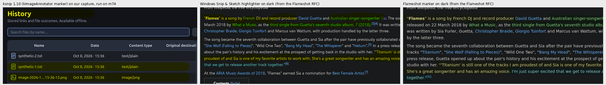
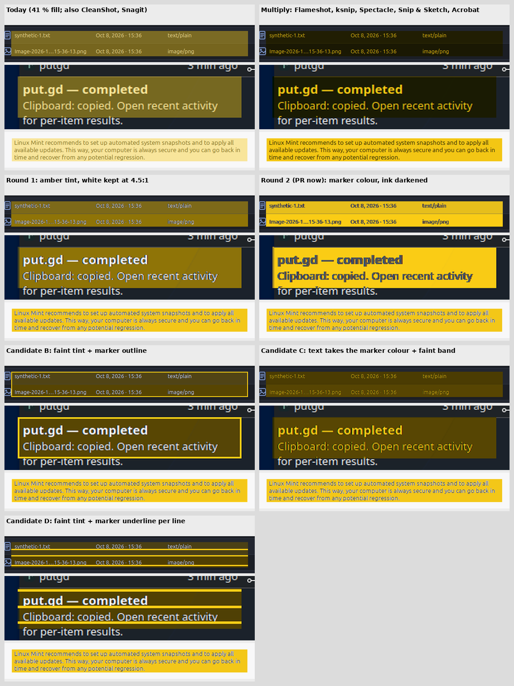

# Highlighter survey: what other tools do on dark pages, and candidate looks

For put.gd-desktop #1237 after Patrick rejected the first two dark-page rules
(round 1: amber tint keeping white at 4.5:1; round 2: marker colour with
darkened ink).

## What the other tools do

- **Multiply** (Flameshot marker, ksnip and Spectacle via kImageAnnotator,
  Windows Snip & Sketch, Acrobat, PixPin default): on a dark page the band is
  nearly invisible and the light text takes the marker colour. Flameshot users
  report "the marker is barely seen over a black background" (discussion
  3192); the maintainer's suggestion was invert colour. PixPin's docs say
  multiply "is inconspicuous on a dark background" and added a semi-transparent
  mode as a manual switch.
- **Translucent fill** (CleanShot X with an opacity slider since 3.1.1, Snagit,
  PixPin's alternative, put.gd today): a muddy band and tinted text.
- **Smart snapping** (CleanShot X 4.7 Smart Highlighter, May 2024; Shottr via
  macOS Vision) changes the shape, not the compositing.

`real-tools-dark.png`: ksnip 1.10 run on our dark capture on m74 (left), and
Snip & Sketch and Flameshot on dark text from the Flameshot opacity RFC.
`web-zoom.png`: the same plus PixPin's own multiply vs semi-transparent
comparison and the light-page versions.

## Candidates on the same captures

`candidates-sheet.png`, each on the put.gd History rows (dark), a Plasma
notice (dark) and the Cinnamon dialog (light). Light pages are multiply with
the ink untouched in every candidate; only the dark rows differ.

| Look | Dark page behaviour | Reads as |
| --- | --- | --- |
| Today | 41 % yellow over everything | muddy band, olive text |
| Multiply (mainstream) | band almost invisible, text turns yellow | "coloured text", not a marker |
| Round 1 | amber band, white text kept at 4.5:1 | rejected live: hard to read |
| Round 2 (PR now) | yellow marker, text darkened | a marker on paper; text changes colour |
| Candidate B | faint tint (ink untouched) + 2 px marker outline | a framed region; text as before |
| Candidate C | text takes the marker colour + faint band | mainstream look made visible |
| Candidate D | faint tint (ink untouched) + 3 px marker underline per text line | underlined text; text as before |

The Pillow sketches use the same background estimate and coverage unmix as the
app; B and D keep every ink pixel byte-identical on dark pages too.
