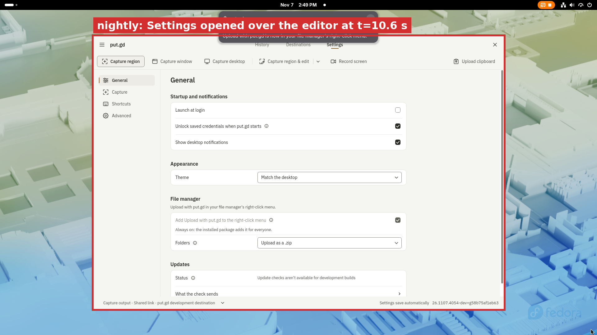
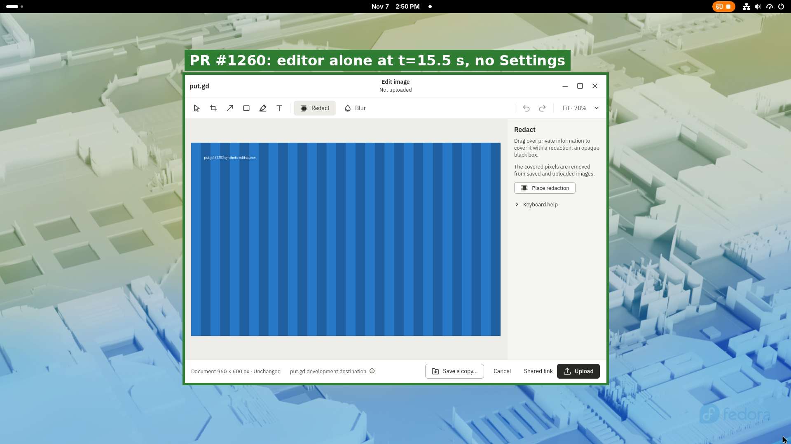

# PR #1260: no-tray startup recovery vs. an editor opened by editor.open (#1252), f44 GNOME

**Verdict: the bug reproduces on nightly and is gone on the PR build.** In both runs, a background resident with no tray was started and `editor.open` was called at about 2.6 s. On nightly, the resident's Settings helper started at t≈10.6 s and Settings covered the editor until the run ended at t=20.5 s. On the PR build, Settings never started: `ui.state` stayed `stopped` through t=20.6 s, the editor stayed in `editing`, and it was the only put.gd window in every frame.

| | nightly | PR #1260 |
| --- | --- | --- |
| Build | `26.1107.4054-dev+g58b75af1eb63` (nightly push CI run 42409939345, `release-appimage`) | `26.1107.4056-dev+g04b78cef28be` (PR CI run 42411035093, `release-appimage`; merge of PR head `612474a1b` into nightly `58b75af1e`) |
| AppImage SHA-256 | `70885c8a…b9c236f` ([nightly/appimage.sha256](nightly/appimage.sha256)) | `9e941d48…a111cfb2` ([pr/appimage.sha256](pr/appimage.sha256)) |
| `editor.open` sent | t=2.64 s | t=2.64 s |
| Editor `editing` | from t=3.7 s | from t=3.6 s to t=20.6 s |
| Settings helper (`diagnostics.ui`) | `stopped` until t=9.6 s; `ready`, pid 2615794, from t=10.6 s | `stopped` at every sample, t=2.7 s to t=20.6 s |
| Key frame t=15.5 s |  |  |

A probe pixel inside Settings' footprint but outside the editor's (x=380, y=600) reads the wallpaper colour `(174,186,160)` in every PR frame. On nightly it reads Settings' background from the t=10.5 s frame onward.

The PR head after this run, `736b199de`, changes only a test assertion. The AppImage's code is the same as at that head.

## Where and how

- Host: f44 (Fedora 44, GNOME Wayland, physical desktop, `192.168.68.70`), under the f44 desktop lock (`workerA-1252`, 20:49–20:51 UTC). Frames come from the host's loopback VNC (`putgd-gnome-vnc`, port 5901) about once a second, using [scripts/frames.py](scripts/frames.py). [scripts/run.sh](scripts/run.sh) does the run.
- **No tray.** f44's own GNOME session has a tray host: the AppIndicator extension is enabled. Without a tray change, the recovery timer would never start there. To avoid changing Patrick's desktop, and another worker's resident on the same session, each run started under `dbus-run-session`. Its private session bus has no `org.kde.StatusNotifierWatcher`, so the resident reports `trayAvailable: false`, as on a tray-less GNOME. The windows still map on the real Mutter display through `WAYLAND_DISPLAY=/run/user/1000/wayland-0`.
- Each run used private `XDG_CONFIG/DATA/STATE/CACHE_HOME` and a private `XDG_RUNTIME_DIR` under `/tmp/wA.*` (socket path 35 bytes, [socket-bytes.txt](pr/socket-bytes.txt)). An offscreen setup pass saved the development template configuration, so `--background` takes the no-tray recovery branch and not the first-run Settings branch.
- The editor opened a synthetic 960×600 PNG (`source: file`). Each run ended with `editor.cancel` and `ui.quit`.
- Packages: the CI `release-appimage` artifacts, extracted with `--appimage-extract` and run from `squashfs-root/AppRun`. No host package operation.
- Focus: GNOME's focus-stealing prevention applies to windows started from SSH, and the f44 session has no compositor witness for keyboard focus. The frames show which window is in front: Settings on nightly, the editor (the only put.gd window) on the PR build. These runs do not claim to show keyboard focus.

## Files

- `nightly/`, `pr/`: [ui-timeline.jsonl](pr/ui-timeline.jsonl) (`diagnostics.ui` and `trayAvailable` about once a second), [editor-timeline.jsonl](pr/editor-timeline.jsonl) (`editor.inspect` phase), [children.txt](pr/children.txt) (the run's put.gd processes; the PR build's only `putgd-ui` is `--edit-image`), the `editor.open`, `editor.cancel` and `ui.quit` replies, `t0.txt`, `env.txt`, `build-info.json`, and frames at t=1.5, 4.5, 7.5, 9.5, 10.5, 11.5, 15.5 and 20.5 s.
- Annotations were made by [scripts/annotate.py](scripts/annotate.py) on the t=15.5 s frames.

## Cleanup

After each run: no `putgd`, `host_input` or `videotestsrc` process, and no services left over from the private bus. The f44 lock was released with `--verified-clean` (receipt `putgd-lab/locks/history/2026-11-07T20-51-07Z-release.json` on f44). The user profile directories `~/.local/share/putgd` and `~/.local/state/putgd` were not written; the log files there predate this slot.
