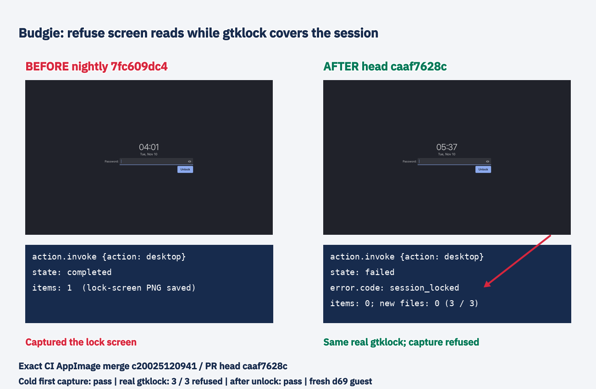

# Current work: capture stack acceptance in progress

Review round50 is green and demonstrated; [its raw proof and timing limits](copy-boundary/README.md) are preserved. Both code branches now merge capture13570fca9 and nightlyaedccdf6c under coordinator instruction. Stacked-head guest acceptance is in progress. Companion blanking docs PR1390 is green. The historical packets below retain earlier accepted rounds.

# Budgie: refuse screen reads behind gtklock

Current coordinator follow-up: head2354d9f69 uses a3s frame wait, CI green,10/10 loaded captures and3/3 gtklock refusals. See [three-second demonstration and blanking-policy answer](three-second/README.md). Both PRs remain held for #1368, with three new unverified outside-diff review concerns recorded for the post-merge stage. The earlier caaf acceptance below is historical.

Part of put.gd-desktop #1383; code PR #1385. Confirmed on plain nightly7fc609dc42f8f3c1118d79a63d42ce37ea4a71c9: an agent desktop request made under visible gtklock completes and saves the lock screen. Fresh d69 KVM guests on the wall used Budgie10.10.3, labwc0.20.2 and gtklock4.0.0.

The adapter now requires a fresh compositor frame on its transparent, input-empty1x1 overlay before reading screen pixels. Real gtklock suppresses that frame. Setup has a bounded5-second deadline, then the actual frame witness gets its own1-second deadline. Close/error/silence fails closed with session_locked. The fresh AF_UNIX connection is nonblocking too: a full server listen backlog refuses immediately rather than blocking the event loop before the setup timer runs. Desktop and window pixel reads use this asynchronous gate; clipboard is unchanged. A live-region request can remain in its selector until pixel acquisition; this protects the pixel-read boundary.

Final headcaaf7628c1d79f950f9f7b8e7fa1cf25b378d7e7 was accepted from exact CI AppImage26.1110.4460-dev+gc20025120941, workflow42762238341. CI's synthetic mergec200251209417365625978f1f1adbe3fccae4a71 has parents nightly5e38f08df8d4dec14bc3828ea73d7b3912e4947b and branchcaaf. Its source tree1819e1059e7766a12cd10bf85bf635feecd5b81b matches local git merge-tree exactly. The intervening nightly changes concern docs and nightly-check scheduling. Build, package/running binary hashes and reviewed-source.json record this identity; none was bypassed.

| Native final-package case | Result |
| --- | --- |
| First cold request after fresh install/start, without warming the probe | completed |
| Real gtklock visible, three immediate desktop requests |3/3 failed: session_locked,0items, no new files |
| After unlocking | completed |

The first cold result and its actual1280x800 PNG are preserved, as is the post-unlock PNG. final-caaf/ is authoritative; final/ holds intermediate4b7 results and after/ holds head930. The4b7 harness initially omitted the independent probe wire helper after a successful cold capture; its correction is preserved. The finalcaaf script includes it and ran without that harness failure. before/repro/fixed-locked-operation.json is a prototype result, not final acceptance.

The earlier implementation's whole-probe1-second timeout falsely refused the first unlocked request in three fresh guests. The bc4 trace shows0.906s spent waiting for registry setup, then destruction at deadline before configure. See startup-investigation for the actual trace and failed requests. This is why setup and frame deadlines are separate now; the first-window render was concurrent, but compositor internals were not profiled. The final fresh guestbc6 atcaaf passes its first request too. Earlier head930 also passed ten later unlocked repeats; those are supplementary, not final-head cold proof.

Lock routes checked on nightly: logind LockedHint remains no; BudgieScreenlock has Lock/Dim/Undim/OnBattery/ScreenPowerResume/ScreenPowerSuspend but no lock-state method, and GetAll is empty. gtklock exposes anonymous GTK application/window bus objects but no useful well-known state service; another anonymous connection's introspection timed out. We do not claim every possible logind signal route is absent. The useful observed signal is a fresh layer frame: the included minimal raw Wayland probe receives configure/sync in both states, but its frame only unlocked.

Plain nightly has no delayed capture yet. In the capture lane branch, lockGate bypasses zero delay and checks screensaver/logind for positive delay; its decisive gtklock refusal is the countdown pill's separate presentation/frame witness. The immediate adapter lacked such a witness. This fix uses the tested session-lock effect on layer surfaces; it is not a universal logind lock-state query.

Tests on f44 (Qt6.11.2, labwc0.9.6): the strict lockedDesktopCaptureIsRefused fails with the original adapter and passes fixed, including unlocked capture after unlock. Its fixture presents opaque lock surfaces on all outputs to match real gtklock; an empty lock object was insufficient on older labwc and was replaced without relaxing the assertion. A second regression pauses only the private child compositor for1.2seconds during setup: old deadline fails, new passes. Final full budgie_labwc_integration passes18.12s with all owned/component source paths matching headcaaf. A third regression fills a private Unix backlog; the old blocking call fails its<1s timing assertion and the fixed call refuses promptly. See connect-review-follow-up.md. Earlier4b7 results19.64s,18.78s and all failed attempts are retained. The intermediate source CI4b7 was cancelled by the necessary review push, not passed. Ubuntu26.04 CI runs this real-labwc suite as well.

Picture: actual nightly saved lock-screen PNG left, actual final guest's locked QMP witness right, beside real operation results. Composition on d69; labels/arrow through the exact-package production editor after unlocking. No protected input shown. Raw selected lock-screen/QMP pictures, all operation receipts, scripts and failed experiments are retained; private archives have matching builder/workstation SHA256 and restore paths. All guests stopped and overlays guarded-retired after export; receipts included. Goldens unchanged.

No physical desktop, unrelated desktop acceptance, upload, workstation build or workstation test was run. No source docs changed.

All substantive CodeRabbit review bodies and walkthroughs were read, including Outside diff range comments. One backlog finding was addressed and its thread resolved; CodeRabbit checked caaf and confirmed it in a reply. Its subsequent full review raised no further code finding. The docstring-coverage advisory is not a required repository check. Temporary f44 source/build trees were retired only by archive-listed individual files after content/checksum verification; SDK cache and indexed cold archives remain. No physical lease or VM tunnel remains.
