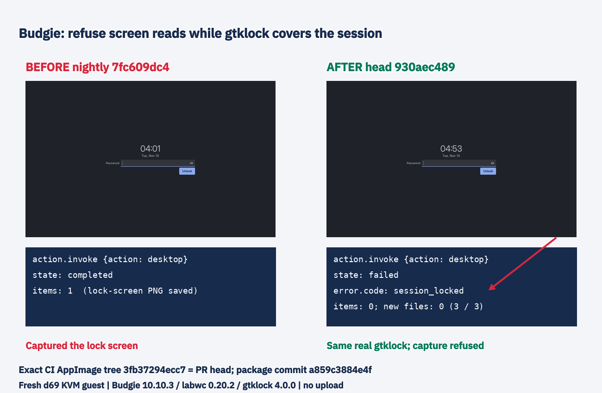

# Budgie: refuse screenshot reads behind real session-lock surfaces

Part of put.gd-desktop #1383; code PR #1385. Plain nightly 7fc609dc42f8f3c1118d79a63d42ce37ea4a71c9 reproduced the reported privacy bug: an agent desktop request completed and saved a picture of gtklock. Fresh d69 KVM guests, on the wall: Budgie 10.10.3, labwc 0.20.2, gtklock 4.0.0.

The after package is the exact CI AppImage from workflow 42756503220, version 26.1110.4453-dev+ga859c3884e4f. Its synthetic PR merge commit is a859c3884e4fe6c3128904fd2134934ccf582112; gitTree 3fb37294ecc722ed18098894c73c32c70eebefcb is identical to branch head 930aec489fa4ac6bc242de19235cbeb85901a828. Package and running resident hashes, build metadata and socket-path checks are retained. No version or identity check was weakened.

After: all three immediate desktop requests under the visibly active real gtklock failed with session_locked, empty items and no new output files. Unlocked capture before and after unlocking completed, and ten further unlocked requests after an ordinary resident restart completed. One initial unlocked request after installation/start failed closed with the same deadline error; its cause was not established, and it is preserved in first-unlocked-attempt.json rather than claimed as a pass. Later calls did not reproduce it. The error explicitly covers locked, blanked or unresponsive screens.

Lock-state routes checked on nightly:

- logind session 1 LockedHint remained no while gtklock was visible. No useful Lock/Unlock change was observed in the saved monitor output.
- org.buddiesofbudgie.BudgieScreenlock publishes Lock, Dim, Undim, OnBattery, ScreenPowerResume and Suspend, but no lock-state query/signal; Properties.GetAll is empty.
- gtklock owns anonymous session-bus connections, with no well-known state service. Its introspection exposed GTK application/window objects; a second unique connection timed out. No usable state was established there.
- A minimal independent raw Wayland client receives layer configure and display sync in both states, but a fresh wl_surface.frame on an overlay only arrives unlocked. The source and JSON are included. This is the useful signal for the tested labwc/gtklock combination.

The new asynchronous gate creates a transparent, input-empty 1x1 layer surface on its own Wayland connection. Only a fresh frame permits pixel reads; a close, failure or one-second deadline refuses with session_locked. It changes no pixels and takes no input focus. Clipboard reads are unchanged. The gate covers desktop frames and window pixel reads; a locked region request can still wait in its selector before any pixels are requested. This is a visibility witness for mapped lock surfaces, not an assertion that logind now reports lock state or a universal guarantee for every compositor.

Plain nightly has no delayed-capture feature yet. The capture lane branch's lockGate bypasses zero delay, then checks screensaver/logind for positive delays. Its decisive refusal under gtklock comes from the countdown pill's independent presentation/frame witness, not a working Budgie lock-state service. The immediate adapter lacked that witness.

The real labwc integration test uses an ext-session-lock fixture with opaque presented lock surfaces on every output. The strict session_locked assertion fails with the original adapter and passes with the gate. An earlier empty-lock-object fixture did not reproduce mapped gtklock surfaces on older labwc and was replaced, without relaxing the assertion. Full budgie_labwc_integration passed on f44 (16.64 seconds), and CI runs the suite on Ubuntu 26.04. The first full focused build lacked putgd-ui; it passed after building the required helper. Build and failed-test logs are retained.

The annotated picture uses the nightly saved lock-screen PNG on the left and a QMP witness of the actual locked guest on the right, beside results copied from the real operation JSON. Labels/arrow were applied by the exact-package production editor after unlocking. No protected input is shown. No upload, physical desktop test, unrelated desktop acceptance, workstation build or workstation test was run.

Full raw captures and experiments remain in checksum-verified private archives indexed in restore-index.json. Both guests were stopped and overlays retired with guarded cleanup after export; receipts are included. Goldens remain unchanged.
