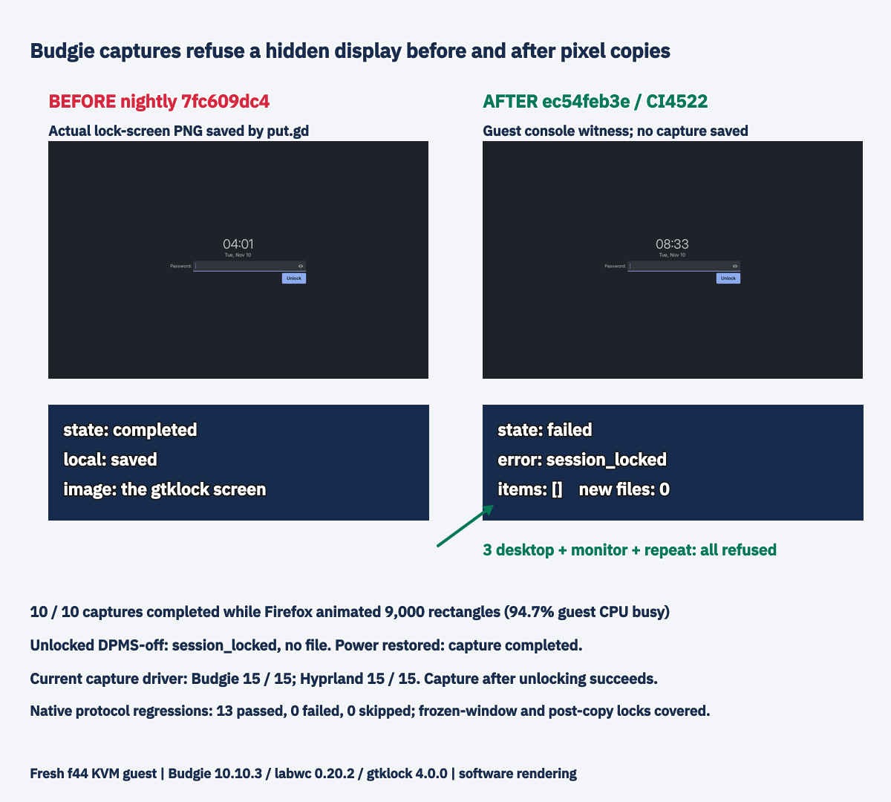

# Budgie locked capture: final stacked-head acceptance

Part of #1383; code PR #1385 at **ec54feb3e53411d31cacce6edec3e3909f58ef26**. Capture13570fca9 and nightly962ac8c0b are merged. Full CI42774500854 is green. Final AppImage **26.1110.4522-dev+g3e071edc821e**, synthetic merge3e071edc821e01b7bbc79feb742d799d15516049, tree9b03b1f48fbed5c53bc8bcfd92f342e9f2eec393 equals the branch tree. Package SHA, version, installed binaries and running resident were independently checked. Blanked-display documentation PR #1390 merges after the code.

Every output-copy batch and frozen-window copy has a fresh transparent, input-empty layer-surface frame before and after it. A withheld frame discards pixels with session_locked. Monitor and repeat converge on the same output-copy gate; delayed-region expiry also asks visibility before freezing. Image-copy streams and witnesses share one resolved compositor endpoint with peer validation, including inherited WAYLAND_SOCKET. Unverifiable inherited endpoints refuse instead of testing a different display. Normal path pins reset only after pixel connection loss; inherited pins remain.

Each witness has a5s setup phase and3s frame phase. Labwc offers no client-held atomic lock boundary: a complete lock-and-unlock between the two observations cannot be detected. A lock that persists through the post-copy frame check discards the image.

## Final CI-package matrix

Fresh f44 KVM guests, one at a time and on both wall heads: Omarchy4.5/Hyprland0.56.2 software rendering, hc5; Fedora45 Budgie10.10.3/labwc0.20.2/gtklock4.0.0, bc9. Each guest ran both independent final code heads sequentially, restarting the resident before every fifteen-check sequence so the initial Repeat refusal was exercised. Hyprland used D's native Arch package then C's AppImage; Budgie used the two AppImages.

| Head / package | Budgie current driver | Hyprland current driver |
| --- | --- | --- |
| C ec54 / CI AppImage4522 | **15/15 PASS** | **15/15 PASS** |
| D ccf0 / CI AppImage/native4515 | **15/15 PASS** | **15/15 PASS** |

Original coordination driver SHA40fca26fa709742d8b29b18d1630275c9df90c5c28782d9666da939d31b25524, including the corrected real-pill locator. Only owned controller ROOT and protected-input unlock were adapted; all fifteen assertions remain. Hyprland setup recovers the actual shell's public OMARCHY_PATH and basename WAYLAND_DISPLAY and requires its IPC ping. The first D attempt did not lock because that environment was missing; the unlocked screenshots prevented any login input. The failed attempt and corrected complete rerun remain separate.

## Final Budgie privacy and load checks

- **10/10 consecutive desktop captures completed** while a fresh private Firefox profile animated9000 rectangles/frame; guest CPU busy94.7%. The actual saved whole-desktop PNG was visually checked and contains the synthetic animated page. All ten operations and PNGs are retained.
- Real gtklock: **3/3 desktop requests plus Capture monitor and Repeat** returned session_locked, empty items and an unchanged output-file list. Completion3278/3611/3717/3662/3678ms. A desktop capture after visually verified unlocking completed.
- Unlocked DPMS-off: both outputs powered off, LockedHint=no, gtklock absent; capture returned session_locked with no items/file (3606ms). Power restoration restored capture.
- **13 native protocol regressions passed,0failed,0skipped,17.649s** on distro Qt6.11.2/labwc0.20.2. These supplementary local binaries cover the requested pause after successful window freezing, output/window post-copy lock transitions, locked desktop, endpoint identity, anonymous inherited refusal, reconnect, bounded backlog and slow compositor setup. They are not substituted for the CI-package desktop proof. Relevant source files match final C exactly; component-source-parity.json records the comparison.
- Full builder integration already passed39.90s on f44 Qt6.11.2/labwc0.9.6 (window protocol unavailable there). Native guest setup first tried an unnecessary privileged hard-coded helper path; sudo-n refused, no password was requested/sent, and that attempt is retained. The targeted security/window subset then ran without privilege; redundant feature unit methods were not rerun inside the guest.

The same guest idle preflight used by acceptance/nightly guest launch disables automatic blanking/sleep and holds a sleep:idle inhibitor; live receipts show it. The deployed nightly profile list had no Budgie row at the earlier audit, so no currently scheduled Budgie nightly cell is claimed. Other desktops have no uniform explicit DPMS-only policy; their actual DPMS-only behavior was not run. The GNOME/X11 documentation qualification is source-audited, not a new desktop reproduction.

## Capture cost

Same fresh1280x800 two-vCPU software guest,20captures/build, one warm-up excluded, single-operation inspection every5ms:

| Implementation | Mean ms | Median ms | Worst ms |
| --- | ---: | ---: | ---: |
| Before post-copy witness2354d9f69 | 542.3 | 532.2 | 656.3 |
| After50f1a6f77, same final copy-boundary implementation | 547.7 | 539.0 | 695.9 |

These whole-operation times include capture, encoding, archive/copy and observation. The5.4ms mean difference does not isolate frame latency or establish zero cost; variability remains. The earlier growing-history observer drift is retained but is not the basis of the table. See copy-boundary/ for raw paired data and strict negative controls: removing either post-copy gate fails window/output tests; independent witness routing also fails.

## Provenance and retirement

stack-final/ contains package identities, both desktop driver logs, final-head editor apply/save records, all final load operations/PNGs, blank/lock state and file-list proofs, native results, source parity and guarded retirement receipts. Before data is the actual plain-nightly7fc609dc4 lock-screen capture; its PNG hash is checked against its original saved-operation artifact.

Full raw sets, private SQLite histories and failed attempts remain in checksum-verified private archives, not in the public packet. hc5 archive7064ea743199c853b10bbaa3d9ce8ee0b2336a786fa4a206098f040e837b8888; bc9 archiveb8e1640730370ca065be04bc9f451065514f8dd9d0c55d6a534018d6355125f7. Both guests stopped, overlays guarded-retired, wall entries/tunnels removed; no physical lease or upload was used. The optional standalone layout.json was absent for bc9; actual layout is preserved in state/preflight/wlr-randr receipts, and the failed initial export is retained.

Older packets remain historical: before/, final-caaf/, three-second/ and copy-boundary/. historical-summary-before-final-stack.md preserves the previous narrative. No workstation build, test, encoding or VM was run.
