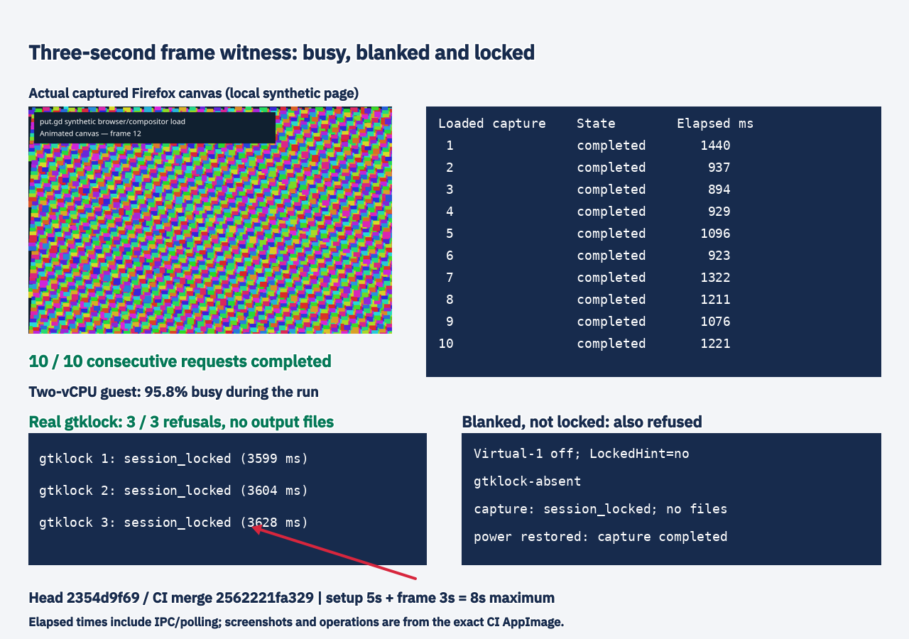
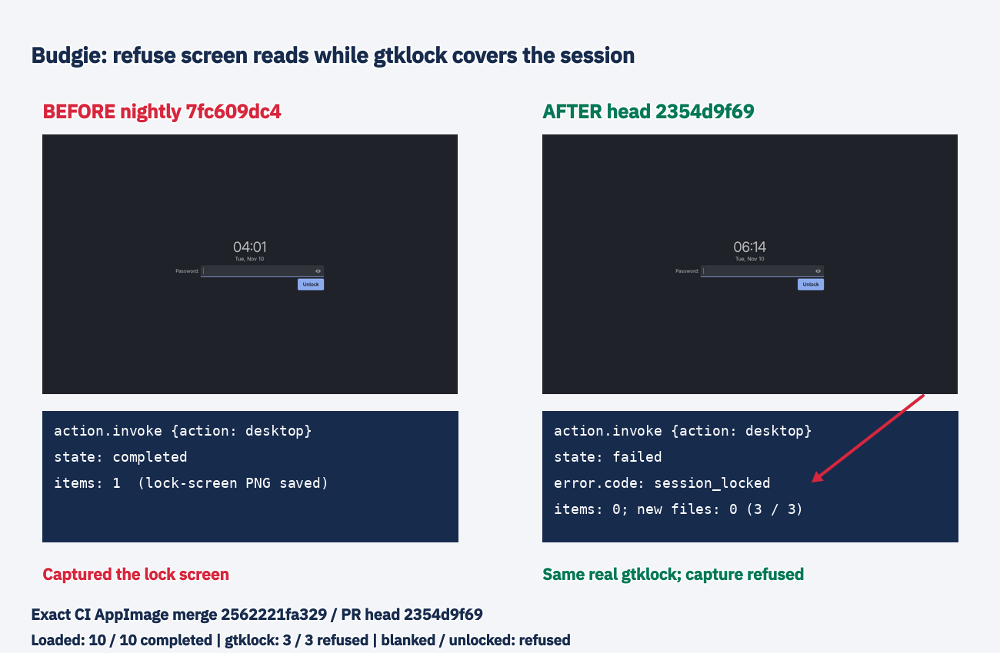

# Three-second visibility witness: coordinator follow-up

Head2354d9f69d248c44bcf5ea09feb74c9ad3e89931 changes only the frame wait1s->3s; setup remains5s, giving an8s maximum across phases. CI42765638280 is green. Exact CI AppImage26.1110.4487-dev+g2562221fa329 combines nightly113442645 and this branch. Merge2562221fa329243c892f2482913b7d86a8528510/treeee2421286d15ad2c90f368628225ca0e97b8c5f9 was checked against git's merge tree and the package/running-binary receipt. No identity override.

Fresh d69 Budgie10.10.3/labwc0.20.2/gtklock4.0.0 software-rendered KVM guest, two vCPUs, on the wall. Firefox158.0.1 was started immediately before capture0 with the included local canvas page drawing9000 moving rectangles per frame. Ten consecutive desktop requests all completed, with all ten actual PNGs exported privately. Average guest busy time95.8% from /proc/stat deltas; elapsed operation times894..1440ms include IPC/polling, not isolated frame-wait latency. The actual captured canvas and independent QMP witness were visually checked. Browser process tree was terminated by exact verified PID/start-time records.

Three requests under visibly active real gtklock all failed session_locked, empty items and no new output files (3599,3604,3628ms observed completion including IPC/polling). Screenshot taken with the focused password field empty. Unlock used the approved protected-input workflow; input removed before checking. A legacy post-unlock helper tried a missing raw-probe file and failed after unlocking; password was not retyped. QMP verified the unlocked desktop, and another actual capture completed. This harness-only follow-up is recorded in unlock-helper-note.json.

Blanking answer: wlopm --off '*' set Virtual-1 off while LockedHint=no and gtklock was absent, before any lock request. An immediate capture was refused with session_locked after3255ms, no items or new files. Power restoration returned Virtual-1 on and capture completed. Thus this Budgie witness also conservatively refuses an unlocked DPMS-off display; it cannot label every missing frame as an actual lock.

Other desktops are not a uniform DPMS-only policy. Source audit: GNOME's extension authenticates on enabled/!Main.sessionMode.isLocked (integrations/gnome/extension.js); X11 raw shortcuts consult screensaver GetActive and logind LockedHint (src/platform/x11/X11SessionLock.cpp, X11Shortcuts.cpp), so screensaver-active blanking is covered by that path. KDE delegates to KWin ScreenShot2 and Hyprland to its native image-copy backend; these adapters have no explicit DPMS-only gate. Their actual blank-only outcomes were NOT measured in this limited phase, so no cross-desktop equivalence is claimed.

No source docs, new capture feature work, nightly branch merge,15-check capture driver, delayed-region or repeat-region checks were done in this phase. Coordinator requires #1368 to land first and will provide its nightly commit. PR1386 remains unchanged at77d9ffb12.

Read the full new CodeRabbit review body: three OUTSIDE-DIFF concerns remain unverified (WAYLAND_SOCKET compositor identity; window-copy and output-batch lock-transition races), plus a locked-window regression suggestion. These are explicitly recorded for verification on the merged capture paths after the coordinator's message; they are NOT marked disproved/resolved. No broader code change was made now, as instructed. Review comment: https://github.com/patrick-hudson/put.gd-desktop/pull/1385#issuecomment-6760578904 .

The guest was stopped and guarded-retired after checksum-verified export to workstation and builder; its tunnel/wall entry was removed. Archive SHA5ea058d51a1bb962809da57a178cd5173e07989d02faeda4c2f1c75a44dd9fcb, private restore index in parent record. No physical desktop lease, upload, workstation build/test/encoding, or subagent used. Labels/arrows applied through the exact package's production editor; source captures/results unchanged.
