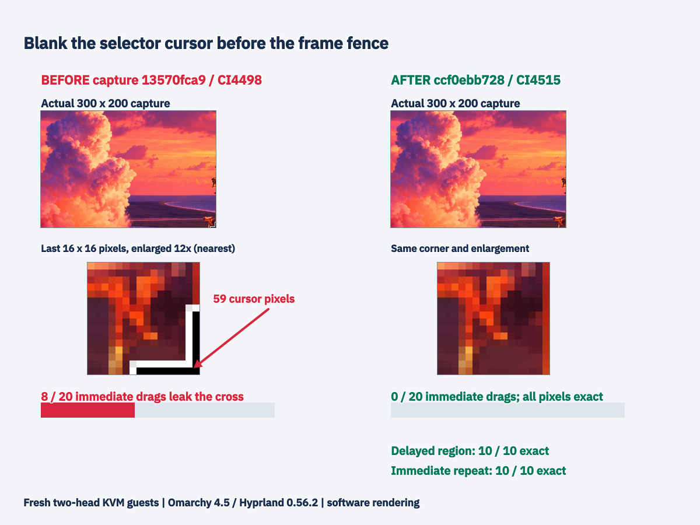

# Hyprland selector cursor: final stacked-head acceptance

Part of #1384; code PR #1386 at **ccf0ebb728a31a92c0fa30fd305aa6864f6cb0fc**, with capture13570fca9 and nightly962ac8c0b merged. PR CI42774482912 and full exact-head package CI42774824781 are green. Native Arch and AppImage **26.1110.4515-dev+gccf0ebb728a3** identify this direct head, tree019a1b2fa09761b5d7e19ffdfe1fe6cd9ad3b699. Package SHA, every installed native binary and running resident were verified.

Acceptance blanks the cursor on every selector surface before transparent-frame cleanup and the existing unmap fence. Clearing widget pixels did not remove the separate compositor cursor surface. No new delay was added. The two-surface mouse/keyboard regression requires synchronous CursorChange before finished/clearing/dismissing; original and ordering-mutation failures are retained. Both restored component suites pass on f44; implementation source matches the final head.

## Strict final cursor measure

Fresh software-rendered two-head Omarchy4.5/Hyprland0.56.2 KVM guest hc5 on released f44,2vCPU/6GB. Actual300x200 drags (300,300)-(600,500), selector waits rotate0.4/0.8/2.5s, eight motion steps. Each saved image is compared across **every RGB pixel** against an independent grim reference after moving the pointer away. There is no corner waiver or tolerance.

| CI package / action | Samples | Images with any difference |
| --- | ---: | ---: |
| Before: capture13570fca9 / CI4498, fresh d69hc4 | 20 | **8**, each59pixels in final11x11;0other differences |
| Final ccf0 / nativeCI4515, immediate dragged region | 20 | **0** |
| Final ccf0 / nativeCI4515, delayed region3s | 10 | **0** |
| Final ccf0 / nativeCI4515, immediate repeat at release pointer position | 10 | **0** |

Delayed regions are followed immediately by Repeat before moving the pointer for the independent reference; no grace period is inserted. All40 final images are bit-exact. The coordinator's independent capture135 run found9/20; this lane's separate same-measure baseline is8/20. Original plain nightly7fc609dc4 reproduced6/30 on two heads and0/24 on one head; waits from every bucket reproduced it. Hardware cursor behavior was not tested.

## Current capture-feature matrix

Each final branch's CI package ran the complete current coordination fifteen-check driver on both fresh guest desktops, one owned guest at a time. The native D package and C AppImage ran sequentially in hc5; the two AppImages ran sequentially in fresh Budgie bc9, restarting the resident before each sequence.

| Head / package | Budgie10.10.3/labwc0.20.2 | Omarchy4.5/Hyprland0.56.2 |
| --- | --- | --- |
| D ccf0 / CI4515 | **15/15 PASS** | **15/15 PASS** |
| C ec54 / CI4522 | **15/15 PASS** | **15/15 PASS** |

Driver original SHA40fca26fa709742d8b29b18d1630275c9df90c5c28782d9666da939d31b25524; corrected real-pill locator and all fifteen assertions unchanged. Only own ROOT and protected-input unlock were adapted. Its existing Hyprland corner allowance is not used by the strict40-image supplement above.

The first D driver attempt did not invoke the locker because setup lacked OMARCHY_PATH and used an absolute display name unlike the shell's IPC identity. Both screenshots were visibly unlocked, so the protected-input guard withheld all login input. The exact helper was stopped after PID/start-time verification. Correct public shell environment plus a required IPC ping fixed setup; the complete successful fifteen-check rerun, including a real visible lock and recovery, is separate. Failed frames/logs and diagnostics are preserved.

The stacked review also found a pending Wayland countdown-sync callback whose listener owner could be destroyed. Its destructor now destroys/nulls that fence in both independent code branches. This is a source-lifetime correction, not a claimed reproduced crash; the real click/API cancellation cases pass in all four matrix cells.

## Evidence and retirement

stack-final/ contains final actual captures/diffs/operation JSON for all40 cursor samples, one whole independent reference per measure (every reference retained privately), both desktop driver logs, exact package/running receipts, final native editor source/apply/save records, source parity and overlay-retirement receipts. stack-baseline20/ contains the capture135 before measure.

Full private archives retain every raw reference, complete failed attempts and private history. hc5 archive7064ea743199c853b10bbaa3d9ce8ee0b2336a786fa4a206098f040e837b8888; bc9 archiveb8e1640730370ca065be04bc9f451065514f8dd9d0c55d6a534018d6355125f7. Both verified builder/workstation before guarded overlay retirement; exact QEMU processes absent, own wall entries/tunnels removed, immutable goldens preserved. No physical desktop, upload, workstation build/test/encoding or independent upstream compositor reproduction was used. The product mitigation is demonstrated on the reported software-rendered guest.

Earlier native4451 results and original review remain historical in after/, review-follow-up.md and historical-summary-before-final-stack.md.
