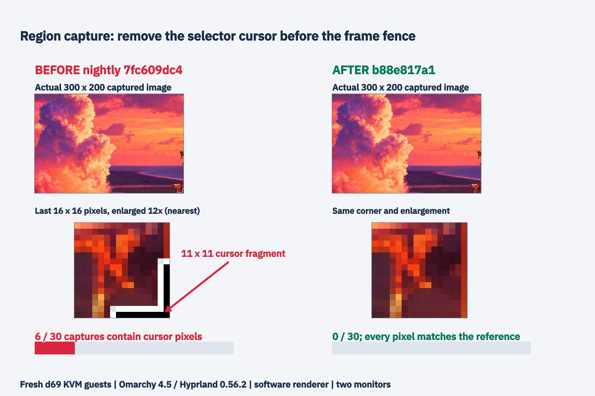

# Hyprland selector cursor: nightly reproduction and native-package fix

Part of put.gd-desktop #1384; code PR #1386. Branch head b88e817a1882c555d4c30ec6ab5bcfee7e91e5a6. Before: plain nightly 7fc609dc42f8f3c1118d79a63d42ce37ea4a71c9. After: exact native Arch CI package 26.1110.4451-dev+gb88e817a1882 from completed full workflow 42755841566. PR CI 42755825515 also passes. Package build commit and tree are in after/accept/version.json.

Fresh d69 KVM guests, displayed on the wall: Omarchy 4.5.0, Hyprland 0.56.2, software llvmpipe LLVM 23.1.3. Two monitors, 1280x800+0+0 and 1024x768+1280+0. A static wallpaper, 300x200 region from (300,300) to (600,500), pointer remains at release until the virtual pointer disconnects. Thirty captures each; selector waits rotate 0.4, 0.8 and 2.5 seconds. Each capture is compared pixel-for-pixel with a cursor-free grim reference after moving the pointer away.

Nightly: 6/30 leak the same 59 pixels, bounding box (289,189)-(300,200), across all wait buckets. Branch: 0/30; all 30 match their reference exactly. Raw results, operation JSON and sample 14 capture/reference/diff are retained here. First one-head nightly run: 0/24. An earlier attempt with Settings open produced unrelated hover-border changes; it is excluded from the 30-sample result and preserved privately. A Fedora helper experiment failed Arch dynamic linking before capture; no build identity check was weakened. We then used the native Arch package above.

The fix blanks all selector cursors at acceptance, before the existing transparent-frame cleanup and unmap fence. A two-surface regression covers mouse and keyboard acceptance: it fails on nightly with CrossCursor, passes after with BlankCursor before the selected signal. Both overlay suites passed on f44. No new frame delay was added.

This demonstrates the race and its mitigation on the reported software-rendered two-head guest. It does not establish hardware cursor behavior or a compositor-wide upstream reproduction independent of put.gd. No physical desktop, S3 upload, or unrelated desktop acceptance was run for this fix. No workstation build or test was run.

Pictures were composed on d69 from actual capture pixels; the corner is enlarged 12x with nearest-neighbor sampling. Labels and arrow were applied by the production editor from the exact native head. Source composition and editor drivers are included. Source pixels are unchanged.

Full raw PNG sets and failed experiments are retained in private checksum-verified archives on workstation and d69, indexed in restore-index.json. Guest overlays were stopped and retired with the guarded cleanup after export; receipts accompany this record.
