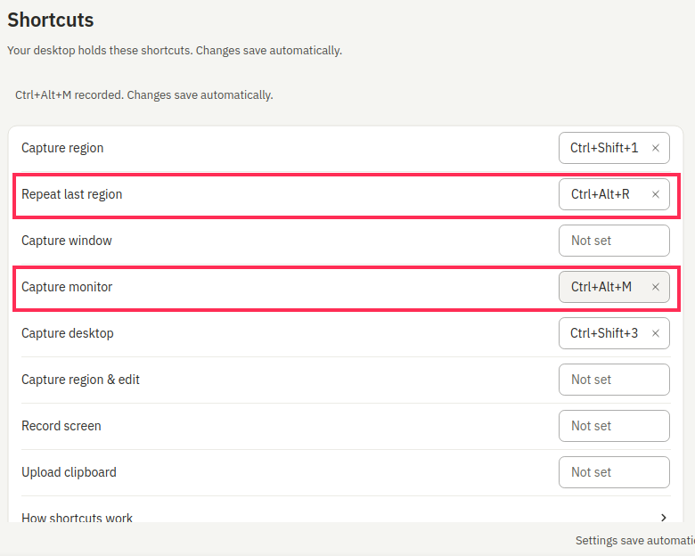
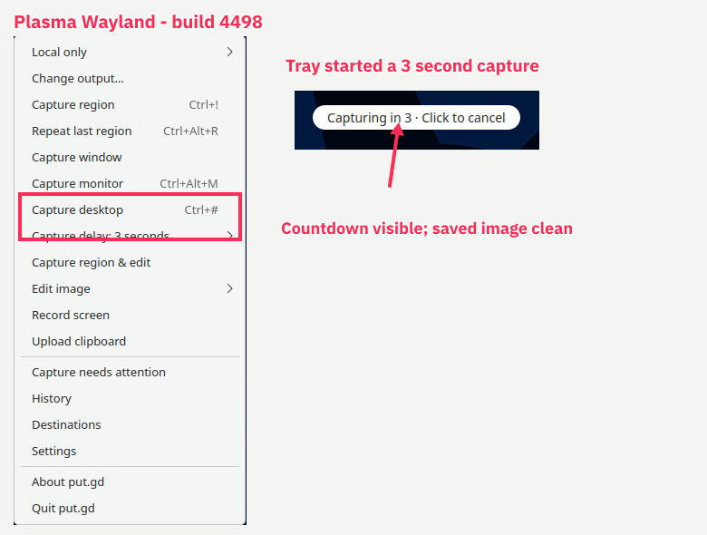

# PR 1368 Plasma Wayland acceptance — ap6

Passed items a–e on fresh k72 guest ap6, run ID 965434e2-8722-48e4-8a4c-359b74ed16e4, 2026-11-10 06:49–07:01 UTC. Kubuntu 26.04.1, Plasma/KWin 6.6.6, native Wayland, KVM, outputs 1280×800+0+0 and 1024×768+1280+0. The physical desktop was not used.

Installed Ubuntu26.04 DEB from CI42763770262, PR head13570fca94df85b799755494d4914fb7009f7e4d. Version26.1110.4498-dev+g0cf6a17ae4f2, merge commit0cf6a17ae4f2fbac36fbaa2e4d64a4e6ceb704bf, tree1e2d35a411dc2f281b3c3414c87503a62476eba8. Package SHA256c5b7adc4951930e994eee2c29b9ff9b7ade767d4295c9adbb32790c8eb41ecbd. Actual mapped distro QtCore6.10.2; /usr/bin/putgd. No compile performed.

- a PASS: supplied checks.py, all15 checks, 0 failures. See checks.log and driver captures.
- b PASS: Settings binds Ctrl+Alt+M and Ctrl+Alt+R; KGlobalAccel reports both bound. Real M on head1 captures1024×768. Real R before any region yields “There is no region to repeat yet. Capture a region first.” After real shortcut region300×200, R returns identical pixels (difference0.0). See bound-capabilities.json, empty-repeat-notice.png, key-monitor-size.json and key-repeat-pixels.json.
- c PASS: added monitor local-output exception through Settings. With a synthetic unavailable upload default, real M saves locally, no profile and local_only status. See different-default.json and exception-result.json. Restored default afterward.
- d PASS: selected3 seconds from the window monitor button context submenu; tray menu reflects3 seconds. Tray desktop and window monitor captures show the countdown. Saved images match the clean pill rectangle exactly (difference0.0 for both). Cancelled a tray countdown by clicking its pill; exact archive file list unchanged. See tray-countdown.png, window-during0.png, pill-omission.json, cancel-proof-countdown.png and cancel-no-file.json.
- e PASS: with GUI delay3 seconds still selected, real Ctrl+Shift+1 region selector is immediate; new result present0.812 seconds after release. See immediate-result.json and immediate-result-operation.json.

Pictures were cropped/composed from this run and annotated using this installed put.gd image editor via editor.open/apply/saveCopy/cancel:

Harness corrections preserved: early install before SSH readiness; duplicate launch controller stopped by exact PID before it booted a guest; shortcut row shifted after recording feedback and first M click bound window, then corrected; early window shots missed countdown mapping, final window-during0.png captures it. No product failure and no product change. Source branch/PR and coordinator acceptance file untouched. VM shutdown, tunnel stopped, wall entries removed; guarded retirement receipt retained.
