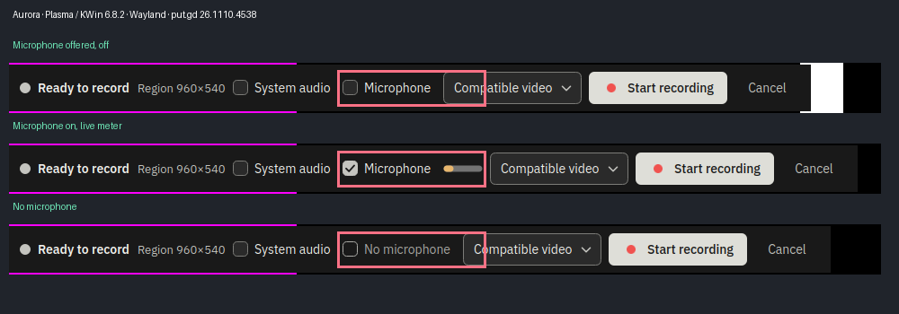
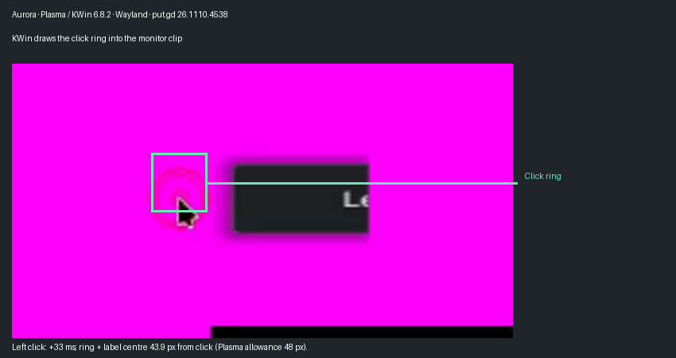
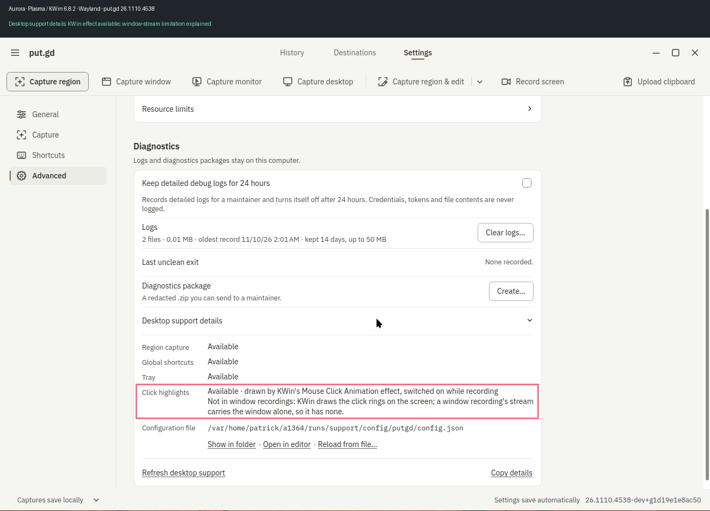
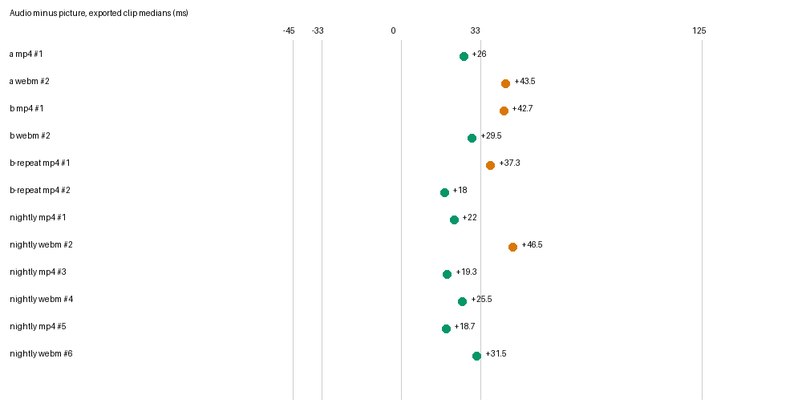

# PR #1372 — physical Aurora Plasma / Wayland acceptance

**PASS a–h**, tested 2026-11-10 07:43–08:03 UTC on physical `aurora-amd` (192.168.68.71), Aurora Fedora Atomic 45, native seat0 session 1, Wayland (`wayland-1`), visible on the physical wall tile via localhost VNC 5900 / workstation 5976. Plasma `6.8.2-1.fc45`, KWin `6.8.2-2.fc45`. No builder compilation, workstation builds, or VMs.

PR head `cccf91a501247dce525217271b78b4665b0fbd0d`; successful CI run `42774290115`, `release-appimage`; AppImage version `26.1110.4538-dev+g1d19e1e8ac50`, synthetic merge commit `1d19e1e8ac506ddb12a80904749536dafdc9117a`, tree `93ae895ea84a5a19a2b3de877573aa9f3189e480`. AppImage SHA-256 `54c1a92618d23e651d8469577b0699252cd65b36e32df388aadf83593181c1d1`. Actual resident startup logs report Qt compiled/runtime **6.12.0**, KDE core resident, Wayland. The AppImage registered its native KWin executable permissions in the real applications directory; recording acquisition was `kde-screencast`, live encoder `vah264enc`.

Driver: coordinator-supplied `/home/patrick/work/putgd-evidence/2026-11-09-features/acceptance-1364/record_run.py`, SHA-256 `e5f1764ff963e974c3755267abb932ecc9aaccf0b23446b89767026fbe68398e`, copied to Aurora's private lab directory. Its corrected delayed-capture step was used unchanged and passed on the real desktop. Other tools came from the PR. Additional bounded lifecycle and remembered-setting wrappers are included in the packet. The picture helper only omits its private XDG_DATA_HOME so AppImage permissions reach KWin; its temporary real-data directory was moved into the run afterwards.

Every acquired/exported primary clip has decoded motion (minimum primary export score 6.047), a saved visual, and no `problems` entry. Audio numbers below are exported audio-minus-picture medians; positive means audio later. Acceptance bound −45..+125 ms; one-frame target ±33 ms. Primary microphone/mixed recordings had 14–16 pairs, Ready-follow 11 pairs, unplug 6 pairs as expected. MP4/WebM exports saved successfully and decoded.

| Item | Result and measurements |
|---|---|
| a | **PASS.** Microphone alone: MP4 +26 ms (14 pairs, peak 0.3453, motion 9.683), WebM +43.5 ms (15 pairs, peak 0.3486, motion 37.226). Both inside acceptance; WebM exceeds one-frame target. Sources microphone true/system false. |
| b | **PASS.** Both sources and both tones present through a 3 s pause. MP4 +42.7 ms; WebM +29.5 ms; capture steps +0.3/+0.5 ms. 1 kHz peaks 0.3457/0.3482; 440 Hz medians 0.0169/0.017. Two additional MP4 runs: +37.3/+18 ms, steps −0.6/+0.3 ms, 16 pairs each. MP4's first two runs exceed the one-frame target, all meet acceptance. |
| c | **PASS.** Tone still fed to simulated microphone while toggle off: microphone source false, export 1 kHz peak 0.0004 (<0.003), system 440 Hz median 0.0169; motion 7.256. |
| d | **PASS.** Simulated microphone removed at 6.074 s: inspect remained `recording`, reported “The microphone was disconnected; the rest of the recording has no microphone audio.” Full saved clip: 14.700 s versus 14.087 s recorded; motion 22.178; +32 ms, 6 pairs; 440 Hz peak 0.0016 (<0.008), no monitor leakage. |
| e | **PASS.** Ready: none → offered after 0.6 s → switched on/effective → removed after 0.9 s, requested still true → reconnected/effective without another toggle. Then recorded: 11 pairs, +32 ms, motion 8.873. Cropped visuals retained for all five Ready states. |
| f | **PASS.** System only, output removed at 6.094 s with a private fallback: inspect remained recording and named fallback.monitor; 14.733 s kept versus 14.120 s recorded, motion 23.393, −24 ms, 440 Hz continuous (median 0.0169). Used `--output-gone-at 6 --output-fallback`; did not disable physical sound cards. |
| g | **PASS.** KWin Mouse Click Animation route available. Monitor and region each 3/3 rings; monitor exported delays +33/+67/+33 ms, region +33/+67/0 ms; ring-plus-label centres within 43.9 px (Plasma allowance 48 px), vertical error <1 px. Off: 0/3 rings. Explicit window request refused `recording_unsupported` with KWin's window-stream explanation. With preference stored true (`remembered-setting.json`) and a window prepare omitting an explicit click request, recording saved with motion 8.470 and 0/3 rings. All three starting effect states restored after Stop, after Cancel during recording, and after helper SIGKILL: 9/9 combinations. Exact corrected helper-kill PIDs 1224898/1225720/1226551. |
| h | **PASS.** One resident: delayed desktop capture before recording completed/saved in 3.25 s, and after recording/review cancellation in 3.23 s; cover fraction 0.5556 each, countdown change 6031 pixels each. Between them: 3/3 rings at 0/+67/0 ms, motion 38.132, audio median +10.7 ms. No restart of put.gd within this sequence. |

Nightly control: published `26.1109.4346-nightly` AppImage, same physical session/marker/region/private output and analyzer, three runs per format. MP4 +22/+19.3/+18.7 ms; WebM +46.5/+25.5/+31.5 ms. All have saved visuals and motion. PR microphone/mixed medians fall within the overall nightly system-audio range apart from +18 ms, which is closer to zero. The first mixed MP4 +42.7 ms is 20.7 ms later than the largest nightly MP4; its repeats +37.3/+18 ms show a 24.7 ms range. These are bounded observational controls, not a statistical proof of identical timing. No consistent shift beyond the documented run-to-run spread was established. One frame is not met by every PR or nightly run and is not reported as such.

No product failure found. Preserved harness-only failures: the first helper-kill wrapper tried to inspect a recording already cleared by put.gd, producing `recording_unavailable`; original logs/results and the equal before/after effect reports are retained. Corrected wrapper catches and retains that expected reply plus the exact PID, and all three repetitions restored state. This did not change the product. The original broken delayed driver was never run here.

Audio safety: original real analog input was never opened. A private campaign null sink was the default output, its monitor the safe default input; all marker/microphone/system tones went to private null sinks. Every per-run simulated module was removed by its printed id. Original default source `alsa_input.pci-0000_04_00.6.analog-stereo` and sink `alsa_output.pci-0000_04_00.6.analog-stereo` restored by name; outer module removed by its saved id. Real input remains SUSPENDED. Socket `/run/user/1000/putgd/session.sock`: 33 UTF-8 bytes, checked before launch. Desktop lease checked and heartbeated; host load observed 0.04 before first measurement and below 2.4 through the campaign, no lab VMs or other heavy work.

Dependency setup: standard `gstreamer1-plugins-good-gtk` installed under authorized `sudo -n rpm-ostree usroverlay` and DNF with updates-archive disabled; DNF also updated its matching good-plugin packages. Setup log retained. No replacement toolchain or compilation.

Evidence and three annotated pictures: see the linked packet and pictures below (the packet uses relative image links). Pictures show this exact build; the bar includes off/on/meter/no-device states, the clip crop calls out the ring, and support details boxes the full window-recording note. Alignment chart also included. All 366 exported files verified against remote SHA-256 manifest before scratch retirement. Cleanup completed: 20,741 owned scratch files retired after export verification, scratch root absent; no owned processes/modules or temporary KWin entries remain, audio defaults and effect state restored. The two-step desktop release passed its cleanup check and released at **08:05:00 UTC**, well before 10:15. The original wall VNC/tunnel remains intact. Release and scratch-retirement receipts are included.

