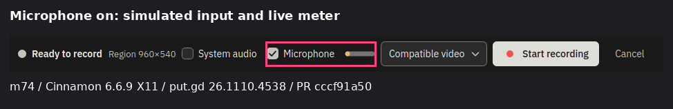
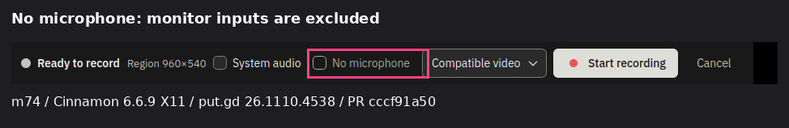
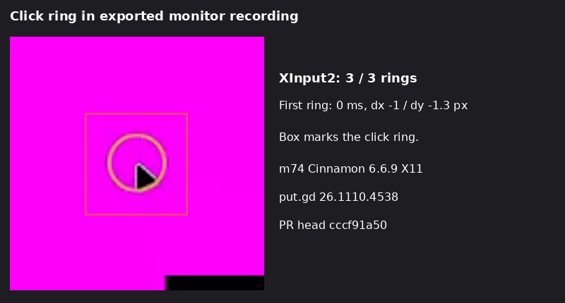
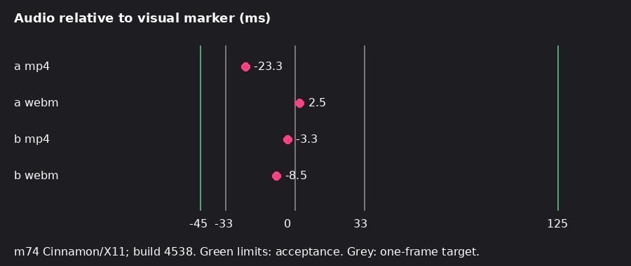

# PR #1372 acceptance — Cinnamon X11, build 4538

PASS a–i. Tested 2026-11-10 07:43–07:55 UTC on physical m74, Linux Mint 22.3, Cinnamon 6.6.9, native X11 display :0, logind session c89 (unlocked). Host reported by the driver: mint-builder. Wall tile: workstation localhost:5974, builder localhost:5900; saved VNC frames and decoded clip frames retained.

PR head cccf91a501247dce525217271b78b4665b0fbd0d. CI run 42774290115 completed successfully (`gh run watch ... --exit-status`, exit 0). Artifact release-native-ubuntu24.04; DEB putgd_26.1110.4538~dev+g1d19e1e8ac50_amd64.deb. Build version 26.1110.4538-dev+g1d19e1e8ac50; synthetic CI merge 1d19e1e8ac506ddb12a80904749536dafdc9117a, tree 93ae895ea84a5a19a2b3de877573aa9f3189e480. Package SHA-256 d0614fee1c3294aec7a44f0aca11577801304c5f086cbbf06384e629116a5424. Extracted at /tmp/c1364/pkg; no installation or compilation. Resident mappings prove dynamically loaded distro Qt 6.4.2 (`loaded-qt.txt`).

Driver used for every run: /home/patrick/work/putgd-evidence/2026-11-09-features/acceptance-1364/record_run.py, copied to /tmp/c1364/lab/record_run.py; SHA-256 e5f1764ff963e974c3755267abb932ecc9aaccf0b23446b89767026fbe68398e. Coordinator-supplied delayed-capture fix, preserved with patch and driver source. No product edits or driver workarounds. All other tools from the PR checkout. `campaign.py` preserves exact arguments.

Quiet-host preflight: lock free, no QEMU guest, load 0.07. Desktop lease c1364-4538 acquired separately and heartbeated. No parallel lab workload; later load reflects this sequential recording/export/analyzer campaign (recording load values retained in results). Before every run the resolved socket /run/user/1000/putgd/session.sock was checked: 33 UTF-8 bytes, below 107. Short new private root /tmp/c1364. No real microphone or real-output playback: private null default output for every run, simulated source only; per-run defaults restored by name and modules unloaded by returned IDs. The no-output run disabled/restored card profiles, with its cards.json retained.

Audio minus picture is reported below, positive means audio late. Acceptance: run median −45 to +125 ms and no regression beyond nightly spread; ±33 ms remains the target. All meaningful exported alignment medians are −26.7 to +2.7 ms, inside both bounds. Prior same-desktop published nightly controls (stage 1b, linked below): MP4 −17.3/−11.3/−10.7 ms, WebM −0.5/−19.5/+17.5 ms. These current results remain within the observed approximately ±20 ms run-to-run spread; no extra nightly run was performed in this row. The toggle-off case has no burst signal, so its analyzer's single spurious pair/−407.3 ms is not an alignment measurement.

| Item | Result and measurements |
|---|---|
| a | PASS. Microphone alone MP4 / WebM: median −23.3 / +2.5 ms, 14 pairs each; 1 kHz peaks 0.3452 / 0.3475. Both sources-at-start select microphone only. |
| b | PASS. Microphone + system, three-second pause, MP4 / WebM: median −3.3 / −8.5 ms, 17 pairs each; capture step +0.3 / −0.5 ms; export-minus-working +0.4 / +1.2 ms. 1 kHz peak 0.3454 / 0.3467, 440 Hz median 0.0169 in both. |
| c | PASS. Tone still playing into simulated input, microphone toggle off: microphone source false; 1 kHz max 0.0001, 440 Hz median 0.0169. |
| d | PASS. Microphone removed at 6.19 s; inspect still recording and reported “The microphone was disconnected; the rest of the recording has no microphone audio.” Full 14.37 s clip vs 14.23 s recorded, saved and decoded; 6 burst pairs, median +2.7 ms; 440 Hz leakage peak 0.0013 (<0.008). |
| e | PASS. Natural default input is an output monitor. Prepare refused: recording_unsupported, “The system's default input is the monitor of an output, not a microphone. Plug one in, or choose a device in Settings.” No clip. Ready state explicitly default_is_monitor; saved bar reads No microphone. |
| f | PASS. Ready none → plugged (available, off, 0.5 s) → on → pulled (unavailable, effective false, requested true, 0.8 s) → back (effective true without a second request). Afterwards 10 burst pairs, median −24 ms, 10.20 s saved clip. Five saved state visuals retained. |
| g | PASS both. Output removed at 6.22 / 6.225 s; recorder stayed recording, reading fallback.monitor / auto_null.monitor. Full clips 14.43 / 14.40 s vs 14.282 / 14.285 s recorded; medians −26 / −6.7 ms. All card profiles/defaults restored. |
| h | PASS. Monitor, region, window each 3/3 rings on and 0/3 off, in working and exported clips. Measurements below. |
| i | PASS. Same resident before/after delayed desktop captures: completed and saved after 4.77 / 4.79 s for a 3 s delay; cover fraction 0.5556 each; countdown pixels 6031 each. Intervening recording 3/3 rings, delays 0/−1/0 ms, median audio +2 ms, exported motion 8.496. |

| Highlight target | Export delays ms, left/right/middle | Maximum absolute dx/dy px | Off rings |
|---|---|---:|---|
| monitor | 0/-34/0 | 1.3 | 0/3 |
| region | 0/0/0 | 1.3 | 0/3 |
| window | 34/34/-3 | 1.2 | 0/3 |

16 primary exported clips retained, plus working clips, generated moving marker inputs, logs, countdown captures, saved cover-checked frames and measurements. All 16 exports saved and decoded with motion >1 (range 6.879–65.778); expected case e refusal produces no clip. Each has passing saved-frame coverage. No unexpected failure or excluded attempt.

Nightly comparison source: https://github.com/patrick-hudson/put.gd-evidence/tree/59b03d5170c9c7125016e204ef062b17510702f0/records/2026-11-10-recording-1364-independent-stage1b

Cleanup: exported packet verified by SHA-256; original marker inputs also verified and preserved. Removed all 921 inventoried owned scratch files and empty directories, including extracted package. No put.gd/helper/gst-launch process or lab module; original sink alsa_output.pci-0000_00_1f.3.analog-stereo and source alsa_output.pci-0000_00_1f.3.analog-stereo.monitor restored, analog input SUSPENDED. First desktop release check: “Nothing new is left on the host”; verified-clean release succeeded 07:56:39 UTC; status free. No new tunnels, login/restart, package installation, PR edit, branch edit or change to earlier reports.

Evidence: https://github.com/patrick-hudson/put.gd-evidence/tree/72c8486d3073caafafa2e39e3014e7232a4006de/records/2026-11-10-recording-1364-cinnamon-4538

Microphone enabled with the simulated input and its live level meter; Cinnamon/X11, build 4538.

Ready bar reads No microphone when the default input is an output monitor; Cinnamon/X11, build 4538.

Exported monitor clip frame with the click ring boxed; first ring 0 ms, dx −1 / dy −1.3 px; Cinnamon/X11, build 4538.

Exported microphone-only and mixed-audio medians against the visual marker, with acceptance and one-frame lines.

