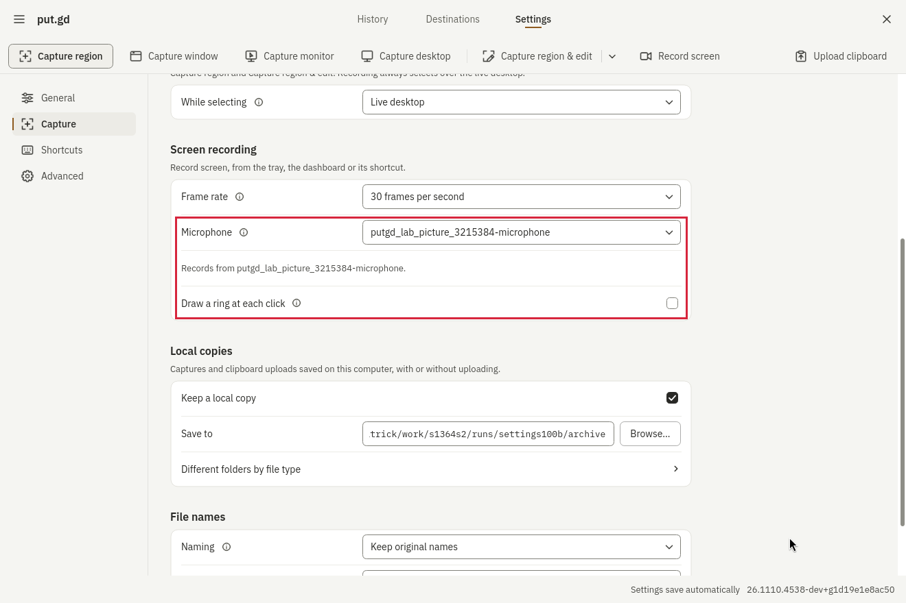
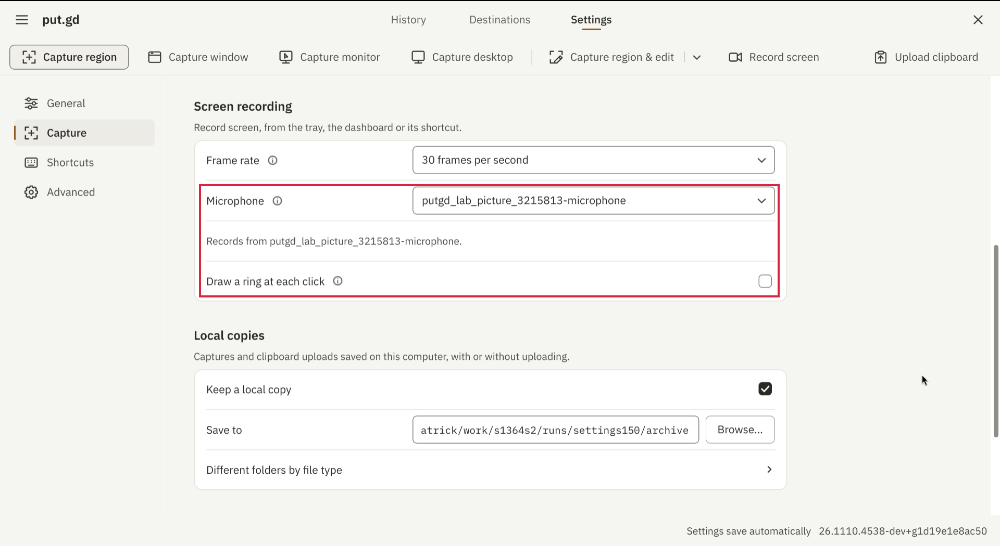
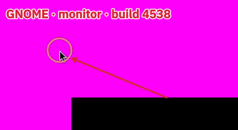
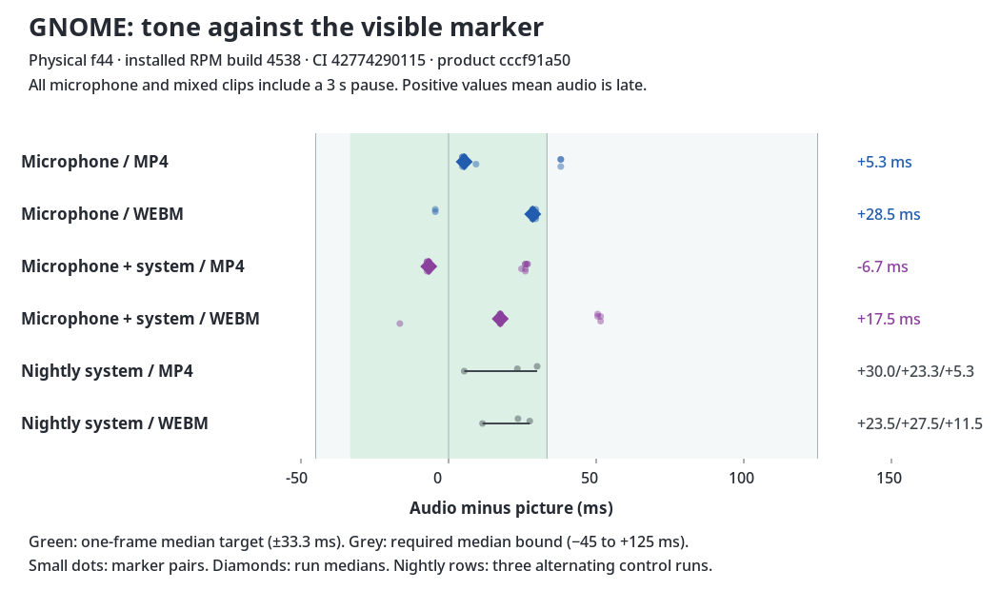

# GNOME physical f44 — independent #1364 acceptance, build4538

**PASS.** Installed exact Fedora44RPM from successful CI42774290115 / package headcccf91a501247dce525217271b78b4665b0fbd0d; version26.1110.4538-dev+g1d19e1e8ac50, synthetic merge1d19e1e8ac506ddb12a80904749536dafdc9117a, tree93ae895ea84a5a19a2b3de877573aa9f3189e480. NativeGNOME50.6/Mutter50.6 Wayland on physicalf44; distroQt6.11.2, GStreamer1.28.8, PipeWire1.6.9, WirePlumber0.5.18. Installed binaries verified identical to the extracted CI package. Extension21 ACTIVE after owner-app audit and a new login. No other lane guest/build on host while measuring.

Final code head6f23ce41616f1a26ad445d76672c025d45d5c704 differs only in tools/lab/record_run.py (two commits); product unchanged. Driver used here: coordination acceptance-1364/record_run.py, copied byte-for-byte to f44:/home/patrick/work/s1364s2/lab/record_run.py, SHA256e5f1764ff963e974c3755267abb932ecc9aaccf0b23446b89767026fbe68398e. The same-session run invokes the supplied both_run.sh unchanged. No product patch. Client-flash fixture and physical-only private-default safety helper changes are published separately and described in README.

| Check | MP4 / WebM | Result |
|---|---|---|
| Microphone alone across3s pause | +5.3 / +28.5ms;17pairs each; captureStep+0.9/0.0ms; exportshift−1.0/−0.2ms | PASS, tone/motion |
| Mixed system+microphone across3s pause | −6.7 / +17.5ms;17pairs each; step−0.2/+0.5ms; exportshift+0.7/−0.2ms | PASS, both tones/motion |
| Toggle off while bursts fed | 1kHz peaks0.000356/0.000309; systemtone remains | PASS |
| Microphone pulled at6s | 14.867/14.866s retained vs14.202/14.196s recorded; inspect reports loss;7initial pairs each | PASS, no unrecorded-output leak |
| Private output pulled, private fallback | 14.933/14.906s vs14.258/14.251s; inspect staysrecording, namesfallback.monitor | PASS |
| Output pulled, muted simulated default microphone | 15.033/14.933s vs14.352/14.261s; 1kHz peaks0.000317/0.000298 | PASS; capture stays on monitor |
| Ready noinput→plugged/off→on→pulled/requested→back/on | waits0.26/0.04/0.72/0.49s;10pairs afterwards,+34.0ms | PASS requiredbound; one-frame target miss |
| Private default input is output monitor | prepare refuses recording_unsupported with monitor reason | PASS; physicalinput unopened |
| Same resident: desktop:3→monitor recording→desktop:3 | completed/saved3.46/3.50s, coverOK,6216countdownpixels each;3/3rings; no error | PASS |

| System-only, alternating builds | MP4 runs1/2/3 | WebM runs1/2/3 |
|---|---|---|
| PR4538 | +8.7/+16.7/+32.0ms | +24.5/+9.5/+19.5ms |
| Published nightly4346 | +30.0/+23.3/+5.3ms | +23.5/+27.5/+11.5ms |

All12controls meet one frame,16–17pairs each. Current microphone/mixed offsets show no worse absolute alignment beyond observed baseline run spread (MP4range24.7ms, WebM16ms). All25signal-bearing run medians meet −45/+125ms;24/25meet±33.3ms, with Ready+34.0the targetmiss. Silent/off cases' noise-derived offsets are not meaningful sync data.

| Click target | Seen on / off | Export ring−visible-client-flash ms | Largest centre error |
|---|---|---|---:|
| Monitor | 3/3 / 0/3 | −33/0/0 | 0.78px |
| Region | 3/3 | −33/−33/−33 | 2.31px |
| Window | 3/3 | 0/0/−33 | 0.78px |

Direct client-flash measurement avoids pointer arrival entirely. Original region analyzer skipped first ring because its pointer was already in place; the retained frame visibly shows the ring and independent flash-first analysis confirms it. Working clips agree (−34..0ms). All9rings meet70ms; off has0rings. Actual source/measurement scripts, raw old diagnostics and new measurements retained.

29exports and29working clips probe/decode, all retain motion4.863–40.864, every exported clip passes cover frame check, no shortclip (smallest actual-duration minus recorded-duration +0.604s). Original setup errors are explicitly excluded/retained: shared rect supplied to monitor/window; reused destructive fixture's second format; a picture helper's internal-only view request and timed photo; annotation SDK field/normal starting state. Fresh valid invocations replace them, without product or same-session workaround.

Private simulated microphone/null sinks only. Outer private default monitor protects physicalinput on f44; safety helper restores that private default before pulling a currently-default simulated mic, leaving the leak-test's private monitor in place. Output-removal uses explicit private fallback; no cards-off/no-fallback variant on this network-output host. All defaults restored by original names and modules unloaded by IDs. Package/extension absent again after second owner-app check/relogin; GNOME extension arrays exact; realinputSUSPENDED. All owned processes/leases cleared; f44 lease released08:01:52UTC. Unrelated pre-existing offline plan SHA unchanged; no OSupgrade/replan. Own offscreen annotation session subsequently closed and swept; retained private root indexed.

Evidence: https://github.com/patrick-hudson/put.gd-evidence/tree/a65fcc8ee4ba12481b6de6e3eb8afec6367a4217/records/2026-11-10-recording-1364-gnome-4538

Pictures use this exact installed product build; cropped/boxed through its own editor using official-SDK MCP, plus a data-derived chart. Settings at100% and150%. Nightly image is explicitly before-feature4346. Extra Cinnamon-off image derives from that worker's current4538retained Ready frame; no new Cinnamon run.

