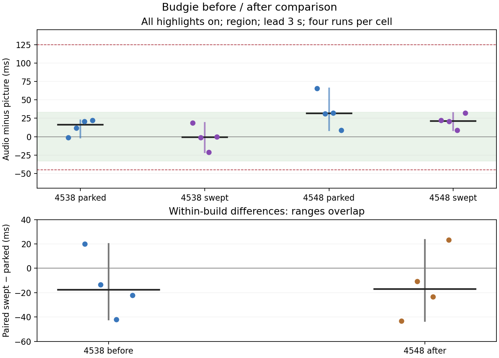

# Budgie new-build report — 4548 / 30eab18a8

**Requested functional retests PASS:** monitor and region rings, cleanup immediately after Stop, and same-session delayed capture/recording/delayed capture. All eight parked/swept clips are retained and within the absolute A/V bound. The measured timing samples overlap; they do not establish a before/after improvement beyond the spread. Original large early offsets are not explained or waived.

Build under test: CI42784508070, source head30eab18a8fa9954438eaa48e9b417b177632b9fd, observed completed/success before testing; release-appimage version26.1110.4548-dev+gf65c1053b22d, CI merge/package commitf65c1053b22d1c7e3a5905945ff7dcc1401dc3b7, treec516a5106b716035bf76b717c7e1a104983450b0. AppImage SHA25606f27e641ce932e241151fd69040ae18214699bdbabb33933d03942caa160611. Actual resident logs confirm loaded Qt6.12.0 and this build version. CI was polled with a one-minute guard, not gh run watch.

Fresh d69-hosted guestb1364n, rundb5b0104-429b-4597-a0d8-769e773b61ca, QEMU2017316, 2vCPUs/6144MiB, 1280×800, UID1000/lab, Budgie Wayland. Same immutable Fedora45 golden (Budgie10.10.3/labwc0.20.2), SHAa6749512438d507ef2b2c47fe675955627464d9a5a85341002f91cd54fb401ad; no guest OS package changes. Host192.168.68.69/d69, Debian13/four cores. Visible wall via workstation5996→d695946, SSH22446; saved desktop/frame visuals retained. This is a separate fresh guest from the current-build report, not a same-session binary A/B.

Protocol: parked/on, swept/on, repeated four times in strict alternating order. Region0,0,1280,400, lead3s, same private output for all eleven new-build cases, same byte-identical marker as build4538 (SHAabf5305fb0b9a1124ad1efc37af6b924484d0917955513060560360b2f6fb2ea). Sweep720px/s, x100…1180/y100, nominal60updates/s, starts before Record and lasts until Stop replies; parked stays(200,100), including clicks. Actual update counts/times retained. Both builds use the same input/marker parameters and the supported bar-hide method at Ready; original guards remain active. Each original and exported clip was copied before a guard could delete it. No new gate failed.

Driver provenance: copied the requested coordination file after NEW HEAD (SHA410d4093573743f088c5bfa9fd6ac14b114b43cbc575b3992f2636b3f58ff00e). It still differed from the pushed source only by the Hyprland delayed-capture fullscreen hold. Used the exact pushed tools/lab/record_run.py instead (SHAaa7fec68b7c69c78c6443ff5c89c8a564f1fe584e522c93b01917a9c823ca31a), with --hide-bar plus preservation/identity instrumentation (SHA421b2d4e6f70c35fa36d9c76c5d76b7a8e87872ec9bc96ab4705d8a5c26d5cc3). Both originals are retained. No product code, branch or PR edits; no compilation on the builder or workstation.

A/V values below are exported-clip medians; negative means sound earlier. Frame-age values are the **means** from the helper's min/mean/max Stop diagnostic. Full triples, sample counts, both raw Stop lines, cursor-only drop counters and every ordered marker pair are retained.

| Build | Pointer / highlights | Four A/V medians / mean frame ages (ms), repetition order | Median range width ms |
|---|---|---|---:|
| 4538 | still / on | -1.3 / 1.9; 12 / 2; 20.7 / 1.9; 22 / 2 | 23.3 |
| 4538 | sweep / on | 18.7 / 1.5; -1.3 / 1.4; -21.3 / 1.5; 0 / 1.5 | 40 |
| 4548 | still / on | 65.3 / 2.1; 31.3 / 2.1; 32 / 2.1; 8.7 / 2.2 | 56.6 |
| 4548 | sweep / on | 22 / 1.4; 20.7 / 1.4; 8.7 / 1.4; 32 / 1.4 | 23.3 |

Within-build paired swept-minus-parked differences, repetition order:

| Build | Four paired differences ms | Median paired difference ms | Difference of cell medians ms | Larger cell range width ms | Cell ranges overlap |
|---|---|---:|---:|---:|---|
| 4538 | 20.0, -13.3, -42.0, -22 | -17.65 | -17.0 | 40.0 | True |
| 4548 | -43.3, -10.6, -23.3, 23.3 | -16.95 | -10.3 | 56.599999999999994 | True |

The paired median moves from−17.65 to−16.95ms (0.7ms toward zero); differences of cell medians move from−17.0 to−10.3ms. Both are much smaller than the observed cell spreads. Samples overlap within and across builds, and each build has a paired run with the opposite sign. This experiment does not resolve an improvement beyond run-to-run variation or establish a consistently early click-path defect. This is not a claim that the unit-tested frame-slot effect is absent. The fresh-guest baseline changes too, so raw before/after medians are not attributed to the fix. No DEFECT-headed STATUS line is added.

Every new motion clip has16 marker pairs and real motion (scores19.14…19.17), saved working/export clips and passing cover edges. Seven of eight meet the±33ms target; the65.3ms parked clip misses that target but meets−45…+125ms. The original−66/−118.7ms measurements remain in the first report, with frame-age mean2.5ms; no extra~100ms of captured-frame age was observed there. Their cause remains unresolved.

Functional retests (same new build):

| Case | Corrected ring delays ms | Maximum absolute centre error px | A/V median ms | Motion | Result |
|---|---|---:|---:|---:|---|
| f-monitor | 0/0/34 | 0.8 | 20 | 4.59 | PASS; retained/full frame gate passed |
| f-region | 0/0/-33 | 1 | 29.3 | 33.979 | PASS; retained/full frame gate passed |
| g-new-driver | 0/0/0 | 0.9 | 43.3 | 19.061 | PASS; retained/full frame gate passed |

All9rings appear at the requested places and within−33…+34ms of the client's visible flash, maximum error1px. Timing is not measured against pointer arrival. Monitor and region after-stop XML snapshots contain zero put.gd click markers and preserve all83 user keybindings structurally; all eleven cases have zero markers immediately after production Stop, before cancel/quit.

g uses one resident for desktop countdown→recording with highlights→desktop countdown. Both captures completed/saved in3.5/3.39s,6031 countdown pixels each, full cover gate passed; capture operation IDs34f745f6-46f3-49f5-80d6-704fbff3a0e4 and783d08bf-7d59-41ad-87de-04ced056c876. BarHidden true; expected overlayExcluded false / overlayPlacement handle; the hidden handle is absent from the retained clip. All recording-frame edge scores1.0; rc.xml is byte-identical before/after. Driver exit0, no reported problems. The43.3ms g median misses the one-frame target while meeting the acceptance bound. Working/export clips, preservation copies, ring frames, countdown visuals and after-Stop snapshots are retained.

Guest load averages1/5/15min: [1.05615234375, 0.3408203125, 0.1181640625] → [2.1533203125, 1.88623046875, 1.0009765625]; per-run start/end values retained. Host snapshots show only this guest, no builds/other VMs, alongside the existing owner desktop/VNC/sampler/ChatGPT and idle service/demo processes; owner's versitygw/smb untouched. Only private guest audio was used, defaults restored, modules removed (left[]). Every resolved recording socket is33UTF-8 bytes; launch checks QMP/VNC paths.

Export verification:208files, zero mismatches. Guest synced/stopped, guarded overlay retirement completed; golden preserved, tunnel stopped and exact wall tile removed. No physical desktop lease was used; no owned process remains on d69. Private host-side run/cleanup/plot metadata retained. Code worktree clean. This packet follows current-build evidence86f56d063719733fac9b966330f300f8a97446d0.

[Every pair trajectory](plots/ordered-pairs.svg)

## Every new run and pair

| Run | Median ms | Frame age min/mean/max ms | Ordered pair offsets ms | First4 → last4 median ms |
|---|---:|---|---|---|
| motion-1-still-on | 65.3 | 0.7/2.1/13.8 | -1.3, 32, 32, 65.3, 32, 32, 32, 65.3, 65.3, 65.3, 65.3, 65.3, 65.3, 65.3, 65.3, 65.3 | 32.0 → 65.3 |
| motion-1-sweep-on | 22 | 0.6/1.4/14.9 | -44.7, -11.3, 22, -11.3, 22, 22, 22, 22, 22, 22, 55.3, 22, 22, 22, 22, 55.3 | -11.3 → 22.0 |
| motion-2-still-on | 31.3 | 0.6/2.1/11.5 | -35.3, -2, 31.3, 31.3, 31.3, 31.3, 31.3, 31.3, 31.3, 31.3, 31.3, 31.3, 31.3, 31.3, 31.3, 31.3 | 14.65 → 31.3 |
| motion-2-sweep-on | 20.7 | 0.5/1.4/8.9 | -46, -12.7, -12.7, -12.7, -12.7, 20.7, -12.7, 20.7, 20.7, 20.7, 20.7, 20.7, 20.7, 20.7, 20.7, 20.7 | -12.7 → 20.7 |
| motion-3-still-on | 32 | 0.7/2.1/8.5 | -34.7, -1.3, 32, -1.3, -1.3, 32, -1.3, 32, 32, 32, 65.3, 65.3, 32, 32, 65.3, 65.3 | -1.3 → 48.65 |
| motion-3-sweep-on | 8.7 | 0.5/1.4/11.1 | -24.7, -24.7, 8.7, 8.7, 8.7, 8.7, 8.7, 8.7, 8.7, 8.7, 42, 42, 42, 8.7, 42, 42 | -8.0 → 42.0 |
| motion-4-still-on | 8.7 | 0.7/2.2/17.2 | -24.7, 8.7, 8.7, 8.7, 8.7, 8.7, 8.7, 8.7, 8.7, 8.7, 42, 42, 8.7, 8.7, 8.7, 8.7 | 8.7 → 8.7 |
| motion-4-sweep-on | 32 | 0.6/1.4/11.3 | -34.7, -1.3, -1.3, -1.3, -1.3, 32, 32, 32, 32, 32, 32, 32, 32, 32, 32, 32 | -1.3 → 32.0 |
| f-monitor | 20 | 0.6/2.2/9.4 | -13.3, 20, 20, 20, 20, 20, 53.3, 53.3, 53.3, 53.3, 53.3, 53.3, 20, 53.3, 20, 20 | 20.0 → 20.0 |
| f-region | 29.3 | 0.7/2.1/9.5 | -4, -4, 29.3, 29.3, 29.3, 29.3, 29.3, 29.3, 29.3, 29.3, 29.3, 29.3, 29.3, 29.3, 29.3, 29.3 | 12.65 → 29.3 |
| g-new-driver | 43.3 | 0.7/2.3/21.5 | 43.3, 43.3, 43.3, 43.3, 10, 43.3, 43.3, 43.3, 43.3, 43.3, 43.3, 43.3, 43.3, 43.3, 43.3, 43.3 | 43.3 → 43.3 |
