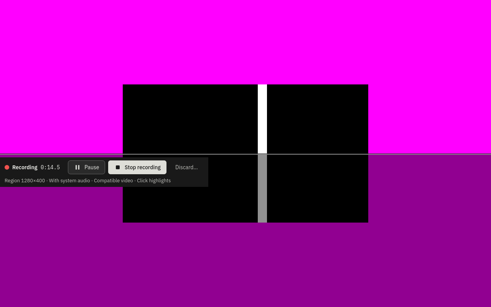

# Final cell — visible control bar, build 4548

**PASS: all eight run medians are inside −45…+125 ms; none is earlier than −45 ms.** The original −66/−118.7 ms observations did not reproduce here and remain unexplained, not waived. Six of eight medians meet the ±33 ms target; off repetitions 2 and 3 (+36/+37.3 ms) miss that target while passing the acceptance bound.

Fresh d69 guest `b1364v`, run `cbb9e054-2c70-4b31-8732-54754748441d`, QEMU2018494, 2vCPUs/6144MiB; Fedora45/Budgie10.10.3/labwc0.20.2, Wayland, 1280×800. Host d69/192.168.68.69, Debian13, four cores. Immutable golden SHA256 a6749512438d507ef2b2c47fe675955627464d9a5a85341002f91cd54fb401ad. Boot/unlocked desktop and recording bar saved visibly on the wall (5996→5946, SSH22446). Recording interval 2026-11-10T09:24:32Z to 2026-11-10T09:30:12Z.

Same AppImage from CI42784508070, source head30eab18a8fa9954438eaa48e9b417b177632b9fd, package26.1110.4548-dev+gf65c1053b22d, package commitf65c1053b22d1c7e3a5905945ff7dcc1401dc3b7/treec516a5106b716035bf76b717c7e1a104983450b0. AppImage SHA25606f27e641ce932e241151fd69040ae18214699bdbabb33933d03942caa160611. Actual resident startup logs confirm **Qt runtime6.12.0**, build4548, Budgie/Wayland; no build or product changes.

Protocol: region0,0,1280,400; lead3s; highlights on then off, repeated four times. Same marker bytes (SHA256abf5305fb0b9a1124ad1efc37af6b924484d0917955513060560360b2f6fb2ea), same private null output for all eight runs, microphone off, system marker audio; no real host or guest audio devices. Normal scripted clicks at4/8/12s, same coordinates as the lead matrix. **Control bar left visible at Ready and during recording. No --hide-bar and zero recording.overlay calls**, enforced by a CLI guard and saved method audits. The product naturally placed the bar outside the region (overlayPlacement outside, overlayExcluded true); it is visible on the desktop, not in the 1280×400 clip. `bar-on-live.png` shows the actual highlighted recording at14.5s; `review-live.png` is explicitly the later review window, not bar proof.

Driver: `drivers/record_run_visible.py`, derived from the previously retained pushed build4548 driver; shared private-sink/identity instrumentation in `runner.py` and `visible.py`. Clip/frame unlink operations in this owned driver and cover helper were replaced with preservation, without changing guard decisions or failure exits. Original and exported clips and pre-guard preservation copies are retained. **No cover gate failed**; every edge score1.0, real motion in every clip (4.607…33.98), sixteen A/V pairs each, exit0 for all eight. Driver hashes are in summary.json; exact commands and operation IDs retained per run.

Values are audio minus picture; positive means sound later. Frame-age triples are **min/mean/max**, not medians. Raw timestamps and frames/cadence-lock Stop lines for every run are in diagnostics.json and runs/*.debug.

| Run in execution order | Highlights | Median ms | Frame age min/mean/max ms | Earlier than −45 ms | Result |
|---|---|---:|---|---|---|
| visible-1-on | on | +29.3 | 0.6/2/20.3 | No | PASS |
| visible-1-off | off | +14 | 1.3/1.6/7.1 | No | PASS |
| visible-2-on | on | +14.7 | 0.6/2.1/9 | No | PASS |
| visible-2-off | off | +36 | 1.4/1.6/7.7 | No | PASS |
| visible-3-on | on | +4.7 | 0.7/2.2/14.1 | No | PASS |
| visible-3-off | off | +37.3 | 1.3/1.6/6.5 | No | PASS |
| visible-4-on | on | +13.3 | 0.6/2.1/8.2 | No | PASS |
| visible-4-off | off | +24 | 1.4/1.7/7.1 | No | PASS |

Ordered per-pair values (all retained, even though no run crossed the early bound):

| Run | Audio-minus-picture pairs ms, first to last |
|---|---|
| visible-1-on | 29.3, 29.3, 29.3, 29.3, 29.3, 29.3, 29.3, 29.3, 29.3, 29.3, 29.3, 29.3, 29.3, 29.3, 29.3, 29.3 |
| visible-1-off | 14, 47.3, -19.3, 14, 14, 14, 14, 14, 14, 14, 14, 14, 14, 14, 14, 14 |
| visible-2-on | -18.7, -18.7, 14.7, 14.7, 14.7, 48, 14.7, 14.7, 48, 14.7, 14.7, 14.7, 14.7, 14.7, 14.7, 14.7 |
| visible-2-off | 2.7, 2.7, 2.7, 36, 36, 2.7, 2.7, 2.7, 2.7, 36, 36, 36, 36, 36, 36, 36 |
| visible-3-on | -62, -28.7, 4.7, 4.7, 4.7, 4.7, 4.7, 4.7, 4.7, 4.7, 4.7, 4.7, 4.7, 4.7, 4.7, 4.7 |
| visible-3-off | -29.3, -29.3, -29.3, 4, -29.3, 4, 37.3, 37.3, 37.3, 37.3, 37.3, 37.3, 37.3, 37.3, 37.3, 37.3 |
| visible-4-on | -20, 13.3, 13.3, 13.3, 13.3, 46.7, 13.3, 13.3, 46.7, 13.3, 13.3, 13.3, 13.3, 13.3, 13.3, 13.3 |
| visible-4-off | -42.7, -9.3, 24, 24, 24, 57.3, 24, -9.3, -9.3, 24, 24, 24, 24, 24, 24, 24 |

On-minus-off paired differences: [15.3, -21.3, -32.6, -10.7] ms; median -16 ms. Cell ranges on 4.7…29.3 ms, off 14…37.3 ms overlap. The paired sign changes and these eight samples do not show a consistent shift beyond the spread; no causal conclusion is claimed.

Guest load average1/5/15min: [0.59423828125, 0.21337890625, 0.076171875] → [2.07666015625, 1.47705078125, 0.67236328125]; per-run start/end retained. Host snapshots show only this QEMU, no builds/other VMs, alongside existing owner KDE/Wayland desktop, VNC, sampler, ChatGPT, tailscale/container services and idle versitygw/demo services. Owner applications/demos untouched; no heavy work beside the guest. Guest-only private null-sink/tone removed successfully, left[]; original defaults auto_null/@DEFAULT_SOURCE@ restored. Every recording socket33UTF-8 bytes.

Export verified137files, zero mismatches. Guest synced/stopped; guarded overlay cleanup completed09:30:35UTC, golden preserved. Exact tunnel inactive, wall entry removed,5996 free, temporary bootstrap copy removed; exact QEMU PID absent and no owned process left on d69. Run metadata, cleanup receipt, clips/frames/logs retained. No physical desktop lease, source/branch/PR edit or build performed. No further measurement requested.

Caption: final-cell visible-2-on, desktop at recording14.5s; the control bar is visible below the top400-pixel capture region and shows Click highlights.
