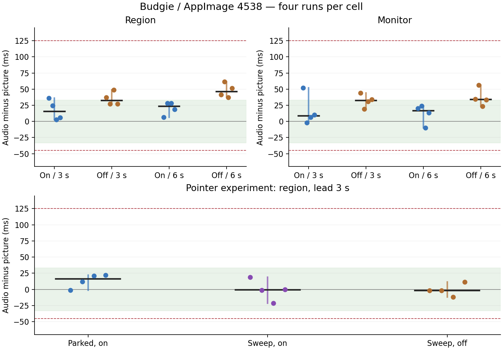

# Current-build Budgie follow-up — build 4538

This is the current-build report, completed before waiting for the new build. **g passes with retained evidence.** Both complete lead matrices and all pointer-motion cells have four valid runs per cell. All 44 experimental run medians meet −45…+125 ms. No product changes or builds were made by this worker. Original −66/−118.7 ms observations remain recorded; no cause or waiver is claimed.

Exact build: PR source cccf91a501247dce525217271b78b4665b0fbd0d, CI42774290115 release-appimage; package 26.1110.4538-dev+g1d19e1e8ac50, AppImage SHA256 54c1a92618d23e651d8469577b0699252cd65b36e32df388aadf83593181c1d1; loaded Qt6.12.0, confirmed in fresh resident logs. d69 / 192.168.68.69, Debian13, four host cores; fresh Fedora45 Budgie10.10.3 / labwc0.20.2 Wayland guest b1364f, run9c0ff6bd-8c89-4b63-b072-b0933c6041ef, QEMU2015121, 2vCPUs/6144MiB, 1280×800. Golden a6749512438d507ef2b2c47fe675955627464d9a5a85341002f91cd54fb401ad. SSH22446 / VNC5946, visible workstation wall port5996.

Protocol: 16 region then 16 monitor runs, on/off adjacent and lead order3/6 reversed between repetitions. One private output for the entire lead matrix, same byte-identical moving marker, MP4, 30fps, 16 seconds timed after start, 3 scripted clicks each. Bar hidden at Ready in every cell; original guards unchanged. Then a second single private output for the twelve motion cells on the same guest. Motion order per repetition: parked/on, sweep/on, sweep/off; reversed on-pair order on even repetitions. Lead3s; pointer prepositioned before Prepare. Parked stays at(200,100), including its clicks. Sweep starts before Record and continues until Stop returns, triangular x100…1180, y100, nominal60updates/s at720px/s; actual counts/times in each pointer-motion.json. Only these controlled inputs differ within each comparison. All records retain commands, input/reference configuration, frame evidence, working/export clips and preservation copies. No real microphone or output used.

Values are audio minus picture: positive means sound later. Frame-age fields are **min/mean/max**, not medians; the table puts the mean beside each per-run A/V median. Raw two-line Stop diagnostics and all three age statistics are in diagnostics.json and the ordered-pair appendix.

| Target / pointer | Lead | Highlights | Four run medians / mean frame age (ms), repetition order | Median range width (ms) |
|---|---:|---|---|---:|
| region | 3 s | on | 36 / 1.9; 24.7 / 2; 2.7 / 2; 6 / 1.9 | 33.3 |
| region | 3 s | off | 37.3 / 1.6; 27.3 / 1.6; 48.7 / 1.6; 27.3 / 1.8 | 21.4 |
| region | 6 s | on | 6.7 / 2; 28 / 1.9; 28 / 1.9; 18.7 / 2 | 21.3 |
| region | 6 s | off | 41.3 / 1.6; 61.3 / 1.6; 37.3 / 1.6; 51.3 / 1.6 | 24 |
| monitor | 3 s | on | 52 / 1.9; -2 / 2; 6.7 / 2.1; 10 / 2 | 54 |
| monitor | 3 s | off | 44 / 1.6; 19.3 / 1.6; 30.7 / 1.6; 34 / 1.7 | 24.7 |
| monitor | 6 s | on | 20 / 1.9; 24 / 2; -10 / 1.9; 13.3 / 2.1 | 34 |
| monitor | 6 s | off | 34.7 / 1.6; 56 / 1.7; 23.3 / 1.6; 33.3 / 1.6 | 32.7 |
| pointer still | 3 s | on | -1.3 / 1.9; 12 / 2; 20.7 / 1.9; 22 / 2 | 23.3 |
| pointer sweep | 3 s | on | 18.7 / 1.5; -1.3 / 1.4; -21.3 / 1.5; 0 / 1.5 | 40 |
| pointer sweep | 3 s | off | -2 / 1.6; -2 / 1.6; -12 / 1.6; 11.3 / 1.6 | 23.3 |

The cells do **not** show a uniform on/off shift larger than their within-cell spread. Region at6s is the exception to overlap: on6.7…28ms versus off37.3…61.3ms. Its paired shifts are −34.6/−33.3/−9.3/−32.6ms (median−33.0); the difference of the two cell medians is −23.0ms, comparable with the larger within-cell range24ms. The 3s region and both monitor on/off ranges overlap. With highlights off, short-minus-long paired median is −14.0ms on region but +4.1ms on monitor, with overlapping ranges and mixed signs: this does not establish that short lead alone causes the earlier anomalies.

For the sharper pointer test, swept/on minus parked/on paired differences are +20.0/−13.3/−42.0/−22.0ms (median−17.65). Swept/on minus swept/off is +20.7/+0.7/−9.3/−11.3ms (median−4.3). These cells overlap, some pairs reverse sign, and the swept/on range is40ms. The data do not establish a consistently early click-path effect beyond the spread, so no DEFECT-headed STATUS line is added. This is not proof that the unit-tested one-frame mechanism is absent. The withdrawn capture-latency/cursor-timeline hypothesis is not presented as a finding.

The offset often grows more positive through the clip in both settings: first-four versus last-four pair medians change by0…66.7ms in the lead matrix; the motion cells also show increases. All pair offsets and clip times are retained in order, rather than replacing each clip with one number. See ordered-pairs.md and the trajectory plots. No root cause is inferred from that trend.

Original earlier anomalies already had debug logging; no reruns were needed to obtain the requested Stop fields:

| Original run | A/V median ms | Frame age min/mean/max ms |
|---|---:|---|
| f-monitor | -66 | 0.7/2.5/47.0 |
| f-region | -118.7 | 0.7/2.5/51.1 |
| f-off | 46.7 | 1.3/2.2/31.3 |

Those fields do not show an extra~100ms of frame age in the early runs. They do not rule out other guest/fixture latency; the large original offsets remain unexplained. The raw timestamps line also retains audio/video lateness, and the frames line retains cadence-lock early-dropped/resync counters.

g: coordinator's hide-bar driver original SHA410d4093573743f088c5bfa9fd6ac14b114b43cbc575b3992f2636b3f58ff00e, plus preservation-only copy SHAa5ca6509b440e09542edbc0ff4a34d10f0d27a0739490e4926535d43acc96983. Called with --hide-bar. It behaved correctly on this desktop: exit0, barHidden true, documented overlayExcluded false / overlayPlacement handle, unchanged rc.xml before/after, one recording resident across both delayed captures. Captures completed in 3.52/3.37s with6031 countdown pixels each, saved and cover-checked. The full working/export clips and frame are retained, all edge scores1.0. Three rings measured against the client's visible flash: -33/-34/-34ms, maximum centre error0.9px. Motion18.919; audio median34.7ms/16pairs. Capture operation IDs 22e9813c-71ec-4529-9f85-65817da3ec87 and b0329a88-9992-42a3-adb4-ead0fc82055f. An earlier independent preservation-wrapper g run also passed and is retained as g-retained. The new implementer driver was actually exercised on the desktop; its guard-failure branch was not forced. Preservation copies are made before clips or frames can be deleted, while all original gates retain their judgement.

Guest load averages (1/5/15min): lead matrix [0.57958984375, 0.310546875, 0.115234375] → [1.99755859375, 2.00341796875, 1.67333984375]; region stage [0.93359375, 0.388671875, 0.1416015625] → [1.751953125, 1.76611328125, 1.11962890625]; monitor stage [1.98876953125, 1.80029296875, 1.1689453125] → [1.99755859375, 2.00341796875, 1.67333984375]; pointer batch including g [1.5556640625, 1.89208984375, 1.64404296875] → [2.28466796875, 2.310546875, 2.0048828125]. Per-run start/end loads are retained. On d69, samples show only this QEMU guest and no builds/other VMs; existing Plasma, VNC, sampler(~0.5%), owner's ChatGPT(~0.4%), tailscale/container/versitygw services remained; fwupd appeared briefly(~0.3%). Owner's versitygw/smb demo was untouched. Plot dependencies were installed before measurement; plotting ran after shutdown. Host snapshots are in identity/.

Audio defaults restored to auto_null / @DEFAULT_SOURCE@, lab modules removed (left[]), no real device opened. Socket preflight33UTF-8 bytes per recording endpoint; launcher checked QMP/VNC paths. Export verification:720 files, zero mismatches. Guest synced/stopped and guarded overlay retirement completed; golden preserved, tunnel stopped, wall entry removed. Exact run/cleanup receipts retained. No physical desktop lock was needed. New head30eab18a8 / CI42784508070 is a separate pending report, not mixed into these data.

[All lead pair trajectories](plots/ordered-pairs.svg) · [Pointer pair trajectories](plots/pointer-pairs.svg)

## Every run and every pair

| Target / condition | Lead | Rep | Median ms | Frame age min/mean/max ms | Ordered pair offsets ms | First4 → last4 median ms |
|---|---:|---:|---:|---|---|---|
| region on | 3 | 1 | 36 | 0.6/1.9/16.8 | -30.7, 2.7, 2.7, 36, 2.7, 2.7, 36, 36, 36, 2.7, 36, 36, 36, 36, 36, 36 | 2.7 → 36.0 |
| region off | 3 | 1 | 37.3 | 1.4/1.6/5.1 | -29.3, -29.3, -29.3, 37.3, 37.3, 37.3, 37.3, 37.3, 37.3, 37.3, 37.3, 70.7, 37.3, 37.3, 37.3, 37.3 | -29.3 → 37.3 |
| region on | 6 | 1 | 6.7 | 0.6/2.0/8.6 | 6.7, 6.7, 40, 6.7, 6.7, 6.7, 6.7, 6.7, 6.7, 6.7, 40, 40, 6.7, 6.7, 6.7, 6.7 | 6.7 → 6.7 |
| region off | 6 | 1 | 41.3 | 1.3/1.6/5.4 | 8, 41.3, 8, 41.3, 41.3, 41.3, 41.3, 41.3, 41.3, 41.3, 41.3, 41.3, 41.3, 41.3, 41.3, 41.3 | 24.65 → 41.3 |
| region on | 6 | 2 | 28 | 0.6/1.9/14.8 | -5.3, -5.3, -5.3, -5.3, -5.3, -5.3, 28, 28, 28, 28, 28, 28, 28, 61.3, 61.3, 28 | -5.3 → 44.65 |
| region off | 6 | 2 | 61.3 | 1.4/1.6/7.9 | 28, 61.3, 61.3, 28, -5.3, 28, 28, 61.3, 61.3, 61.3, 61.3, 61.3, 61.3, 61.3, 61.3, 61.3 | 44.65 → 61.3 |
| region on | 3 | 2 | 24.7 | 0.6/2.0/15.6 | -8.7, -8.7, 24.7, 24.7, -8.7, 24.7, 24.7, 24.7, 24.7, 24.7, 24.7, 24.7, -8.7, 24.7, 24.7, 24.7 | 8.0 → 24.7 |
| region off | 3 | 2 | 27.3 | 1.3/1.6/5.1 | -39.3, -39.3, -6, 27.3, -6, 27.3, 27.3, 27.3, 27.3, 27.3, 27.3, 27.3, -6, 27.3, 27.3, 27.3 | -22.65 → 27.3 |
| region on | 3 | 3 | 2.7 | 0.6/2.0/16.2 | -30.7, -30.7, 2.7, 2.7, 2.7, 2.7, 2.7, 2.7, 2.7, 36, 36, 36, 2.7, 36, 36, 36 | -14.0 → 36.0 |
| region off | 3 | 3 | 48.7 | 1.4/1.6/8.9 | -18, -18, -18, 48.7, -18, 15.3, 15.3, 15.3, 15.3, 48.7, 48.7, 48.7, 48.7, 48.7, 48.7, 48.7 | -18.0 → 48.7 |
| region on | 6 | 3 | 28 | 0.7/1.9/15.3 | -5.3, -5.3, 28, 28, 28, 28, 28, 61.3, 28, 28, 61.3, 61.3, 28, 28, 61.3, 28 | 11.35 → 28.0 |
| region off | 6 | 3 | 37.3 | 1.4/1.6/9.5 | 4, 37.3, 37.3, 37.3, 4, 37.3, 37.3, 37.3, 37.3, 37.3, 37.3, 37.3, 70.7, 70.7, 70.7, 70.7 | 37.3 → 70.7 |
| region on | 6 | 4 | 18.7 | 0.6/2.0/13.6 | -14.7, -14.7, 18.7, 18.7, -14.7, 18.7, 18.7, 18.7, 18.7, 18.7, 18.7, 18.7, 52, 52, 52, 52 | 2.0 → 52.0 |
| region off | 6 | 4 | 51.3 | 1.3/1.6/5.2 | 18, 51.3, 51.3, 51.3, 18, 51.3, 51.3, 51.3, 51.3, 51.3, 51.3, 51.3, 51.3, 51.3, 51.3, 51.3 | 51.3 → 51.3 |
| region on | 3 | 4 | 6 | 0.6/1.9/18.0 | -27.3, -27.3, 6, 6, 6, 6, 6, 6, 6, 6, 39.3, 39.3, 6, 39.3, 39.3, 39.3 | -10.65 → 39.3 |
| region off | 3 | 4 | 27.3 | 1.2/1.8/12.3 | -6, -6, 27.3, 27.3, 27.3, 27.3, 27.3, 27.3, 27.3, 27.3, 27.3, 27.3, 27.3, 60.7, 60.7, 60.7 | 10.65 → 60.7 |
| g / g-retained on | 3 | 0 | 18.7 | 0.6/1.9/10.7 | 18.7, 18.7, 18.7, 52, 18.7, 18.7, 52, 52, 18.7, 18.7, 52, 52, 18.7, 18.7, 18.7, 52 | 18.7 → 18.7 |
| monitor on | 3 | 1 | 52 | 0.6/1.9/14.0 | -48, -14.7, -14.7, 18.7, 18.7, 18.7, 18.7, 52, 52, 52, 52, 52, 18.7, 52, 52, 52 | -14.7 → 52.0 |
| monitor off | 3 | 1 | 44 | 1.3/1.6/8.0 | 444, 10.7, 10.7, 10.7, 44, 44, 44, 44, 44, 44, 44, 44, 44, 44, 44, 44, 44 | 10.7 → 44.0 |
| monitor on | 6 | 1 | 20 | 0.6/1.9/10.4 | 20, 20, 20, 20, 20, 20, 53.3, 20, 20, 20, 53.3, 53.3, 53.3, 53.3, 53.3, 53.3 | 20.0 → 53.3 |
| monitor off | 6 | 1 | 34.7 | 1.4/1.6/6.7 | 468, 34.7, 34.7, 34.7, 34.7, 34.7, 34.7, 34.7, 34.7, 34.7, 34.7, 34.7, 34.7, 34.7, 34.7, 34.7, 34.7 | 34.7 → 34.7 |
| monitor on | 6 | 2 | 24 | 0.6/2.0/9.8 | -9.3, -9.3, -9.3, 24, -9.3, -9.3, 24, 24, 24, 24, 57.3, 24, 24, 24, 24, 24 | -9.3 → 24.0 |
| monitor off | 6 | 2 | 56 | 1.3/1.7/6.3 | 456, 22.7, 22.7, 56, 56, 56, 56, 56, 22.7, 22.7, 56, 56, 56, 56, 56, 56, 56 | 39.35 → 56.0 |
| monitor on | 3 | 2 | -2 | 0.7/2.0/10.8 | -35.3, -35.3, -2, -2, -2, -2, -2, -2, -2, -2, 31.3, 31.3, -2, 31.3, 31.3, 31.3 | -18.65 → 31.3 |
| monitor off | 3 | 2 | 19.3 | 1.4/1.6/6.7 | 486, -14, 19.3, 19.3, 19.3, 19.3, 19.3, 19.3, 19.3, 52.7, 52.7, 19.3, 52.7, 52.7, 52.7, 52.7, 52.7 | 19.3 → 52.7 |
| monitor on | 3 | 3 | 6.7 | 0.7/2.1/11.5 | -26.7, -26.7, 6.7, 6.7, 6.7, 6.7, 6.7, 6.7, 6.7, 40, 40, 40, 40, 73.3, 40, 40 | -10.0 → 40.0 |
| monitor off | 3 | 3 | 30.7 | 1.3/1.6/4.9 | 464, -2.7, -2.7, 30.7, 30.7, 30.7, 30.7, 30.7, 30.7, 30.7, 30.7, 64, 30.7, 64, 30.7, 30.7, 30.7 | 14.0 → 30.7 |
| monitor on | 6 | 3 | -10 | 0.6/1.9/11.8 | -10, -10, -10, -10, -10, -10, 23.3, 23.3, -10, -10, 23.3, 23.3, -10, 23.3, 23.3, 23.3 | -10.0 → 23.3 |
| monitor off | 6 | 3 | 23.3 | 1.2/1.6/4.8 | 490, 56.7, 23.3, 23.3, 23.3, 23.3, 23.3, 23.3, 23.3, 23.3, 56.7, 56.7, 56.7, 23.3, 56.7, 56.7, 56.7 | 40.0 → 56.7 |
| monitor on | 6 | 4 | 13.3 | 0.7/2.1/13.0 | -20, -20, 13.3, 13.3, 13.3, 13.3, 13.3, 13.3, 13.3, 13.3, 13.3, 13.3, 13.3, 13.3, 13.3, 13.3 | -3.35 → 13.3 |
| monitor off | 6 | 4 | 33.3 | 1.4/1.6/6.6 | 500, 33.3, 33.3, 33.3, 33.3, 33.3, 33.3, 33.3, 33.3, 33.3, 33.3, 33.3, 33.3, 33.3, 33.3, 33.3, 33.3 | 33.3 → 33.3 |
| monitor on | 3 | 4 | 10 | 0.6/2.0/12.5 | -56.7, -23.3, -23.3, -23.3, -23.3, 10, 10, 10, 10, 10, 10, 10, 10, 10, 10, 43.3 | -23.3 → 10.0 |
| monitor off | 3 | 4 | 34 | 1.4/1.7/5.9 | 434, -32.7, 0.7, 34, 34, 0.7, 34, 34, 34, 34, 34, 67.3, 34, 34, 34, 34, 34 | 17.35 → 34.0 |
| pointer still on | 3 | 1 | -1.3 | 0.6/1.9/9.8 | -34.7, -34.7, -1.3, -1.3, -1.3, -1.3, 32, -1.3, -1.3, -1.3, 32, 32, 32, 32, 32, 65.3 | -18.0 → 32.0 |
| pointer sweep on | 3 | 1 | 18.7 | 0.6/1.5/12.4 | -48, -14.7, -14.7, -14.7, -14.7, -14.7, -14.7, 18.7, 18.7, 18.7, 18.7, 18.7, 18.7, 18.7, 18.7, 18.7 | -14.7 → 18.7 |
| pointer sweep off | 3 | 1 | -2 | 1.3/1.6/5.5 | -68.7, -35.3, -2, -2, -2, -2, -2, -2, -2, -2, -2, -2, -2, -2, -2, -2 | -18.65 → -2.0 |
| pointer sweep on | 3 | 2 | -1.3 | 0.6/1.4/15.5 | -68, -68, -34.7, -34.7, -34.7, -34.7, -34.7, -1.3, -1.3, -1.3, -1.3, -1.3, -1.3, -1.3, -1.3, -1.3 | -51.35 → -1.3 |
| pointer still on | 3 | 2 | 12 | 0.7/2.0/11.2 | -54.7, -21.3, -21.3, 12, -21.3, -21.3, 12, 12, 12, 12, 12, 12, 12, 12, 12, 12 | -21.3 → 12.0 |
| pointer sweep off | 3 | 2 | -2 | 1.3/1.6/4.8 | -35.3, -35.3, -2, -35.3, -2, -2, -2, -2, -2, -2, -2, -2, -2, -2, 31.3, -2 | -35.3 → -2.0 |
| pointer still on | 3 | 3 | 20.7 | 0.7/1.9/13.7 | -46, -12.7, -12.7, -12.7, -12.7, -12.7, -12.7, 20.7, 20.7, -12.7, 20.7, 20.7, 20.7, 20.7, 20.7, 20.7 | -12.7 → 20.7 |
| pointer sweep on | 3 | 3 | -21.3 | 0.6/1.5/12.9 | -54.7, -54.7, -21.3, -54.7, -21.3, -21.3, -21.3, -21.3, -21.3, -21.3, -21.3, 12, -21.3, 12, 12, -21.3 | -54.7 → -4.65 |
| pointer sweep off | 3 | 3 | -12 | 1.3/1.6/5.8 | -45.3, -45.3, -12, -45.3, -12, -12, -12, -12, -12, -12, -12, -12, -12, -12, -12, -12 | -45.3 → -12.0 |
| pointer sweep on | 3 | 4 | 0 | 0.6/1.5/9.9 | -66.7, -33.3, 0, -33.3, 0, 0, 0, 0, 0, 0, 0, 0, 0, 0, 0, 0 | -33.3 → 0.0 |
| pointer still on | 3 | 4 | 22 | 0.7/2.0/10.1 | -44.7, -11.3, -11.3, -11.3, -11.3, -11.3, 22, 22, 22, 22, 22, 22, 22, 22, 22, 22 | -11.3 → 22.0 |
| pointer sweep off | 3 | 4 | 11.3 | 1.2/1.6/5.2 | -55.3, -22, 11.3, -22, 11.3, 11.3, 11.3, 11.3, 11.3, 11.3, 11.3, 11.3, 11.3, 11.3, 11.3, 11.3 | -22.0 → 11.3 |
| g / g-new-driver on | 3 | 0 | 34.7 | 0.7/2.0/10.9 | 1.3, 34.7, 34.7, 34.7, 1.3, 34.7, 34.7, 34.7, 34.7, 34.7, 34.7, 34.7, 34.7, 34.7, 34.7, 34.7 | 34.7 → 34.7 |
