> **Final head aba2c8096** is30eab18a8 with nightly60d4ee7dc merged in; that merge changes nothing under src/record. Since the first tested build4538, the product adds the cursor-only frame-slot fix in six src/record files, image-copy path only. **Tested:4538 on all five desktops;4548 on Budgie and Hyprland.** Cinnamon/GNOME/Plasma retain4538 results because their paths are untouched (coordinator ruling). CI42790832995 for the final merged head is in progress. **Budgie: pending last visible-bar cell; acceptance is not complete.**

Part of #1364. Docs are in #1374.

Recordings can be narrated, and can show what was clicked.

## What this adds

**Microphone in recordings.** The recording bar has a **Microphone** toggle beside System audio, with a level meter while the input is open. It is off by default and remembered. The microphone is opened only while the toggle is on and released at Stop. It records alone or mixed with system audio into the clip's one audio track (MP4 and WebM; GIF and WebP stay silent). The device is the system default input, or the one chosen in **Settings → Capture → Screen recording → Microphone**.

- An output's monitor is never listed or opened as a microphone. Where the default input is a monitor (a desktop with nothing plugged in) or there is no input, the toggle reads **No microphone**, and a `prepare` that asks for the microphone is refused with `recording_unsupported` and the reason.
- The bar follows the sound server while it is at Ready. Open the bar, see **No microphone**, plug one in: within about a second the toggle reads **Microphone** and can be ticked, without cancelling. One that is pulled is no longer offered, and one that comes back is recorded again without a second click if it was asked for.
- A microphone that goes away mid-recording does not end or shorten the recording: the clip goes on, silent on that input, the bar says so and `recording.inspect` reports `progress.microphoneLost`. The microphone's stream is pinned to its device, so the sound server cannot move it to another input (measured: unpinned, PipeWire moves it to the default input, which on a desktop without a microphone is an output's monitor).

**Click highlights.** Optional (**Settings → Capture → Screen recording → Draw a ring at each click**, or `clickHighlights: true` on `recording.prepare`): a ring opens at the pointer on each press and fades over 0.45 s. Each desktop gives presses differently:

| Desktop | Where the presses come from | Drawn by | Recordings |
| --- | --- | --- | --- |
| Cinnamon and other X11 | XInput 2 raw button events, read by the helper | put.gd, into the clip only | monitor, desktop, region, window |
| GNOME | the put.gd Shell extension (version 21, recording protocol 3) | put.gd, into the clip only | monitor, desktop, region, window |
| Hyprland | runtime mouse binds that pass the click on and report it on the event socket | put.gd, into the clip only | monitor, desktop, region, window |
| KDE Plasma | KWin's own Mouse Click Animation effect, switched on for the recording and put back exactly as it was | KWin, on the screen | monitor, desktop, region |
| Budgie (labwc) | mouse binds in labwc's `rc.xml` for the length of the recording say that a button went down; the capture is taken without a painted cursor, put.gd draws the cursor from the capture's cursor session and takes the press's place from it | put.gd, into the clip only | monitor, desktop, region |

Window recordings have no rings on Plasma (KWin draws on the screen; a window stream carries the window alone) and on Budgie (wlroots' window capture source has no cursor source, `types/ext_image_capture_source_v1/scene.c`, and labwc reports no window geometry). `prepare` refuses that combination with `click_target_unsupported` and the reason, and **Settings → Advanced → Desktop support details** names it.

**Agent control.** `recording.microphones {device?}`; `recording.audio {id, microphone?, system?}` sets the ready bar's two toggles as a click does (a microphone that appeared is switched on without a new `prepare`; refused with the reason where none can be opened, and from Record on); `audio {system, microphone, microphoneDevice}` and `clickHighlights` on `recording.prepare`; `audio` and `clickHighlights` in `recording.capabilities`; `progress.audioSources`, `microphoneLost` and `clickHighlightsError` in `recording.inspect`. `putgd-cli` forwards them. MCP: `list_recording_microphones`, `set_recording_audio` and the new `prepare_recording` arguments, covered in `tests/integration/test_mcp.py`.

## Final independent assembly

**Tested product builds:** 4538 / CI42774290115 / cccf91a50 on all five desktops; 4548 / CI42784508070 /30eab18a8 on Budgie and Hyprland. Both package runs green. Build4548 adds the cursor-only frame-slot fix in six src/record files, image-copy path only. Cinnamon, GNOME and Plasma retain4538 evidence by coordinator ruling because their paths are untouched. These are two tested builds, not a claim that4538equals4548. Existing pictures retain their original build captions.

| Desktop | Tested build / retained results | Final assembly status |
|---|---|---|
| Cinnamon6.6.9/X11, physicalm74 | 4538 DEB, Qt6.4.2; a–i pass. Microphone MP4/WebM−23.3/+2.5ms; mixed−3.3/−8.5ms, pause steps+0.3/−0.5ms. Rings3/3 monitor/region/window,0/3off; same-session passes | PASS as reported; coordinator ruling, no rerun |
| GNOME50.6/Wayland, physicalf44 | 4538 installedRPM, Qt6.11.2, extension21. Microphone+5.3/+28.5ms; mixed−6.7/+17.5ms; both modes/formats acrosspause; loss/toggle/Ready/private-monitor refusal/outputloss pass;9/9rings,0off; same-session3.46/3.50s passes | PASS; Ready+34ms misses one-frame target but meets required bound. Package/extension/audio restored, lease released08:01:52UTC |
| Plasma/KWin6.8.2/Wayland, physicalAurora | 4538 AppImage, Qt6.12; a–h pass. Mic+26/+43.5ms; mixed+42.7/+29.5ms, repeats+37.3/+18. Same-host nightly+18.7…+46.5ms; effect9/9 restores; same-session passes | PASS as reported; some PR/nightly runs miss one-frame target |
| Hyprland0.56.2, freshk72guests | Original4538 audio/functional evidence retained;4548 on/off and still/swept retest:3/3rings on,0/3off; audio medians−40.7…+26.7ms inside−45/+125. Same-session3.64/3.52s passes, both stills retained, closing earlier gap | Product checks pass. Ring−application-flash generally1–2frames early, one click of15 at−100ms outside70ms lab bound: coordinator ruling **observation, not a defect**, no rerun; see explanation below |
| Budgie10.10.3/labwc0.20.2, freshd69guests | 4538 originala–e/clickcleanup plus44-run experiment;4548 eight parked/swept experimental runs and functional retest. **52experimental run medians all inside−45/+125ms**, no consistent highlights shift beyond spread. 4548 monitor/region3/3rings; retained same-session3.50/3.39s passes | **PENDING LAST CELL:** eight highlights-on/off runs with control bar visible not yet present in row file. Acceptance not complete. Any run earlier than−45ms keeps Budgie open |

Audio values are audio minus picture, positive=sound late. Required run-median bound−45…+125ms plus no worse than nightly beyond observed spread;±33.3ms stays the target. Silent/off noise pairings are not meaningful alignment. Pair-level trajectories and every run are retained in the row records.

**Hyprland4548 timing ruling:** rings3/3on,0/3off; audio within bound; same-session passes with final still retained. Rings were1–2frames early against the application's visible flash on every clip and3frames(100ms) on one click of15, outside the implementer's70ms lab bound. Coordinator ruling: an observation, not a defect; a ring cannot precede the real click, the reference is the application's own reaction, which trails in a software-rendered guest; on physical Cinnamon the same measure was0,−1,0ms. No rerun. Original4538 h wording remains historical: product behaviour passed; final still not retained because the fixture lost fullscreen; coordinator ruling, no rerun. Its gap is now closed on4548.

**Budgie ruling and outstanding gate:** all52 experimental medians within bound; no consistent click-highlight shift beyond spread; functional and retained same-session checks pass on4548. The initial−66/−118.7ms medians did not reproduce and remain unexplained; unmodified third-party recorder on the same guest measured−56ms. Do not describe the cursor-slot change as experimentally proving their cause or a before/after improvement beyond spread. Last visible-bar cell decides acceptance and remains pending until its eight results appear. Whole-monitor Stop handle inclusion is documented behaviour (overlayExcluded false, overlayPlacement handle), not a finding.

| Row/build | Actual lab driver |
|---|---|
| Cinnamon/GNOME/Plasma4538 | Coordination acceptance-1364/record_run.py, SHA256e5f1764ff963e974c3755267abb932ecc9aaccf0b23446b89767026fbe68398e; GNOME f44:/home/patrick/work/s1364s2/lab/record_run.py; Cinnamon/tmp/c1364/lab/record_run.py |
| Budgie initial4538 | Same e5f1764f driver; client-visible flash fixture. 4538 retained-g follow-up uses hide-bar driver410d4093 plus preservation copya5ca6509, both retained |
| Hyprland4538 | Initial observational/fullscreen driver0446cbe5; retained-g/h follow-up unchanged record_run-hide-bar.py --hide-bar, SHA256410d4093573743f088c5bfa9fd6ac14b114b43cbc575b3992f2636b3f58ff00e |
| Hyprland4548 | Unchanged pushed tools/lab/record_run.py, equal coordination record_run-hide-bar-hyprland-hold.py, SHA256aa7fec68b7c69c78c6443ff5c89c8a564f1fe584e522c93b01917a9c823ca31a; --hide-bar, --delayed-capture desktop:3 for h; wrapper observes inspect/injects pointer, gates unchanged |
| Budgie4548 | Same pushed aa7fec68 driver with --hide-bar; preservation/identity instrumented copy SHA256421b2d4e6f70c35fa36d9c76c5d76b7a8e87872ec9bc96ab4705d8a5c26d5cc3; originals retained |

Raw evidence and build-labelled pictures:

- [GNOME4538](https://github.com/patrick-hudson/put.gd-evidence/tree/a65fcc8ee4ba12481b6de6e3eb8afec6367a4217/records/2026-11-10-recording-1364-gnome-4538):29exports+29working clips, all probe/decode/motion/no shortclips. All25signal-bearing medians meet required bound;24/25oneframe, Ready+34targetmiss. TemporaryRPM/extension/settings/audio restored; own resources clean.
- [Cinnamon4538](https://github.com/patrick-hudson/put.gd-evidence/tree/72c8486d3073caafafa2e39e3014e7232a4006de/records/2026-11-10-recording-1364-cinnamon-4538), [Plasma4538](https://github.com/patrick-hudson/put.gd-evidence/tree/2e457ecb10c17372a96ad4c749ca05b2490c04dd/records/2026-11-10-plasma-1364).
- [Budgie4538 matrix](https://github.com/patrick-hudson/put.gd-evidence/tree/86f56d063719733fac9b966330f300f8a97446d0/records/2026-11-10-recording-1364-budgie-followup), [Budgie4548](https://github.com/patrick-hudson/put.gd-evidence/tree/6711bf3884ae80d2e8a5db80867dd75f1c782200/records/2026-11-10-recording-1364-budgie-4548).
- [Hyprland4548](https://github.com/patrick-hudson/put.gd-evidence/tree/6f1fc2ef623000494e2034fc4f7ca98ce94d2f8f/records/2026-11-10-recording-1364-hyprland-4548): retained stills/clips, timing observation and independent cross-check, source/build/driver identities and guarded-retirement receipt.
- [Earlier assembly/picture provenance](https://github.com/patrick-hudson/put.gd-evidence/tree/5dab5b5b2fe504003b5906a02ce38ac869b1e1ee/records/2026-11-10-recording-1364-assembly-4538). Prior failed observations remain historical rather than erased.

All measurements use simulated microphones/private null outputs; no real microphone or physical output playback. Worker receipts record restored defaults and module IDs, guest retirement and wall/tunnel removal. No desktop work, build, VM, merge or PR watch in this final assembly.

## Build4538 pictures — retained with their original captions

### Before and after: microphone controls

Published nightly4346, GNOME: System audio only. Then PR4538 with Microphone off, on with its live simulated-input meter, and no microphone. All crops/boxes are from the actual desktop surfaces through put.gd's own editor/MCP.

### Cinnamon/X11 and Plasma/Wayland bars

Cinnamon4538 off-state is cropped from its retained actual Ready/plugged frame; on/meter and no-microphone are the row worker’s package pictures.

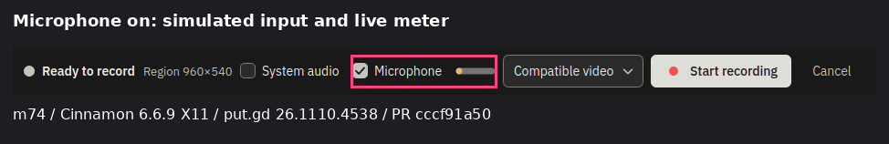

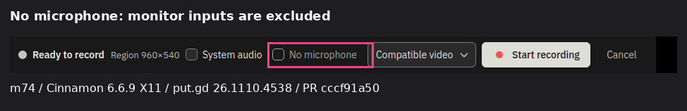

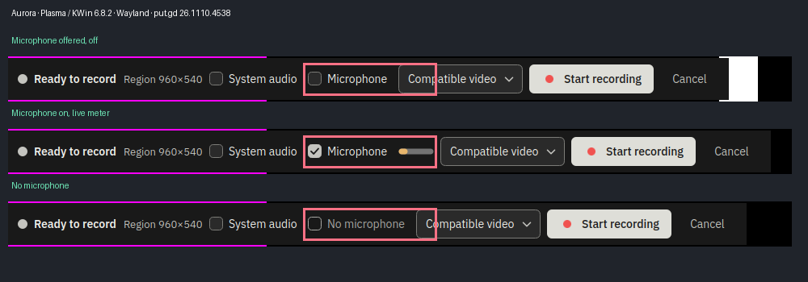

### Build4538 guest surfaces and retained ring frames

These depict build4538, as captioned; build4548 retest evidence and plots follow below. The supplemental off/no-input variants below are cropped/boxed from retained actual4538Ready frames through the same build’s editor/MCP. This is picture assembly, not a new desktop run.

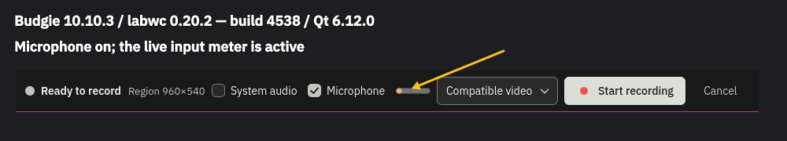

### Device setting at100% and150%

The selected device is a private simulated input. The same native RPM is shown at both actual Qt scales.

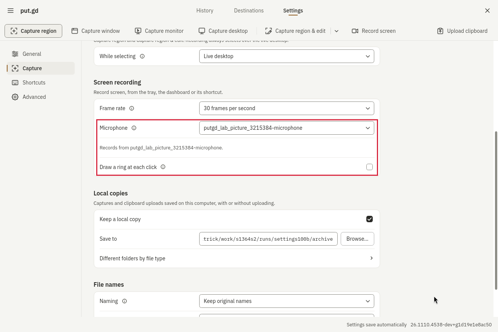

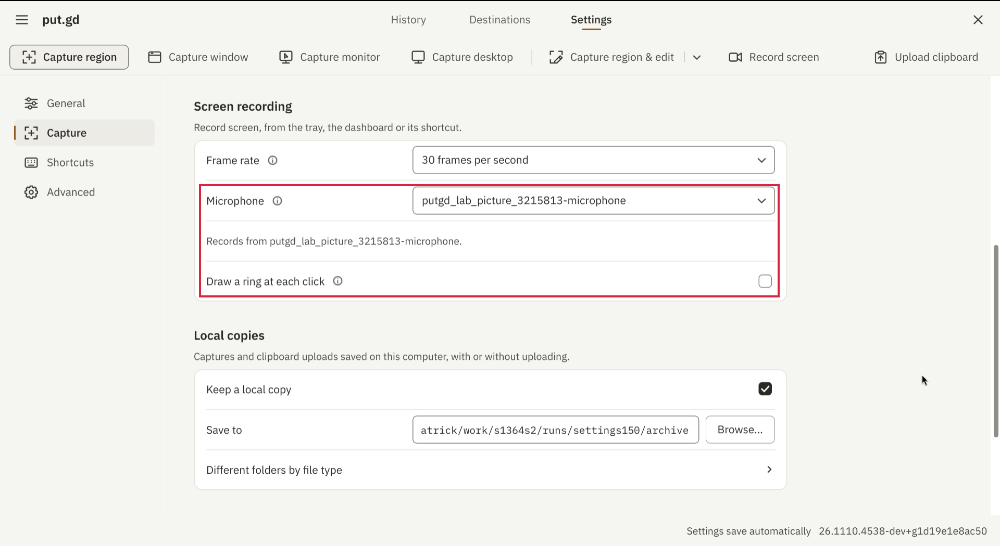

### A retained click-ring frame from every desktop

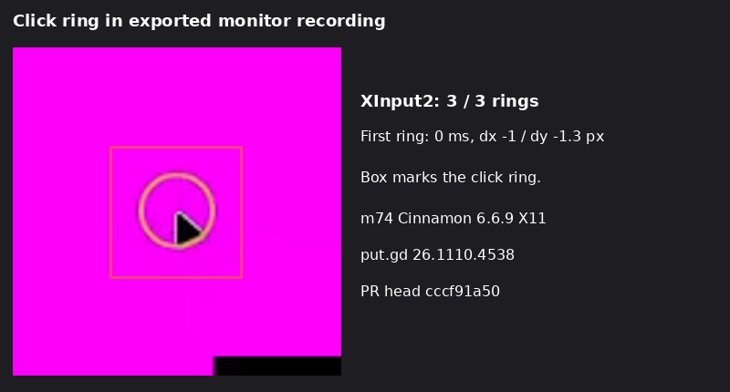

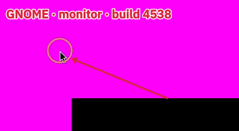

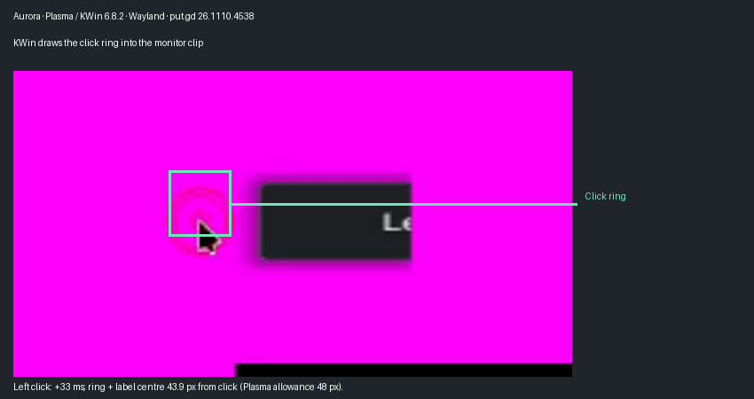

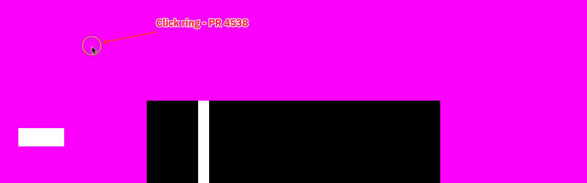

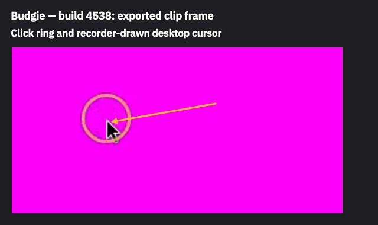

### Support details where window rings are unavailable

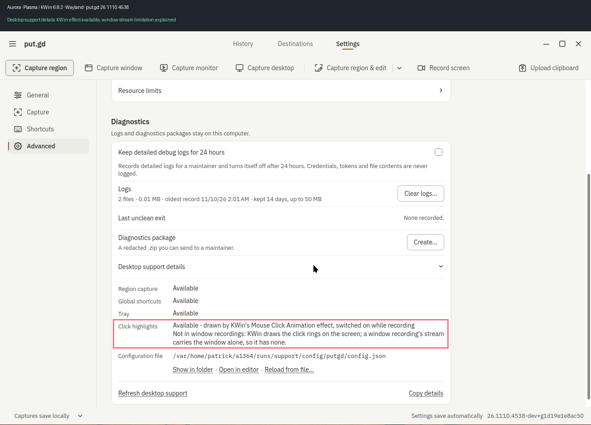

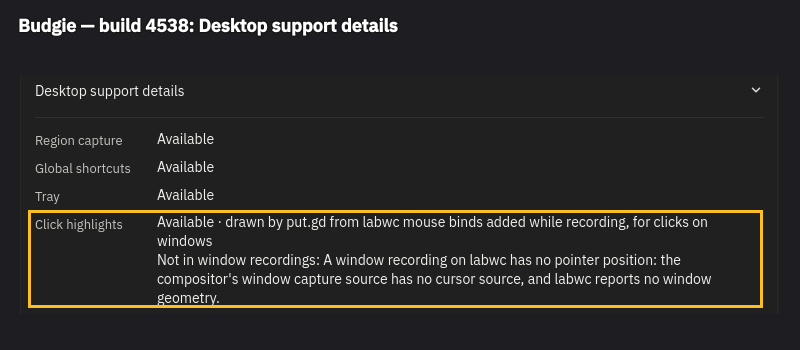

### Audio against the marker, and the same-session countdown

These show exact4538 package measurements. Diamonds are run medians; individual pairs may differ by a captured frame. One frame remains the target, not the current acceptance line.

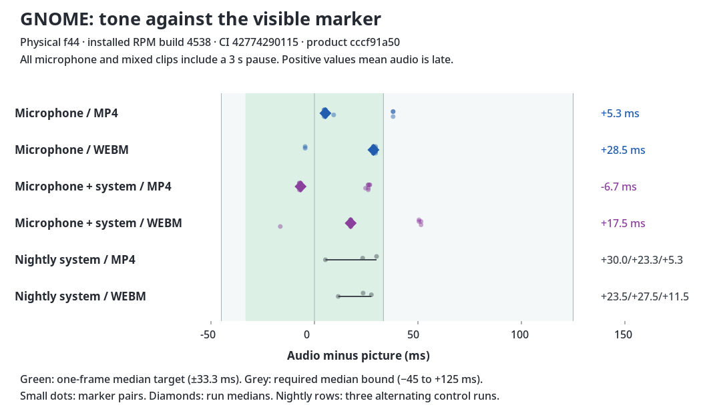

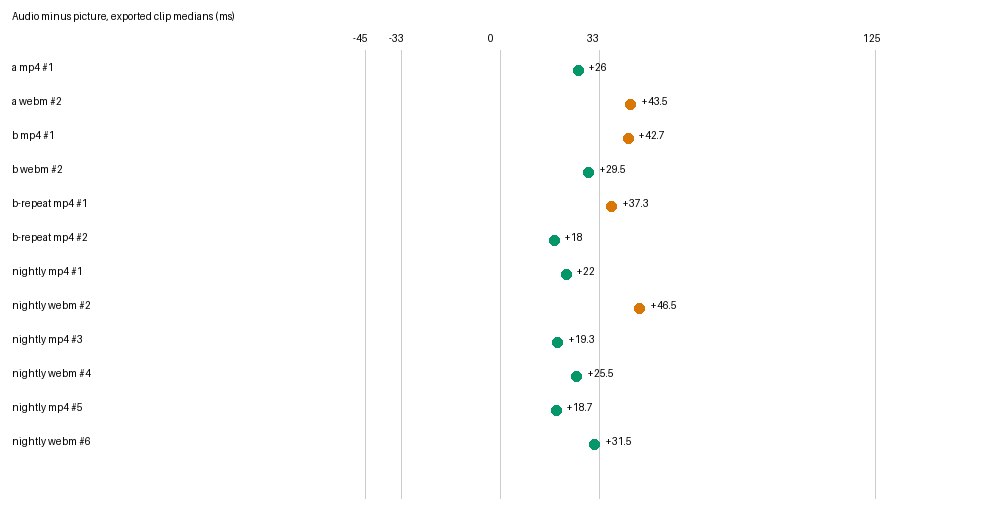

## Build4548 retest pictures and charts

These newly published plots are explicitly build4548 retest evidence. Older UI pictures above retain their4538 captions and are not relabelled as4548.

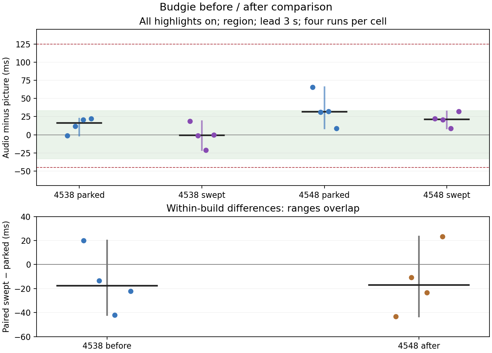

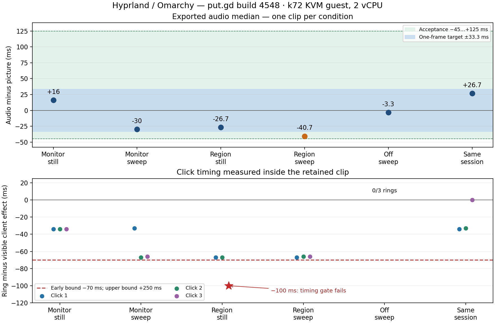
