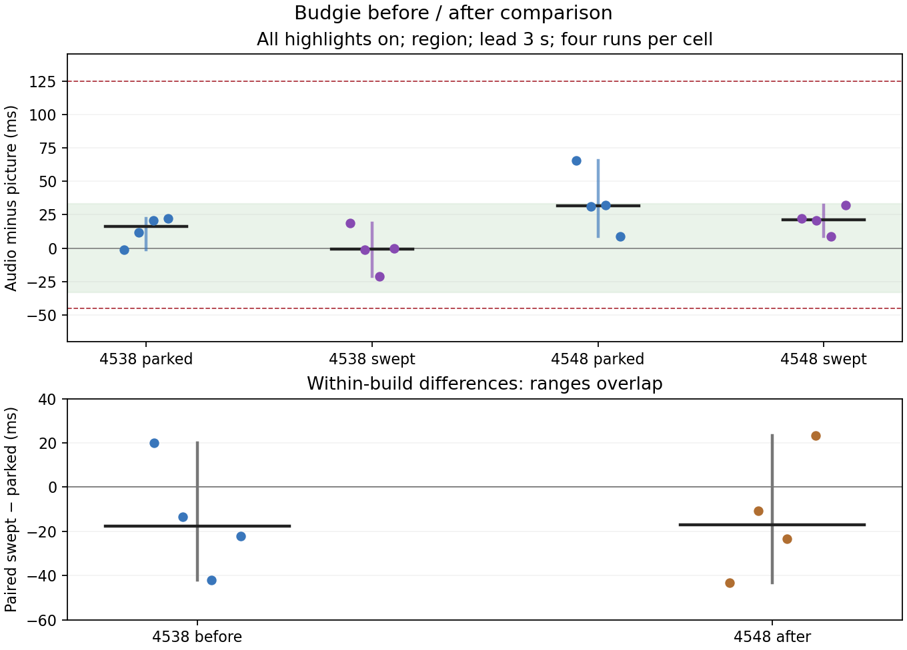
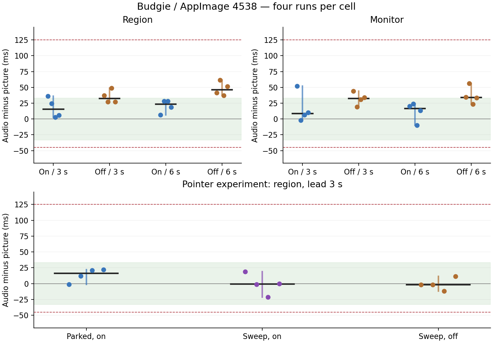
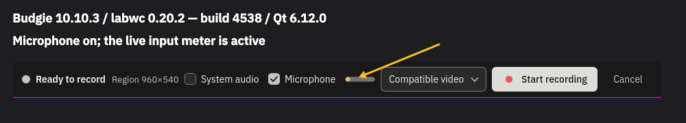
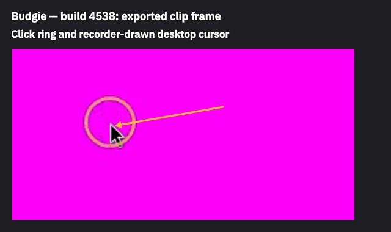
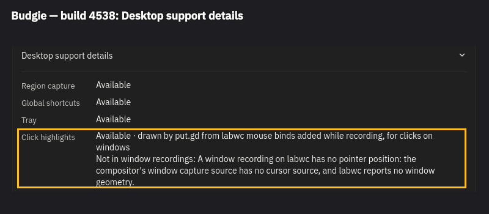

## New-build retest (2026-11-10T09:19:56.132116+00:00)

# Budgie new-build report — 4548 / 30eab18a8

**Requested functional retests PASS:** monitor and region rings, cleanup immediately after Stop, and same-session delayed capture/recording/delayed capture. All eight parked/swept clips are retained and within the absolute A/V bound. The measured timing samples overlap; they do not establish a before/after improvement beyond the spread. Original large early offsets are not explained or waived.

Build under test: CI42784508070, source head30eab18a8fa9954438eaa48e9b417b177632b9fd, observed completed/success before testing; release-appimage version26.1110.4548-dev+gf65c1053b22d, CI merge/package commitf65c1053b22d1c7e3a5905945ff7dcc1401dc3b7, treec516a5106b716035bf76b717c7e1a104983450b0. AppImage SHA25606f27e641ce932e241151fd69040ae18214699bdbabb33933d03942caa160611. Actual resident logs confirm loaded Qt6.12.0 and this build version. CI was polled with a one-minute guard, not gh run watch.

Fresh d69-hosted guestb1364n, rundb5b0104-429b-4597-a0d8-769e773b61ca, QEMU2017316, 2vCPUs/6144MiB, 1280×800, UID1000/lab, Budgie Wayland. Same immutable Fedora45 golden (Budgie10.10.3/labwc0.20.2), SHAa6749512438d507ef2b2c47fe675955627464d9a5a85341002f91cd54fb401ad; no guest OS package changes. Host192.168.68.69/d69, Debian13/four cores. Visible wall via workstation5996→d695946, SSH22446; saved desktop/frame visuals retained. This is a separate fresh guest from the current-build report, not a same-session binary A/B.

Protocol: parked/on, swept/on, repeated four times in strict alternating order. Region0,0,1280,400, lead3s, same private output for all eleven new-build cases, same byte-identical marker as build4538 (SHAabf5305fb0b9a1124ad1efc37af6b924484d0917955513060560360b2f6fb2ea). Sweep720px/s, x100…1180/y100, nominal60updates/s, starts before Record and lasts until Stop replies; parked stays(200,100), including clicks. Actual update counts/times retained. Both builds use the same input/marker parameters and the supported bar-hide method at Ready; original guards remain active. Each original and exported clip was copied before a guard could delete it. No new gate failed.

Driver provenance: copied the requested coordination file after NEW HEAD (SHA410d4093573743f088c5bfa9fd6ac14b114b43cbc575b3992f2636b3f58ff00e). It still differed from the pushed source only by the Hyprland delayed-capture fullscreen hold. Used the exact pushed tools/lab/record_run.py instead (SHAaa7fec68b7c69c78c6443ff5c89c8a564f1fe584e522c93b01917a9c823ca31a), with --hide-bar plus preservation/identity instrumentation (SHA421b2d4e6f70c35fa36d9c76c5d76b7a8e87872ec9bc96ab4705d8a5c26d5cc3). Both originals are retained. No product code, branch or PR edits; no compilation on the builder or workstation.

A/V values below are exported-clip medians; negative means sound earlier. Frame-age values are the **means** from the helper's min/mean/max Stop diagnostic. Full triples, sample counts, both raw Stop lines, cursor-only drop counters and every ordered marker pair are retained.

| Build | Pointer / highlights | Four A/V medians / mean frame ages (ms), repetition order | Median range width ms |
|---|---|---|---:|
| 4538 | still / on | -1.3 / 1.9; 12 / 2; 20.7 / 1.9; 22 / 2 | 23.3 |
| 4538 | sweep / on | 18.7 / 1.5; -1.3 / 1.4; -21.3 / 1.5; 0 / 1.5 | 40 |
| 4548 | still / on | 65.3 / 2.1; 31.3 / 2.1; 32 / 2.1; 8.7 / 2.2 | 56.6 |
| 4548 | sweep / on | 22 / 1.4; 20.7 / 1.4; 8.7 / 1.4; 32 / 1.4 | 23.3 |

Within-build paired swept-minus-parked differences, repetition order:

| Build | Four paired differences ms | Median paired difference ms | Difference of cell medians ms | Larger cell range width ms | Cell ranges overlap |
|---|---|---:|---:|---:|---|
| 4538 | 20.0, -13.3, -42.0, -22 | -17.65 | -17.0 | 40.0 | True |
| 4548 | -43.3, -10.6, -23.3, 23.3 | -16.95 | -10.3 | 56.599999999999994 | True |

The paired median moves from−17.65 to−16.95ms (0.7ms toward zero); differences of cell medians move from−17.0 to−10.3ms. Both are much smaller than the observed cell spreads. Samples overlap within and across builds, and each build has a paired run with the opposite sign. This experiment does not resolve an improvement beyond run-to-run variation or establish a consistently early click-path defect. This is not a claim that the unit-tested frame-slot effect is absent. The fresh-guest baseline changes too, so raw before/after medians are not attributed to the fix. No DEFECT-headed STATUS line is added.

Every new motion clip has16 marker pairs and real motion (scores19.14…19.17), saved working/export clips and passing cover edges. Seven of eight meet the±33ms target; the65.3ms parked clip misses that target but meets−45…+125ms. The original−66/−118.7ms measurements remain in the first report, with frame-age mean2.5ms; no extra~100ms of captured-frame age was observed there. Their cause remains unresolved.

Functional retests (same new build):

| Case | Corrected ring delays ms | Maximum absolute centre error px | A/V median ms | Motion | Result |
|---|---|---:|---:|---:|---|
| f-monitor | 0/0/34 | 0.8 | 20 | 4.59 | PASS; retained/full frame gate passed |
| f-region | 0/0/-33 | 1 | 29.3 | 33.979 | PASS; retained/full frame gate passed |
| g-new-driver | 0/0/0 | 0.9 | 43.3 | 19.061 | PASS; retained/full frame gate passed |

All9rings appear at the requested places and within−33…+34ms of the client's visible flash, maximum error1px. Timing is not measured against pointer arrival. Monitor and region after-stop XML snapshots contain zero put.gd click markers and preserve all83 user keybindings structurally; all eleven cases have zero markers immediately after production Stop, before cancel/quit.

g uses one resident for desktop countdown→recording with highlights→desktop countdown. Both captures completed/saved in3.5/3.39s,6031 countdown pixels each, full cover gate passed; capture operation IDs34f745f6-46f3-49f5-80d6-704fbff3a0e4 and783d08bf-7d59-41ad-87de-04ced056c876. BarHidden true; expected overlayExcluded false / overlayPlacement handle; the hidden handle is absent from the retained clip. All recording-frame edge scores1.0; rc.xml is byte-identical before/after. Driver exit0, no reported problems. The43.3ms g median misses the one-frame target while meeting the acceptance bound. Working/export clips, preservation copies, ring frames, countdown visuals and after-Stop snapshots are retained.

Guest load averages1/5/15min: [1.05615234375, 0.3408203125, 0.1181640625] → [2.1533203125, 1.88623046875, 1.0009765625]; per-run start/end values retained. Host snapshots show only this guest, no builds/other VMs, alongside the existing owner desktop/VNC/sampler/ChatGPT and idle service/demo processes; owner's versitygw/smb untouched. Only private guest audio was used, defaults restored, modules removed (left[]). Every resolved recording socket is33UTF-8 bytes; launch checks QMP/VNC paths.

Export verification:208files, zero mismatches. Guest synced/stopped, guarded overlay retirement completed; golden preserved, tunnel stopped and exact wall tile removed. No physical desktop lease was used; no owned process remains on d69. Private host-side run/cleanup/plot metadata retained. Code worktree clean. This packet follows current-build evidence86f56d063719733fac9b966330f300f8a97446d0.

[Every pair trajectory](https://raw.githubusercontent.com/patrick-hudson/put.gd-evidence/6711bf3884ae80d2e8a5db80867dd75f1c782200/records/2026-11-10-recording-1364-budgie-4548/plots/ordered-pairs.svg)

## Every new run and pair

| Run | Median ms | Frame age min/mean/max ms | Ordered pair offsets ms | First4 → last4 median ms |
|---|---:|---|---|---|
| motion-1-still-on | 65.3 | 0.7/2.1/13.8 | -1.3, 32, 32, 65.3, 32, 32, 32, 65.3, 65.3, 65.3, 65.3, 65.3, 65.3, 65.3, 65.3, 65.3 | 32.0 → 65.3 |
| motion-1-sweep-on | 22 | 0.6/1.4/14.9 | -44.7, -11.3, 22, -11.3, 22, 22, 22, 22, 22, 22, 55.3, 22, 22, 22, 22, 55.3 | -11.3 → 22.0 |
| motion-2-still-on | 31.3 | 0.6/2.1/11.5 | -35.3, -2, 31.3, 31.3, 31.3, 31.3, 31.3, 31.3, 31.3, 31.3, 31.3, 31.3, 31.3, 31.3, 31.3, 31.3 | 14.65 → 31.3 |
| motion-2-sweep-on | 20.7 | 0.5/1.4/8.9 | -46, -12.7, -12.7, -12.7, -12.7, 20.7, -12.7, 20.7, 20.7, 20.7, 20.7, 20.7, 20.7, 20.7, 20.7, 20.7 | -12.7 → 20.7 |
| motion-3-still-on | 32 | 0.7/2.1/8.5 | -34.7, -1.3, 32, -1.3, -1.3, 32, -1.3, 32, 32, 32, 65.3, 65.3, 32, 32, 65.3, 65.3 | -1.3 → 48.65 |
| motion-3-sweep-on | 8.7 | 0.5/1.4/11.1 | -24.7, -24.7, 8.7, 8.7, 8.7, 8.7, 8.7, 8.7, 8.7, 8.7, 42, 42, 42, 8.7, 42, 42 | -8.0 → 42.0 |
| motion-4-still-on | 8.7 | 0.7/2.2/17.2 | -24.7, 8.7, 8.7, 8.7, 8.7, 8.7, 8.7, 8.7, 8.7, 8.7, 42, 42, 8.7, 8.7, 8.7, 8.7 | 8.7 → 8.7 |
| motion-4-sweep-on | 32 | 0.6/1.4/11.3 | -34.7, -1.3, -1.3, -1.3, -1.3, 32, 32, 32, 32, 32, 32, 32, 32, 32, 32, 32 | -1.3 → 32.0 |
| f-monitor | 20 | 0.6/2.2/9.4 | -13.3, 20, 20, 20, 20, 20, 53.3, 53.3, 53.3, 53.3, 53.3, 53.3, 20, 53.3, 20, 20 | 20.0 → 20.0 |
| f-region | 29.3 | 0.7/2.1/9.5 | -4, -4, 29.3, 29.3, 29.3, 29.3, 29.3, 29.3, 29.3, 29.3, 29.3, 29.3, 29.3, 29.3, 29.3, 29.3 | 12.65 → 29.3 |
| g-new-driver | 43.3 | 0.7/2.3/21.5 | 43.3, 43.3, 43.3, 43.3, 10, 43.3, 43.3, 43.3, 43.3, 43.3, 43.3, 43.3, 43.3, 43.3, 43.3, 43.3 | 43.3 → 43.3 |

Published second report: https://github.com/patrick-hudson/put.gd-evidence/tree/6711bf3884ae80d2e8a5db80867dd75f1c782200/records/2026-11-10-recording-1364-budgie-4548

---

## Current-build follow-up (2026-11-10T08:59:57.235916+00:00)

# Current-build Budgie follow-up — build 4538

This is the current-build report, completed before waiting for the new build. **g passes with retained evidence.** Both complete lead matrices and all pointer-motion cells have four valid runs per cell. All 44 experimental run medians meet −45…+125 ms. No product changes or builds were made by this worker. Original −66/−118.7 ms observations remain recorded; no cause or waiver is claimed.

Exact build: PR source cccf91a501247dce525217271b78b4665b0fbd0d, CI42774290115 release-appimage; package 26.1110.4538-dev+g1d19e1e8ac50, AppImage SHA256 54c1a92618d23e651d8469577b0699252cd65b36e32df388aadf83593181c1d1; loaded Qt6.12.0, confirmed in fresh resident logs. d69 / 192.168.68.69, Debian13, four host cores; fresh Fedora45 Budgie10.10.3 / labwc0.20.2 Wayland guest b1364f, run9c0ff6bd-8c89-4b63-b072-b0933c6041ef, QEMU2015121, 2vCPUs/6144MiB, 1280×800. Golden a6749512438d507ef2b2c47fe675955627464d9a5a85341002f91cd54fb401ad. SSH22446 / VNC5946, visible workstation wall port5996.

Protocol: 16 region then 16 monitor runs, on/off adjacent and lead order3/6 reversed between repetitions. One private output for the entire lead matrix, same byte-identical moving marker, MP4, 30fps, 16 seconds timed after start, 3 scripted clicks each. Bar hidden at Ready in every cell; original guards unchanged. Then a second single private output for the twelve motion cells on the same guest. Motion order per repetition: parked/on, sweep/on, sweep/off; reversed on-pair order on even repetitions. Lead3s; pointer prepositioned before Prepare. Parked stays at(200,100), including its clicks. Sweep starts before Record and continues until Stop returns, triangular x100…1180, y100, nominal60updates/s at720px/s; actual counts/times in each pointer-motion.json. Only these controlled inputs differ within each comparison. All records retain commands, input/reference configuration, frame evidence, working/export clips and preservation copies. No real microphone or output used.

Values are audio minus picture: positive means sound later. Frame-age fields are **min/mean/max**, not medians; the table puts the mean beside each per-run A/V median. Raw two-line Stop diagnostics and all three age statistics are in diagnostics.json and the ordered-pair appendix.

| Target / pointer | Lead | Highlights | Four run medians / mean frame age (ms), repetition order | Median range width (ms) |
|---|---:|---|---|---:|
| region | 3 s | on | 36 / 1.9; 24.7 / 2; 2.7 / 2; 6 / 1.9 | 33.3 |
| region | 3 s | off | 37.3 / 1.6; 27.3 / 1.6; 48.7 / 1.6; 27.3 / 1.8 | 21.4 |
| region | 6 s | on | 6.7 / 2; 28 / 1.9; 28 / 1.9; 18.7 / 2 | 21.3 |
| region | 6 s | off | 41.3 / 1.6; 61.3 / 1.6; 37.3 / 1.6; 51.3 / 1.6 | 24 |
| monitor | 3 s | on | 52 / 1.9; -2 / 2; 6.7 / 2.1; 10 / 2 | 54 |
| monitor | 3 s | off | 44 / 1.6; 19.3 / 1.6; 30.7 / 1.6; 34 / 1.7 | 24.7 |
| monitor | 6 s | on | 20 / 1.9; 24 / 2; -10 / 1.9; 13.3 / 2.1 | 34 |
| monitor | 6 s | off | 34.7 / 1.6; 56 / 1.7; 23.3 / 1.6; 33.3 / 1.6 | 32.7 |
| pointer still | 3 s | on | -1.3 / 1.9; 12 / 2; 20.7 / 1.9; 22 / 2 | 23.3 |
| pointer sweep | 3 s | on | 18.7 / 1.5; -1.3 / 1.4; -21.3 / 1.5; 0 / 1.5 | 40 |
| pointer sweep | 3 s | off | -2 / 1.6; -2 / 1.6; -12 / 1.6; 11.3 / 1.6 | 23.3 |

The cells do **not** show a uniform on/off shift larger than their within-cell spread. Region at6s is the exception to overlap: on6.7…28ms versus off37.3…61.3ms. Its paired shifts are −34.6/−33.3/−9.3/−32.6ms (median−33.0); the difference of the two cell medians is −23.0ms, comparable with the larger within-cell range24ms. The 3s region and both monitor on/off ranges overlap. With highlights off, short-minus-long paired median is −14.0ms on region but +4.1ms on monitor, with overlapping ranges and mixed signs: this does not establish that short lead alone causes the earlier anomalies.

For the sharper pointer test, swept/on minus parked/on paired differences are +20.0/−13.3/−42.0/−22.0ms (median−17.65). Swept/on minus swept/off is +20.7/+0.7/−9.3/−11.3ms (median−4.3). These cells overlap, some pairs reverse sign, and the swept/on range is40ms. The data do not establish a consistently early click-path effect beyond the spread, so no DEFECT-headed STATUS line is added. This is not proof that the unit-tested one-frame mechanism is absent. The withdrawn capture-latency/cursor-timeline hypothesis is not presented as a finding.

The offset often grows more positive through the clip in both settings: first-four versus last-four pair medians change by0…66.7ms in the lead matrix; the motion cells also show increases. All pair offsets and clip times are retained in order, rather than replacing each clip with one number. See ordered-pairs.md and the trajectory plots. No root cause is inferred from that trend.

Original earlier anomalies already had debug logging; no reruns were needed to obtain the requested Stop fields:

| Original run | A/V median ms | Frame age min/mean/max ms |
|---|---:|---|
| f-monitor | -66 | 0.7/2.5/47.0 |
| f-region | -118.7 | 0.7/2.5/51.1 |
| f-off | 46.7 | 1.3/2.2/31.3 |

Those fields do not show an extra~100ms of frame age in the early runs. They do not rule out other guest/fixture latency; the large original offsets remain unexplained. The raw timestamps line also retains audio/video lateness, and the frames line retains cadence-lock early-dropped/resync counters.

g: coordinator's hide-bar driver original SHA410d4093573743f088c5bfa9fd6ac14b114b43cbc575b3992f2636b3f58ff00e, plus preservation-only copy SHAa5ca6509b440e09542edbc0ff4a34d10f0d27a0739490e4926535d43acc96983. Called with --hide-bar. It behaved correctly on this desktop: exit0, barHidden true, documented overlayExcluded false / overlayPlacement handle, unchanged rc.xml before/after, one recording resident across both delayed captures. Captures completed in 3.52/3.37s with6031 countdown pixels each, saved and cover-checked. The full working/export clips and frame are retained, all edge scores1.0. Three rings measured against the client's visible flash: -33/-34/-34ms, maximum centre error0.9px. Motion18.919; audio median34.7ms/16pairs. Capture operation IDs 22e9813c-71ec-4529-9f85-65817da3ec87 and b0329a88-9992-42a3-adb4-ead0fc82055f. An earlier independent preservation-wrapper g run also passed and is retained as g-retained. The new implementer driver was actually exercised on the desktop; its guard-failure branch was not forced. Preservation copies are made before clips or frames can be deleted, while all original gates retain their judgement.

Guest load averages (1/5/15min): lead matrix [0.57958984375, 0.310546875, 0.115234375] → [1.99755859375, 2.00341796875, 1.67333984375]; region stage [0.93359375, 0.388671875, 0.1416015625] → [1.751953125, 1.76611328125, 1.11962890625]; monitor stage [1.98876953125, 1.80029296875, 1.1689453125] → [1.99755859375, 2.00341796875, 1.67333984375]; pointer batch including g [1.5556640625, 1.89208984375, 1.64404296875] → [2.28466796875, 2.310546875, 2.0048828125]. Per-run start/end loads are retained. On d69, samples show only this QEMU guest and no builds/other VMs; existing Plasma, VNC, sampler(~0.5%), owner's ChatGPT(~0.4%), tailscale/container/versitygw services remained; fwupd appeared briefly(~0.3%). Owner's versitygw/smb demo was untouched. Plot dependencies were installed before measurement; plotting ran after shutdown. Host snapshots are in identity/.

Audio defaults restored to auto_null / @DEFAULT_SOURCE@, lab modules removed (left[]), no real device opened. Socket preflight33UTF-8 bytes per recording endpoint; launcher checked QMP/VNC paths. Export verification:720 files, zero mismatches. Guest synced/stopped and guarded overlay retirement completed; golden preserved, tunnel stopped, wall entry removed. Exact run/cleanup receipts retained. No physical desktop lock was needed. New head30eab18a8 / CI42784508070 is a separate pending report, not mixed into these data.

[All lead pair trajectories](https://raw.githubusercontent.com/patrick-hudson/put.gd-evidence/86f56d063719733fac9b966330f300f8a97446d0/records/2026-11-10-recording-1364-budgie-followup/plots/ordered-pairs.svg) · [Pointer pair trajectories](https://raw.githubusercontent.com/patrick-hudson/put.gd-evidence/86f56d063719733fac9b966330f300f8a97446d0/records/2026-11-10-recording-1364-budgie-followup/plots/pointer-pairs.svg)

## Every run and every pair

| Target / condition | Lead | Rep | Median ms | Frame age min/mean/max ms | Ordered pair offsets ms | First4 → last4 median ms |
|---|---:|---:|---:|---|---|---|
| region on | 3 | 1 | 36 | 0.6/1.9/16.8 | -30.7, 2.7, 2.7, 36, 2.7, 2.7, 36, 36, 36, 2.7, 36, 36, 36, 36, 36, 36 | 2.7 → 36.0 |
| region off | 3 | 1 | 37.3 | 1.4/1.6/5.1 | -29.3, -29.3, -29.3, 37.3, 37.3, 37.3, 37.3, 37.3, 37.3, 37.3, 37.3, 70.7, 37.3, 37.3, 37.3, 37.3 | -29.3 → 37.3 |
| region on | 6 | 1 | 6.7 | 0.6/2.0/8.6 | 6.7, 6.7, 40, 6.7, 6.7, 6.7, 6.7, 6.7, 6.7, 6.7, 40, 40, 6.7, 6.7, 6.7, 6.7 | 6.7 → 6.7 |
| region off | 6 | 1 | 41.3 | 1.3/1.6/5.4 | 8, 41.3, 8, 41.3, 41.3, 41.3, 41.3, 41.3, 41.3, 41.3, 41.3, 41.3, 41.3, 41.3, 41.3, 41.3 | 24.65 → 41.3 |
| region on | 6 | 2 | 28 | 0.6/1.9/14.8 | -5.3, -5.3, -5.3, -5.3, -5.3, -5.3, 28, 28, 28, 28, 28, 28, 28, 61.3, 61.3, 28 | -5.3 → 44.65 |
| region off | 6 | 2 | 61.3 | 1.4/1.6/7.9 | 28, 61.3, 61.3, 28, -5.3, 28, 28, 61.3, 61.3, 61.3, 61.3, 61.3, 61.3, 61.3, 61.3, 61.3 | 44.65 → 61.3 |
| region on | 3 | 2 | 24.7 | 0.6/2.0/15.6 | -8.7, -8.7, 24.7, 24.7, -8.7, 24.7, 24.7, 24.7, 24.7, 24.7, 24.7, 24.7, -8.7, 24.7, 24.7, 24.7 | 8.0 → 24.7 |
| region off | 3 | 2 | 27.3 | 1.3/1.6/5.1 | -39.3, -39.3, -6, 27.3, -6, 27.3, 27.3, 27.3, 27.3, 27.3, 27.3, 27.3, -6, 27.3, 27.3, 27.3 | -22.65 → 27.3 |
| region on | 3 | 3 | 2.7 | 0.6/2.0/16.2 | -30.7, -30.7, 2.7, 2.7, 2.7, 2.7, 2.7, 2.7, 2.7, 36, 36, 36, 2.7, 36, 36, 36 | -14.0 → 36.0 |
| region off | 3 | 3 | 48.7 | 1.4/1.6/8.9 | -18, -18, -18, 48.7, -18, 15.3, 15.3, 15.3, 15.3, 48.7, 48.7, 48.7, 48.7, 48.7, 48.7, 48.7 | -18.0 → 48.7 |
| region on | 6 | 3 | 28 | 0.7/1.9/15.3 | -5.3, -5.3, 28, 28, 28, 28, 28, 61.3, 28, 28, 61.3, 61.3, 28, 28, 61.3, 28 | 11.35 → 28.0 |
| region off | 6 | 3 | 37.3 | 1.4/1.6/9.5 | 4, 37.3, 37.3, 37.3, 4, 37.3, 37.3, 37.3, 37.3, 37.3, 37.3, 37.3, 70.7, 70.7, 70.7, 70.7 | 37.3 → 70.7 |
| region on | 6 | 4 | 18.7 | 0.6/2.0/13.6 | -14.7, -14.7, 18.7, 18.7, -14.7, 18.7, 18.7, 18.7, 18.7, 18.7, 18.7, 18.7, 52, 52, 52, 52 | 2.0 → 52.0 |
| region off | 6 | 4 | 51.3 | 1.3/1.6/5.2 | 18, 51.3, 51.3, 51.3, 18, 51.3, 51.3, 51.3, 51.3, 51.3, 51.3, 51.3, 51.3, 51.3, 51.3, 51.3 | 51.3 → 51.3 |
| region on | 3 | 4 | 6 | 0.6/1.9/18.0 | -27.3, -27.3, 6, 6, 6, 6, 6, 6, 6, 6, 39.3, 39.3, 6, 39.3, 39.3, 39.3 | -10.65 → 39.3 |
| region off | 3 | 4 | 27.3 | 1.2/1.8/12.3 | -6, -6, 27.3, 27.3, 27.3, 27.3, 27.3, 27.3, 27.3, 27.3, 27.3, 27.3, 27.3, 60.7, 60.7, 60.7 | 10.65 → 60.7 |
| g / g-retained on | 3 | 0 | 18.7 | 0.6/1.9/10.7 | 18.7, 18.7, 18.7, 52, 18.7, 18.7, 52, 52, 18.7, 18.7, 52, 52, 18.7, 18.7, 18.7, 52 | 18.7 → 18.7 |
| monitor on | 3 | 1 | 52 | 0.6/1.9/14.0 | -48, -14.7, -14.7, 18.7, 18.7, 18.7, 18.7, 52, 52, 52, 52, 52, 18.7, 52, 52, 52 | -14.7 → 52.0 |
| monitor off | 3 | 1 | 44 | 1.3/1.6/8.0 | 444, 10.7, 10.7, 10.7, 44, 44, 44, 44, 44, 44, 44, 44, 44, 44, 44, 44, 44 | 10.7 → 44.0 |
| monitor on | 6 | 1 | 20 | 0.6/1.9/10.4 | 20, 20, 20, 20, 20, 20, 53.3, 20, 20, 20, 53.3, 53.3, 53.3, 53.3, 53.3, 53.3 | 20.0 → 53.3 |
| monitor off | 6 | 1 | 34.7 | 1.4/1.6/6.7 | 468, 34.7, 34.7, 34.7, 34.7, 34.7, 34.7, 34.7, 34.7, 34.7, 34.7, 34.7, 34.7, 34.7, 34.7, 34.7, 34.7 | 34.7 → 34.7 |
| monitor on | 6 | 2 | 24 | 0.6/2.0/9.8 | -9.3, -9.3, -9.3, 24, -9.3, -9.3, 24, 24, 24, 24, 57.3, 24, 24, 24, 24, 24 | -9.3 → 24.0 |
| monitor off | 6 | 2 | 56 | 1.3/1.7/6.3 | 456, 22.7, 22.7, 56, 56, 56, 56, 56, 22.7, 22.7, 56, 56, 56, 56, 56, 56, 56 | 39.35 → 56.0 |
| monitor on | 3 | 2 | -2 | 0.7/2.0/10.8 | -35.3, -35.3, -2, -2, -2, -2, -2, -2, -2, -2, 31.3, 31.3, -2, 31.3, 31.3, 31.3 | -18.65 → 31.3 |
| monitor off | 3 | 2 | 19.3 | 1.4/1.6/6.7 | 486, -14, 19.3, 19.3, 19.3, 19.3, 19.3, 19.3, 19.3, 52.7, 52.7, 19.3, 52.7, 52.7, 52.7, 52.7, 52.7 | 19.3 → 52.7 |
| monitor on | 3 | 3 | 6.7 | 0.7/2.1/11.5 | -26.7, -26.7, 6.7, 6.7, 6.7, 6.7, 6.7, 6.7, 6.7, 40, 40, 40, 40, 73.3, 40, 40 | -10.0 → 40.0 |
| monitor off | 3 | 3 | 30.7 | 1.3/1.6/4.9 | 464, -2.7, -2.7, 30.7, 30.7, 30.7, 30.7, 30.7, 30.7, 30.7, 30.7, 64, 30.7, 64, 30.7, 30.7, 30.7 | 14.0 → 30.7 |
| monitor on | 6 | 3 | -10 | 0.6/1.9/11.8 | -10, -10, -10, -10, -10, -10, 23.3, 23.3, -10, -10, 23.3, 23.3, -10, 23.3, 23.3, 23.3 | -10.0 → 23.3 |
| monitor off | 6 | 3 | 23.3 | 1.2/1.6/4.8 | 490, 56.7, 23.3, 23.3, 23.3, 23.3, 23.3, 23.3, 23.3, 23.3, 56.7, 56.7, 56.7, 23.3, 56.7, 56.7, 56.7 | 40.0 → 56.7 |
| monitor on | 6 | 4 | 13.3 | 0.7/2.1/13.0 | -20, -20, 13.3, 13.3, 13.3, 13.3, 13.3, 13.3, 13.3, 13.3, 13.3, 13.3, 13.3, 13.3, 13.3, 13.3 | -3.35 → 13.3 |
| monitor off | 6 | 4 | 33.3 | 1.4/1.6/6.6 | 500, 33.3, 33.3, 33.3, 33.3, 33.3, 33.3, 33.3, 33.3, 33.3, 33.3, 33.3, 33.3, 33.3, 33.3, 33.3, 33.3 | 33.3 → 33.3 |
| monitor on | 3 | 4 | 10 | 0.6/2.0/12.5 | -56.7, -23.3, -23.3, -23.3, -23.3, 10, 10, 10, 10, 10, 10, 10, 10, 10, 10, 43.3 | -23.3 → 10.0 |
| monitor off | 3 | 4 | 34 | 1.4/1.7/5.9 | 434, -32.7, 0.7, 34, 34, 0.7, 34, 34, 34, 34, 34, 67.3, 34, 34, 34, 34, 34 | 17.35 → 34.0 |
| pointer still on | 3 | 1 | -1.3 | 0.6/1.9/9.8 | -34.7, -34.7, -1.3, -1.3, -1.3, -1.3, 32, -1.3, -1.3, -1.3, 32, 32, 32, 32, 32, 65.3 | -18.0 → 32.0 |
| pointer sweep on | 3 | 1 | 18.7 | 0.6/1.5/12.4 | -48, -14.7, -14.7, -14.7, -14.7, -14.7, -14.7, 18.7, 18.7, 18.7, 18.7, 18.7, 18.7, 18.7, 18.7, 18.7 | -14.7 → 18.7 |
| pointer sweep off | 3 | 1 | -2 | 1.3/1.6/5.5 | -68.7, -35.3, -2, -2, -2, -2, -2, -2, -2, -2, -2, -2, -2, -2, -2, -2 | -18.65 → -2.0 |
| pointer sweep on | 3 | 2 | -1.3 | 0.6/1.4/15.5 | -68, -68, -34.7, -34.7, -34.7, -34.7, -34.7, -1.3, -1.3, -1.3, -1.3, -1.3, -1.3, -1.3, -1.3, -1.3 | -51.35 → -1.3 |
| pointer still on | 3 | 2 | 12 | 0.7/2.0/11.2 | -54.7, -21.3, -21.3, 12, -21.3, -21.3, 12, 12, 12, 12, 12, 12, 12, 12, 12, 12 | -21.3 → 12.0 |
| pointer sweep off | 3 | 2 | -2 | 1.3/1.6/4.8 | -35.3, -35.3, -2, -35.3, -2, -2, -2, -2, -2, -2, -2, -2, -2, -2, 31.3, -2 | -35.3 → -2.0 |
| pointer still on | 3 | 3 | 20.7 | 0.7/1.9/13.7 | -46, -12.7, -12.7, -12.7, -12.7, -12.7, -12.7, 20.7, 20.7, -12.7, 20.7, 20.7, 20.7, 20.7, 20.7, 20.7 | -12.7 → 20.7 |
| pointer sweep on | 3 | 3 | -21.3 | 0.6/1.5/12.9 | -54.7, -54.7, -21.3, -54.7, -21.3, -21.3, -21.3, -21.3, -21.3, -21.3, -21.3, 12, -21.3, 12, 12, -21.3 | -54.7 → -4.65 |
| pointer sweep off | 3 | 3 | -12 | 1.3/1.6/5.8 | -45.3, -45.3, -12, -45.3, -12, -12, -12, -12, -12, -12, -12, -12, -12, -12, -12, -12 | -45.3 → -12.0 |
| pointer sweep on | 3 | 4 | 0 | 0.6/1.5/9.9 | -66.7, -33.3, 0, -33.3, 0, 0, 0, 0, 0, 0, 0, 0, 0, 0, 0, 0 | -33.3 → 0.0 |
| pointer still on | 3 | 4 | 22 | 0.7/2.0/10.1 | -44.7, -11.3, -11.3, -11.3, -11.3, -11.3, 22, 22, 22, 22, 22, 22, 22, 22, 22, 22 | -11.3 → 22.0 |
| pointer sweep off | 3 | 4 | 11.3 | 1.2/1.6/5.2 | -55.3, -22, 11.3, -22, 11.3, 11.3, 11.3, 11.3, 11.3, 11.3, 11.3, 11.3, 11.3, 11.3, 11.3, 11.3 | -22.0 → 11.3 |
| g / g-new-driver on | 3 | 0 | 34.7 | 0.7/2.0/10.9 | 1.3, 34.7, 34.7, 34.7, 1.3, 34.7, 34.7, 34.7, 34.7, 34.7, 34.7, 34.7, 34.7, 34.7, 34.7, 34.7 | 34.7 → 34.7 |

Published evidence: https://github.com/patrick-hudson/put.gd-evidence/tree/86f56d063719733fac9b966330f300f8a97446d0/records/2026-11-10-recording-1364-budgie-followup

## Original row report (historical)

# Budgie acceptance — PR #1372 / issue #1364

**Overall: FAIL; not an all-clear.** No product changes, branch edits, builds or subagents. The microphone cases and click functionality passed; retained observations include two early-audio medians, and case g's recording failed the harness's cover gate.

Host d69: Debian 13, 192.168.68.69, four cores. Fresh Fedora 45 Budgie guest `b1364`, run `3acc6be3-e1fd-4628-923e-2a3c0fa5d50f`, QEMU PID 2008274, KVM, 2 vCPUs/6144 MiB, 1280×800, lab / seat0 / Wayland. Budgie 10.10.3-3.fc45; labwc 0.20.2-2.fc45 / wlroots 0.20.2; PipeWire 1.6.9. Immutable golden SHA-256 `a6749512438d507ef2b2c47fe675955627464d9a5a85341002f91cd54fb401ad`. Visible wall tunnel `putgd-vm-1364-b1364`, workstation 5996 → d69 5946; guest SSH 22446. Boot and final idle visuals retained.

Package: CI run [42774290115](https://github.com/patrick-hudson/put.gd-desktop/actions/runs/42774290115), artifact `release-appimage`; waited with the requested `gh run watch … --exit-status` (exit 0; CI success). PR source `cccf91a501247dce525217271b78b4665b0fbd0d`; CI merge/package commit `1d19e1e8ac506ddb12a80904749536dafdc9117a`; tree `93ae895ea84a5a19a2b3de877573aa9f3189e480`. Version **26.1110.4538-dev+g1d19e1e8ac50**. AppImage SHA-256 `54c1a92618d23e651d8469577b0699252cd65b36e32df388aadf83593181c1d1`. Resident startup logs report **Qt runtime 6.12.0**, compiled 6.12.0, adapter Budgie Wayland. Nothing compiled on d69 or the workstation.

Driver: coordinator-provided `/home/patrick/work/putgd-evidence/2026-11-09-features/acceptance-1364/record_run.py`, SHA-256 `e5f1764ff963e974c3755267abb932ecc9aaccf0b23446b89767026fbe68398e`, copied unchanged as guest `b1364/lab/record_run.py`. The click fixture adds only a 500 ms white patch on GTK button press, at `(40,220,100,40)`; measure its centre `(90,240)` against each ring. Full drivers and commands retained. Corrected case g was not worked around or repeated.

Audio offsets below are audio minus picture; medians, milliseconds, exported copies. Acceptance −45…+125 ms plus no regression beyond nightly's observed run spread; target ±33 ms. Fresh same-guest nightly system controls (published 26.1109.4346-nightly, SHA `d72454ab90ff75ef5378f141651d83f2c3b341eaa133b3bc86b4ced4efe2714b`) measured +44 MP4 / +39.5 WebM. Earlier nightly Budgie measurements span about +11…+54 ms; the largest microphone/mixed delta from this guest's corresponding control is +28.7 ms, within that prior 43 ms run spread. One current control per format is supporting comparison, not proof that regression is impossible.

| Item | Result | Observations |
|---|---|---|
| a Microphone alone | PASS | MP4 +17.3 ms / 14 pairs; WebM +44.5 / 14. 1 kHz peaks .3459/.3461; motion 7.555/7.564; saved. MP4 meets one-frame target; WebM misses target. |
| b Mixed across 3 s pause | PASS | MP4 +72.7 / 16 pairs; WebM +27.5 / 17. Pause steps +0.5/+0.5 ms. 440 Hz median .0169/.0170; 1 kHz peaks .3456/.3520. Motion 33.095/20.284; saved. MP4 misses one-frame target; WebM meets it. |
| c Microphone off while tone plays | PASS | Microphone effective false, system true; 1 kHz peak .0004 (<.003), 440 Hz median .0169. Motion 33.095; saved. Spurious tone-free marker pairing is not a sync measurement. |
| d Microphone removed | PASS | Removed at 6.142 s; inspect stayed `recording`, reported “The microphone was disconnected; the rest of the recording has no microphone audio.” 15.733 s clip vs 14.163 s timed after start; saved/decoded, motion 7.559. 6 burst pairs, −1.3 ms; 440 Hz peak .0021 (<.008), no output-monitor leak. |
| e Ready follows devices | PASS | none unavailable → plugged available/ineffective → on effective → pulled unavailable/ineffective with requested true (0.7 s) → back effective automatically. Other polls observed immediately after their plug/on command completed; this excludes simulator setup time. Saved clip: 10 pairs, +2 ms, motion 33.091. State frames retained. |
| f Click functionality | PASS | Retained monitor: 3/3 rings, −33/−33/0 ms against visible effects. Region: 3/3, −33/0/0. During natural-scroll rewrite: 3/3, 0/−34/0, including presses after the rewrite. Maximum absolute centre error 1.4 px. Off: 0/3. Explicit window request refused `recording_unsupported`, `click_target_unsupported`, with labwc's missing cursor-source/window-geometry reason; preference true but no explicit click request records the window with 0 rings (motion 18.912). Cleanup after Stop, cancel during recording and exact helper PID 16060 SIGKILL: click markers zero. 83 user keybindings unchanged structurally; full-byte diagnostic differed only by three put.gd custom shortcut entries. Painted/drawn resting cursor: 63/64 dark pixels, 60 overlap after −1,−1 px alignment; same visible shape. |
| f Additional audio observation | FAIL | Original monitor exported median −66 ms (16 pairs); region −118.7 (15), both outside −45 ms early bound. Off-region +46.7. Later retained monitor +32, rewrite +45.3. Original monitor used lead 3 and visible Stop handle; retained monitor used lead 6 and the production overlay-hide method. These changes do not isolate the cause; no product-regression attribution or waiver is claimed. |
| g Same-session countdown + recording | FAIL (harness retention) | Corrected driver completed desktop countdown before/after in 3.53/3.50 s, both saved, cover .775, 6031 countdown pixels each. Same resident recorded 3 rings, motion 26.292, audio +36.7 ms. rc.xml SHA unchanged before/after. However the recording's saved-frame check reports `uncovered_edge`: the app's Stop handle is in the bottom edge. Driver automatically destroyed working/export clips. Ring frames, countdown captures, logs and metrics survive; full recording cannot be supplied or independently remeasured against the visible effect. No workaround/retry of g. |

The original monitor/rewrite recordings also hit that cover guard; their ring frames and complete analyzer JSON survive, but the driver deleted their full clips automatically. This is explicitly a limit on failure preservation, not a claim that those deleted clips were retained. Separate monitor/rewrite recordings use supported `recording.overlay {visible:false}` **at Ready**, retaining the same cover gates; both pass full-frame coverage. Three unsuccessful wrapper attempts (preparing-state refusal, residual owned resident/socket refusal, Python global-name collision) are preserved under distinct run paths. Residual residents were inspected and quit via production CLI before retry. The first launch attempt used d69's old canonical lab controller, which lacked the profile and never booted; the PR's copied controller with canonical cleanup ROOT launched successfully.

Quiet-host evidence: other lane hc4 PID1862812 was retired by its owner before boot. No other QEMU, builds or heavy jobs ran beside this guest. Host snapshots retain PIDs/CPU: existing Plasma, w0vncserver (~0.6%), sampler (~0.5%), owner's ChatGPT (~0.4%), versitygw/smb/container services (idle) remained untouched. This was not an otherwise empty host. Every actual put.gd socket resolves to `/run/user/1000/putgd/session.sock` (33 UTF-8 bytes); QMP/VNC socket paths passed launcher preflight. Private simulated microphones and null sinks only; no real host/guest audio devices opened. Defaults restored, lab modules empty, remaining owned clipboard keeper disappears with guest shutdown.

Pictures: `images/bar.png` — microphone enabled and live meter; `images/ring.png` — exported ring with recorder-drawn desktop cursor; `images/support.png` — Click highlights route and complete window exclusion reason. Labels/arrows/box added by this exact AppImage's own editor through production CLI; editor receipts retained. Raw cursor pair, screenshots, all surviving working/export clips, frame failures, marker inputs, logs, settings-free identity records and reproducible commands are included. `identity/export-verification.json` verifies 236 exported files against guest SHA-256; cleanup receipts record retirement. No PR edits or GitHub comments.

Retirement completed 2026-11-10T08:09:36.815872+00:00; stopped QEMU PID 2008274 absent, overlay deleted through the guard, golden preserved, tunnel inactive, port 5996 free, exact wall entry removed. No guest or owned long-lived process remains on d69; no physical lease was needed. Source worktree clean. Private host-side evidence and retirement metadata retained.

Evidence: https://github.com/patrick-hudson/put.gd-evidence/tree/5fa1155fdd5e0d9d7f2342635c6c00717a39644e/records/2026-11-10-recording-1364-budgie

Recording bar: microphone on with its live input meter; exact AppImage build 4538, Qt 6.12.0.

Exported recording frame: click ring and the recorder-drawn desktop cursor; exact build 4538.

Desktop support details: labwc mouse-bind route and the complete window-recording exclusion reason; exact build 4538.

