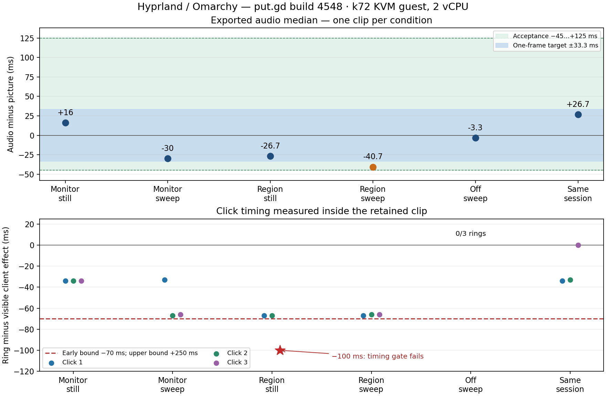

# Build 4548 / head 30eab18a8: requested retest completed

**Outcome: one click-timing gate FAIL; all other requested conditions and h PASS.** All four highlighted monitor/region clips show3/3 rings and every client click was received; swept off-control0/3. Region/still click3 is−100ms against the client-visible effect, outside the documented−70ms lower bound. Both independent pixel analysis and the installed package’s analyzer agree. Clip, before/effect frames and raw log retained; no recording was repeated and no product change was made. This is a timing finding, with no established product/fixture cause. Earlier build4538 a–g results remain accepted; the coordinator ruled its h product behaviour passed with an evidence gap. **That h gap is now closed by the retained final still on4548.**

[Published build4548 evidence](https://github.com/patrick-hudson/put.gd-evidence/tree/6f1fc2ef623000494e2034fc4f7ca98ce94d2f8f/records/2026-11-10-recording-1364-hyprland-4548) · [results/identities/scripts/cleanup](https://github.com/patrick-hudson/put.gd-evidence/tree/6f1fc2ef623000494e2034fc4f7ca98ce94d2f8f/records/2026-11-10-recording-1364-hyprland-4548/README.md) · [timing chart](https://raw.githubusercontent.com/patrick-hudson/put.gd-evidence/6f1fc2ef623000494e2034fc4f7ca98ce94d2f8f/records/2026-11-10-recording-1364-hyprland-4548/alignment-and-clicks.png).

Exact package from GREEN CI42784508070 (checked STATUS.md once per minute until handoff): `putgd-26.1110.4548dev.gf65c1053b22d-1-x86_64.pkg.tar.zst`, installed in fresh Omarchy4.5.0/Hyprland0.56.2-4 Wayland guest h4 on k72/192.168.68.72. Version `26.1110.4548-dev+gf65c1053b22d`; loaded dynamic distro Qt6.12.0. CI mergef65c1053b22d1c7e3a5905945ff7dcc1401dc3b7, treec516a5106b716035bf76b717c7e1a104983450b0; product source equals PR head30eab18a8fa9954438eaa48e9b417b177632b9fd (extra merge files are nightly timer/CI/docs only). PackageSHA256a77a2dbcedb1e796c78c548e103e4081024633cbda3a0e5f0a5cae8d06e847a4. Run d69b1fb4-fb74-4530-a825-cd92606aebba, QEMU2308047, KVM2vCPU/6144MiB,1280×800, accepted immutable golden bd74b783…69f3256. Socket paths50/33bytes (<107). No compilation by this worker and no workstation VM/build/encoding.

**Cursor path is recorder-drawn.** Guest permissions enforcement=false, output transform0, hardwareCursorsInUse=true. A separate post-matrix Ready-only protocol witness from actual package helperPID6445/recording4532c365-b781-4231-ade4-8d7238f0abd9 shows `create_pointer_cursor_session`, `get_capture_session`, `enter`, `position` and `hotspot`; [matching helper identity and cursor messages](https://raw.githubusercontent.com/patrick-hudson/put.gd-evidence/6f1fc2ef623000494e2034fc4f7ca98ce94d2f8f/records/2026-11-10-recording-1364-hyprland-4548/cursor-probe/cursor-witness.json). No compositor-paints-cursor fallback occurs in that probe or any recording debug log. The six recordings had no protocol tracing; they used only their separate `PUTGD_RECORD_DEBUG_LOG` files.

Driver is unchanged pushed `tools/lab/record_run.py`, equal to coordination `acceptance-1364/record_run-hide-bar-hyprland-hold.py`, SHA256aa7fec68b7c69c78c6443ff5c89c8a564f1fe584e522c93b01917a9c823ca31a. Every run uses `--hide-bar`; h also `--delayed-capture desktop:3`. The private wrapper only observes inspect and injects swept pointer input; recording/audio/countdown/frame gates are unchanged. Still input moves only for scripted clicks. Swept input has970/972/973 events for monitor/region/off, max gaps22.0/21.1/20.6ms; region0,0,1280,720. Ring timing is against the white client flash, not pointer arrival. The swept-input analysis rejects the arrow by requiring an annulus in3quadrants; calibrated on retained on/off clips and independently cross-checked against the package analyzer on still/h. Raw pointer-relative `clickCheck` values are preserved but not used for swept timing. Decoder retry only replaced FFmpeg’s removed `-vsync` with `-fps_mode passthrough` on these same retained clips; original error/script retained.

| Run | Click gate | Ring−client effect (ms) | Audio median (ms) | Export motion |
|---|---|---|---|---|
| m-still | PASS | -34, -34, -34 | +16 | 19.059 |
| m-sweep | PASS | -33, -67, -66 | -30 | 18.924 |
| r-still | FAIL timing | -67, -67, -100 | -26.7 | 21.012 |
| r-sweep | PASS | -67, -66, -66 | -40.7 | 21.033 |
| off | PASS | 0/3 rings | -3.3 | 18.926 |
| h | PASS | -34, -33, 0 | +26.7 | 19.062 |

All ring centres≤1px per axis. All audio medians meet−45..+125ms; region-sweep−40.7ms misses the±33.3ms target. One trial per condition; still/sweep differences do not establish cause. The r-still failure is visible in [ring before client effect](https://raw.githubusercontent.com/patrick-hudson/put.gd-evidence/6f1fc2ef623000494e2034fc4f7ca98ce94d2f8f/records/2026-11-10-recording-1364-hyprland-4548/runs/r-still/frames/third-ring-before-effect.png) and [client effect100ms later](https://raw.githubusercontent.com/patrick-hudson/put.gd-evidence/6f1fc2ef623000494e2034fc4f7ca98ce94d2f8f/records/2026-11-10-recording-1364-hyprland-4548/runs/r-still/frames/third-client-effect.png), with the [retained clip](https://raw.githubusercontent.com/patrick-hudson/put.gd-evidence/6f1fc2ef623000494e2034fc4f7ca98ce94d2f8f/records/2026-11-10-recording-1364-hyprland-4548/runs/r-still/out/pr-mp4-1.mp4) and [analyzer cross-check](https://raw.githubusercontent.com/patrick-hudson/put.gd-evidence/6f1fc2ef623000494e2034fc4f7ca98ce94d2f8f/records/2026-11-10-recording-1364-hyprland-4548/still-helper-crosscheck.json).

**h PASS, retained evidence:** both desktop operations completed after3.64/3.52s, each with5180countdown pixels, cover0.7748/all edges1.0. The recording between them has3/3 rings,+26.7ms audio and motion19.062. [Both still captures retained](https://github.com/patrick-hudson/put.gd-evidence/tree/6f1fc2ef623000494e2034fc4f7ca98ce94d2f8f/records/2026-11-10-recording-1364-hyprland-4548/runs/h/captures), including the previously missing final still. No frame-coverage gate failed in any of these runs.

| Run | Frame age least/mean/greatest (ms), n | Early dropped / cursor-only early dropped | Exact timestamps/frames lines |
|---|---|---|---|
| m-still | 9.5/11.4/50.9 ms (n=453) | 2 / 0 | [raw log](https://raw.githubusercontent.com/patrick-hudson/put.gd-evidence/6f1fc2ef623000494e2034fc4f7ca98ce94d2f8f/records/2026-11-10-recording-1364-hyprland-4548/runs/m-still/helper.debug) |
| m-sweep | 0.9/12.5/26.3 ms (n=280) | 0 / 0 | [raw log](https://raw.githubusercontent.com/patrick-hudson/put.gd-evidence/6f1fc2ef623000494e2034fc4f7ca98ce94d2f8f/records/2026-11-10-recording-1364-hyprland-4548/runs/m-sweep/helper.debug) |
| r-still | 9.7/12.2/34.8 ms (n=292) | 0 / 0 | [raw log](https://raw.githubusercontent.com/patrick-hudson/put.gd-evidence/6f1fc2ef623000494e2034fc4f7ca98ce94d2f8f/records/2026-11-10-recording-1364-hyprland-4548/runs/r-still/helper.debug) |
| r-sweep | 1.0/9.8/29.4 ms (n=297) | 0 / 0 | [raw log](https://raw.githubusercontent.com/patrick-hudson/put.gd-evidence/6f1fc2ef623000494e2034fc4f7ca98ce94d2f8f/records/2026-11-10-recording-1364-hyprland-4548/runs/r-sweep/helper.debug) |
| off | 9.2/11.6/31.3 ms (n=447) | 10 / 0 | [raw log](https://raw.githubusercontent.com/patrick-hudson/put.gd-evidence/6f1fc2ef623000494e2034fc4f7ca98ce94d2f8f/records/2026-11-10-recording-1364-hyprland-4548/runs/off/helper.debug) |
| h | 9.8/11.5/27.4 ms (n=441) | 3 / 0 | [raw log](https://raw.githubusercontent.com/patrick-hudson/put.gd-evidence/6f1fc2ef623000494e2034fc4f7ca98ce94d2f8f/records/2026-11-10-recording-1364-hyprland-4548/runs/h/helper.debug) |

The cursor-only number counts early drops, not all cursor frames; it is0in these runs and does not by itself establish ownership (the protocol witness does). Full raw debug files contain the requested `timestamps: … frame age …` and `frames: … cadence lock … early dropped` lines for every case.

Host snapshots show its existing Plasma desktop, VNC/watchdog,btop and light Python services; no other guest/build/heavy work during measurement. Only guest-private null audio sinks, no host audio devices; microphone off. Defaults restored; no simulated modules/players left.108 selected guest files checksum-verified; explicit export allowlist excludes generated profile/config/cache/data and cookies. Old cookie-history note remains unchanged. Guest synced/stopped, guarded overlay retirement completed with failed outcome for the timing gate, tunnel stopped, wall tile removed, QEMU2308047 and all owned builder processes absent; named scratch/key files and dedicated workstation agent removed. Immutable golden and host evidence preserved. Plot generation ran on k72 after guest shutdown.

## Earlier build4538 reports (historical)

The old driver’s h FAIL below was subsequently ruled a product pass with the fixture/evidence gap by the coordinator. It does not supersede the fully retained new-build h result above.

# Current follow-up: g PASS, h FAIL with the supplied hide-bar driver

Used the coordinator-requested `acceptance-1364/record_run-hide-bar.py --hide-bar` unchanged (SHA256 `410d4093573743f088c5bfa9fd6ac14b114b43cbc575b3992f2636b3f58ff00e`) in a new h3 Omarchy guest on k72, same CI Arch package/build4538 and loaded Qt6.12.0. **No frame-gate changes are used in these results.** The shared `acceptance-1364/record_run.py` was restored byte-for-byte (SHA256 `e5f1764ff963e974c3755267abb932ecc9aaccf0b23446b89767026fbe68398e`); my added helper was removed. The earlier exact-rectangle attempt had completed before the coordinator’s later correction arrived; it is superseded, remains private, and its h2 guest was retired.

The documented case is an expected in-clip Stop handle: a direct live `recording.inspect` on h3 reports `overlayExcluded:false`, `overlayPlacement:handle`. Raw reply: [inspect-monitor.json](https://raw.githubusercontent.com/patrick-hudson/put.gd-evidence/f541f828bebc204ac35d69eff8422a7ddd22684e/records/2026-11-10-recording-1364-hyprland-4538-hide-bar/inspect-monitor.json). The supplied driver successfully used the supported overlay API at Ready, and every round records `barHidden:true`. Ordinary recording-frame edge scores are1.0 on all sides in all three reruns. No ignored pixels or gate exemptions.

- **g PASS:** monitor highlights-on3/3; ring minus client-visible effect0/0/0ms, centers≤0.7px per axis. Off0/3. Every client click received; validated working/export clips retained. Export motion19.064/19.062. Original region/window and bind/config checks remain as reported.
- **h FAIL with the supplied driver (exit1):** both delayed operations completed in3.56/3.67s with5180countdown pixels each. The intervening retained recording has3/3 rings, corrected timing−33/−33/0ms and motion33.396. The final still failed `uncovered_edge` (cover0.6948; top0.0,bottom0.6133,left/right0.7169): the surviving after-frame shows the cover is no longer fullscreen, exposing the desktop panel, wallpaper margins and window border. The supplied driver deleted that PNG. No workaround or rerun after this failure; no product defect is inferred.

[Published follow-up evidence](https://github.com/patrick-hudson/put.gd-evidence/tree/f541f828bebc204ac35d69eff8422a7ddd22684e/records/2026-11-10-recording-1364-hyprland-4538-hide-bar) includes the validated clips/frames, first passing delayed still, commands, results/logs, exact driver and source/build/session identities. Generated profile/config/cache/data directories are excluded by an explicit artifact allowlist;44selected files were checksum-verified. Failed-gate visuals were not published: surviving final-countdown/after-frame screenshots and cover log are private at `/home/patrick/work/putgd-evidence/2026-11-09-features/hyprland-1364-hide-private/` and k72 `~/work/h1364/evidence-hide/` (0700/0600). The original cookie note and evidence history below remain unchanged.

h3 run `3ae1bf23-ba18-4615-aecc-839b0a0e9463`, QEMU PID2292288, KVM2vCPU/6144MiB,1280×800. k72 had its existing Plasma desktop, VNC/watchdog,btop and light Python services, no other guest/build/heavy work. Only guest-private null audio sinks used; defaults restored and simulated modules/players absent. Guest synced/stopped; guarded overlay retirement completed with failed outcome recorded; tunnel stopped, wall entry removed, QEMU and owned launcher absent. Named scratch/key files and dedicated workstation bootstrap agent removed; immutable goldens and host evidence preserved.

The original a–f measurements and first-attempt history follow; the g/h table reflects this follow-up.

# Hyprland recording acceptance, PR 1372 build 4538

Current outcome: a–g PASS; h FAIL with the supplied hide-bar driver (final delayed still fails fixture coverage). The first attempt’s deleted monitor clips are superseded by the retained monitor-on/off clips in the follow-up below. No product changes or workarounds. All recordings actually ran on a fresh accepted Omarchy overlay on k72, with the Arch CI package installed.

PR head cccf91a501247dce525217271b78b4665b0fbd0d; successful CI 42774290115; package putgd-26.1110.4538dev.g1d19e1e8ac50-1-x86_64.pkg.tar.zst, SHA256 ee20d5f70d49e7649da367291517a29a15b3679d6ba728b43cae2095744f87e1. Build 26.1110.4538-dev+g1d19e1e8ac50; source tree 93ae895ea84a5a19a2b3de877573aa9f3189e480 exactly matches PR. Loaded Qt 6.12.0 (startup log), dynamically linked distro Qt. Hyprland 0.56.2-4, native Wayland, Omarchy 4.5.0 golden bd74b7832c4a43f15a06f5a5b448e670a77d33ae75516b5bc5856773b69f3256. Guest run 9fc1fe85-ccc9-4c04-9c41-9b5d84ff4ed7, QEMU PID 2281156, KVM, 2 vCPU / 6144 MiB, 1280×800; host k72/192.168.68.72 (4 physical cores, 15 GiB). Golden streamed from f44 and verified in about four minutes while CI ran; no fallback, no build or VM on workstation, no compilation on builder.

Host had its existing Plasma/Wayland desktop, VNC/watchdog, btop and light Python services running. No other QEMU or build workload; top CPU consumer throughout was this one guest. Saved host samples give exact process IDs, names, loads and resource use. No host audio devices passed to guest. Only simulated microphone and private null sinks used; source/sink auto_null.monitor/auto_null restored, no putgd_lab modules or tone players remained. A detached clipboard keeper was confined to this disposable guest and ended with it.

Driver: coordination acceptance-1364/record_run.py, obtained by applying its record_run-delayed-capture-fix.patch to a private copy of the PR driver. Preserved lab/record_run.py includes observational bind/config receipts, intentional cancel/helper-death probes, and the previously documented Hyprland fullscreen focus hold/restoration for every target. Fixture lab/cover_player.py is the earlier client-flash fixture, with its flash moved to x40..140,y280..320 (inside region), plus button-receipt logging. No tracked checkout edits. Scripts and exact commands are preserved. Socket preflight: /run/user/1000/putgd/session.sock = 33 bytes, VM qmp.sock = 49 bytes, below 107.

Audio-minus-picture medians below are exported values, in ms. Acceptance bound −45..+125; one-frame target ±33.3. All a–f clips pass saved visual checks and contain real motion.

| Item | Result | Measurements |
|---|---|---|
| a microphone alone | PASS | MP4 −29.3 (12 pairs, motion 30.916); WebM −15.5 (13, 20.331); 1 kHz peaks 0.3454/0.3455, both saved |
| b mixed, 3-second pause | PASS | MP4 −24.7 / WebM −14.5, 16 pairs each; pause capture step +0.5/−0.3 ms; 1 kHz peaks 0.3454/0.3477, 440 Hz median 0.0169; motion 33.077/6.831 |
| c system-only WebM, three runs | PASS bound | −12.5 (17 pairs, motion45.833), −11.5 (17,45.843), −40.5 (16,7.560). Third misses one-frame target. Same-guest nightly v26.1109.4346 control +34 MP4, +23.5 WebM (16 pairs each). PR median absolute error12.5 vs nightly23.5; worst40.5 is17 ms beyond nightly WebM absolute error, within documented≈20 ms run scatter. No reproduced−73.5ms result. |
| d toggle off, mic tone playing | PASS | Mic source false; 1 kHz peak0.0002 (<0.003), 440Hz median0.0169, motion20.313. Single-pair102ms is not a meaningful mic sync measurement: mic tone is absent. |
| e unplug at ~6 seconds | PASS | Unplug6.256s; inspect stays recording and reports microphoneLost. 14.289s requested recording,15.867s playable export, motion33.069; six burst pairs, median−24; 440Hz peak0.0054 (<0.008 leakage bound). |
| f Ready device following | PASS | none→plugged(off)→on→pulled(requested true/effective false)→back(effective true). Driver waits0.02/0.05/0.95/0.03s after causes, all<8s. Saved per-step frames; recording9 pairs,+2.7ms,motion7.558. |
| g click targets, off, cleanup | PASS | Fresh h3 monitor-on/off reruns with unmodified record_run-hide-bar.py --hide-bar retained working/export clips: 3/3 rings on; 0/3 off. Monitor ring−client flash0/0/0ms, centers within0.7px per axis. Original retained region/window results and bind/config cleanup receipts remain valid. |
| h same resident delayed capture then clicks | FAIL (fixture coverage) | Supplied hide-bar driver exit1. Both capture operations completed after3.56/3.67s, countdown5180pixels each. Intervening retained recording:3/3 rings, ring−client flash−33/−33/0ms, motion33.396. Final still failed uncovered_edge: cover0.6948, top0.0/bottom0.6133/left-right0.7169. Cover lost fullscreen, exposing desktop edges; supplied driver deleted that PNG. Surviving failure frames/log saved privately; no workaround. |

Bind cleanup: baseline254; monitor/region while recording257 (3 non-consuming runtime mouse binds); after Stop254, after cancellation254, after killing exact helper PID12534 mid-recording254; zero click binds after all endings. Immediate post-start samples in some runs precede async bind registration (254). All ~/.config/hypr file sets and SHA256s identical before/recording/after in every receipt; no configuration file written. Killing helper and cancelling intentionally produce recording_unavailable in driver output; these are cleanup probes, not claims of spontaneous product failure.

Frame-gate failure detail: monitor, off and h have cover fraction0.7654 and bottom/right edge scores0.8915/0.9536, reason uncovered_edge; surviving ring frame shows put.gd's own bottom-right Stop bar over the cover. The driver reported exit0 despite failed frame validation and deleted both clips itself. Earlier provisional success messages were superseded by this final review. r/*/results.json, surviving ring PNGs, raw logs and region/window clips retained. Do not treat this as complete desktop acceptance. Failed postprocessing attempts initially lacked a display environment, then revealed the missing deleted clips; the final analyzer uses offscreen only to decode retained real-desktop clips, never as desktop evidence.

Pictures, annotated with this installed build's own image editor: pictures/microphone-on.png (toggle on and live meter); pictures/no-microphone.png (No microphone); pictures/click-ring.png (retained region clip with ring). Raw originals and image-editor automation preserved. The initial annotation polling hit editor_starting; retry waits for that normal state before applying shapes.

232 exported guest files verified by SHA256 with zero mismatches before shutdown. Guest synced; sudo poweroff unavailable under its narrow sudo policy, so lab.py reset stopped exact owned QEMU. Tunnel putgd-vm-h1364-k72 stopped and wall5984 entry removed. Guarded overlay cleanup and final builder sweep receipts accompany this record. Immutable source goldens preserved. No PR/branch/earlier status edits; no subagents.

Publication correction: the first evidence commit included a generated PulseAudio cookie from the private bar-profile configuration. Removed with generated profile/cache/data files in commit 1ff3f302592139da5ffdfba57fb686231475b0fa. The disposable guest/audio server was already destroyed; the obsolete cookie remains in the earlier Git commit. No history rewrite was attempted.

Evidence: [2026-11-10-recording-1364-hyprland-4538](https://github.com/patrick-hudson/put.gd-evidence/tree/1ff3f302592139da5ffdfba57fb686231475b0fa/records/2026-11-10-recording-1364-hyprland-4538)

- Ready bar: microphone on with the live simulated-input meter. Build 26.1110.4538-dev+g1d19e1e8ac50, Hyprland/Wayland on k72 Omarchy guest: https://raw.githubusercontent.com/patrick-hudson/put.gd-evidence/1ff3f302592139da5ffdfba57fb686231475b0fa/records/2026-11-10-recording-1364-hyprland-4538/pictures/microphone-on.png
- Ready bar: No microphone after device removal. Build 26.1110.4538-dev+g1d19e1e8ac50, Hyprland/Wayland on k72 Omarchy guest: https://raw.githubusercontent.com/patrick-hudson/put.gd-evidence/1ff3f302592139da5ffdfba57fb686231475b0fa/records/2026-11-10-recording-1364-hyprland-4538/pictures/no-microphone.png
- Retained region recording: click ring; arrow and label drawn by this build’s image editor. Build 26.1110.4538-dev+g1d19e1e8ac50, Hyprland/Wayland on k72 Omarchy guest: https://raw.githubusercontent.com/patrick-hudson/put.gd-evidence/1ff3f302592139da5ffdfba57fb686231475b0fa/records/2026-11-10-recording-1364-hyprland-4538/pictures/click-ring.png

Cleanup complete: QEMU2281156, launcher2281045 and host sampler2283869 absent; exact helper kill probe12534; guest3276 campaign ended before shutdown. Tunnel inactive, wall entry removed, overlay retirement status completed. Removed22 named owned scratch files; retained immutable copied golden and host-side evidence/source/retirement receipts. Workstation temporary bootstrap key and its dedicated SSH agent removed.
