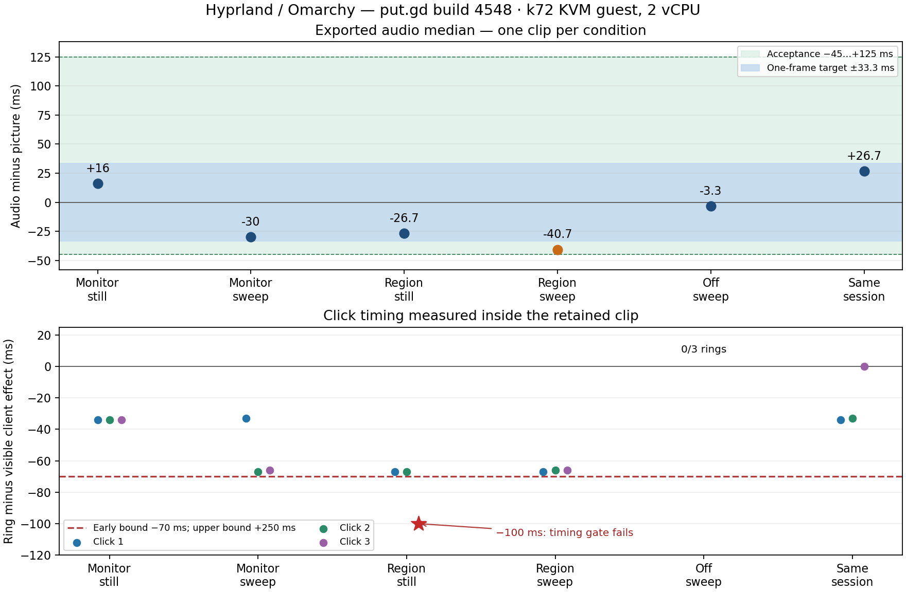

# Hyprland build 4548 cursor-frame follow-up

Outcome: one click-timing gate FAIL; the remaining requested cases and h PASS. All on-runs show3/3 rings, every client click was received, and the off-control shows0/3. Region/still click3 is100ms before its client-visible flash, outside the documented−70ms lower bound. Both independent pixel analysis and the package’s own analyzer agree. No recording was repeated to improve the result; no product change was made. Clips, before/effect frames and raw logs retained. Cause not established: ring−client-effect timing does not independently separate application painting, capture and recorder latency.

## Exact build and session

NEW HEAD30eab18a8fa9954438eaa48e9b417b177632b9fd, successful CI42784508070; waited for the explicit GREEN STATUS.md handoff, checking once per minute, then downloaded its release-native-archlinux artifact. Installed package putgd-26.1110.4548dev.gf65c1053b22d-1-x86_64.pkg.tar.zst, SHA256a77a2dbcedb1e796c78c548e103e4081024633cbda3a0e5f0a5cae8d06e847a4. Actual build26.1110.4548-dev+gf65c1053b22d, merge commitf65c1053b22d1c7e3a5905945ff7dcc1401dc3b7, treec516a5106b716035bf76b717c7e1a104983450b0. Its other parent is nightly77c9d278d5a2274a9c74d674bea2c5a2bd062c37; differences from PR head are timer/CI/docs files only (metadata/ci-merge-diff.txt), no product source changes. Loaded dynamically linked distro Qt6.12.0 in every startup identity. No compilation by this worker, no builds or VMs on the workstation.

Fresh Omarchy4.5.0/Hyprland0.56.2-4 native Wayland guest h4 on k72/192.168.68.72, run d69b1fb4-fb74-4530-a825-cd92606aebba, QEMU PID2308047, KVM,2vCPU/6144MiB,1280×800, one output. Golden SHA256bd74b7832c4a43f15a06f5a5b448e670a77d33ae75516b5bc5856773b69f3256. Verified visible unlocked desktop over wall port5984, VNC5964; socket preflight QMP50bytes/session33bytes (limit107). Host had its existing Plasma/Wayland desktop, VNC/watchdog,btop and light background Python services; no other guest, build or heavy workload beside this guest. Host snapshots saved. Plot dependencies/plotting were done on k72 only after guest shutdown.

Only synthetic marker audio and guest-private null sinks; microphone off, no host audio devices passed through. auto_null.monitor/auto_null restored, no putgd_lab modules or tone players left.

## Cursor route: recorder-drawn, confirmed

Guest ecosystem:enforce_permissions is false; monitor transform0, hardwareCursorsInUse:true, cursor:no_hardware_cursors2(auto). To avoid relying only on absent fallback messages, a separate Ready-only protocol witness prepared the same highlighted monitor target through the installed app/CLI, with no audio or timing recording. Actual helper PID6445 belongs to recording4532c365-b781-4231-ade4-8d7238f0abd9. Its stderr shows create_pointer_cursor_session, get_capture_session, enter, position and hotspot on cursor-session#14. See cursor-probe/cursor-witness.json, including the matching Helper started record, and cursor-probe/inspect.json (clickHighlights:true). No compositor-paints-cursor fallback is in its debug log or any of the six recording logs. This witnesses an actual cursor session in use; the known installed source draws that cursor itself. Protocol tracing was confined to this post-matrix Ready-only probe. All six timing runs used only PUTGD_RECORD_DEBUG_LOG, not protocol tracing.

## Driver and measurement

Used the pushed tools/lab/record_run.py unchanged, equal to coordination acceptance-1364/record_run-hide-bar-hyprland-hold.py, SHA256aa7fec68b7c69c78c6443ff5c89c8a564f1fe584e522c93b01917a9c823ca31a. --hide-bar on every run; h uses --delayed-capture desktop:3. The pushed driver holds/restores Hyprland’s fullscreen option for delayed-capture runs. No shared driver, branch, product or gate edits. A private wrapper only records inspect receipts and injects continuous pointer input; it imports the pushed driver, leaving acquisition, audio, countdown and frame gates unchanged.

Still input is the original scripted moves2.5s before each press, otherwise stationary. Swept input runs~60Hz in the cover’s plain area, jumps to each requested press and moves within1px while the button is held60ms (below drag threshold), then resumes the sweep. Saved pointer-events traces have970/972/973 events for monitor-sweep/region-sweep/off, maximum gaps22.0/21.1/20.6ms. Region is0,0,1280,720; all clicks/marker/flash are inside. Fixture is the earlier client-flash cover, flash at90,300, with client button logging.

Ring timing is the ring’s first frame minus the client-visible flash in the same retained clip. The separate analysis requires a green-bearing annulus in at least3 quadrants outside radius4, rejecting a moving arrow at its hotspot; it fits the circle centre on the other quadrants. It was calibrated on prior retained on/off clips and the off-control here also rejects all arrows. For still runs and h, the installed putgd-record --click-check independently agrees on ring first frames (within1ms rounding); r-still’s third offset is−100ms with both methods. Raw legacy clickCheck results remain in results.json: its pointer-arrival reference does not apply to continuously swept input. The row uses ring-effect.json, summary.json and still-helper-crosscheck.json, not that legacy reference. The only analysis retry corrected FFmpeg’s removed -vsync option to -fps_mode passthrough on the same clips; original script/error retained, no recording repeated.

## Results

Audio-minus-picture export medians in ms. Acceptance−45..+125; one-frame target±33.3. Click bound−70..+250ms. Each condition is one clip, not a causal or statistical comparison. Every working/export clip decodes and has real motion; no privacy/frame gate failed.

| Run | Click gate | Ring−client effect, ms | Audio median, ms | Pairs | Export motion |
|---|---|---|---|---|---|
| m-still | PASS | -34, -34, -34 | +16 | 16 | 19.059 |
| m-sweep | PASS | -33, -67, -66 | -30 | 16 | 18.924 |
| r-still | FAIL timing | -67, -67, -100 | -26.7 | 16 | 21.012 |
| r-sweep | PASS | -67, -66, -66 | -40.7 | 13 | 21.033 |
| off | PASS | none (0/3) | -3.3 | 16 | 18.926 |
| h | PASS | -34, -33, 0 | +26.7 | 16 | 19.062 |

All ring centres≤1px per axis; all three client clicks are logged for every case (GTK bubbles each twice). Region-sweep audio−40.7ms meets the acceptance bound but misses the one-frame target. The still/sweep median differences are46.0ms on monitor and14.0ms on region; these single runs do not establish a cause. Raw timing diagnostics below are retained for that assessment. All cursor-only-early-drop counts are0; this counter counts early drops, not total cursor frames, so it alone does not establish cursor ownership.

h closes the earlier evidence gap: both desktop operations completed and are retained, before3.64s/after3.52s, cover0.7748 and all edge fractions1.0, countdown5180changed pixels each; the intervening recording has3/3 rings and+26.7ms audio median. Both final still and countdown witnesses are in runs/h/captures and runs/h/frames.



## Exact helper timing lines

Values in each range are least/mean/greatest, with n retained. Debug times are guest local UTC−6; matrix.log timestamps use UTC.

### m-still

```text
2026-11-10T03:03:46.969 timestamps: clock GstSystemClock, video lateness -5.6/121.9/1715.5 ms (n=532), audio lateness -4.8/6.3/20.7 ms (n=1767), frame age 9.5/11.4/50.9 ms (n=453), arrival-stamped frames 0, audio re-anchored 0 times
2026-11-10T03:03:46.969 frames: 532 reached the video encoder, 0 leaked at the capture queue; source arrivals 460 (interval 12.7/35.1/111.6 ms (n=459)), 0 with a repeated compositor time, contents 429 new / 7 same dropped, cadence lock 2 early dropped (0 of them cursor-only frames) / 30 resyncs / 0 changes slotted after a repeat
```

### m-sweep

```text
2026-11-10T03:04:40.771 timestamps: clock GstSystemClock, video lateness 9.0/137.4/1654.5 ms (n=532), audio lateness -3.5/7.1/35.6 ms (n=1767), frame age 0.9/12.5/26.3 ms (n=280), arrival-stamped frames 0, audio re-anchored 0 times
2026-11-10T03:04:40.772 frames: 532 reached the video encoder, 1 leaked at the capture queue; source arrivals 516 (interval 16.8/31.5/89.5 ms (n=515)), 0 with a repeated compositor time, contents 275 new / 236 same dropped, cadence lock 0 early dropped (0 of them cursor-only frames) / 203 resyncs / 0 changes slotted after a repeat
```

### r-still

```text
2026-11-10T03:05:30.470 timestamps: clock GstSystemClock, video lateness 8.9/140.1/1677.3 ms (n=531), audio lateness -0.1/20.2/35.7 ms (n=1766), frame age 9.7/12.2/34.8 ms (n=292), arrival-stamped frames 0, audio re-anchored 0 times
2026-11-10T03:05:30.470 frames: 531 reached the video encoder, 0 leaked at the capture queue; source arrivals 294 (interval 21.5/55.2/147.4 ms (n=293)), 0 with a repeated compositor time, contents 281 new / 2 same dropped, cadence lock 0 early dropped (0 of them cursor-only frames) / 171 resyncs / 0 changes slotted after a repeat
```

### r-sweep

```text
2026-11-10T03:06:23.622 timestamps: clock GstSystemClock, video lateness 8.6/132.1/1619.5 ms (n=530), audio lateness -11.4/-0.9/16.9 ms (n=1763), frame age 1.0/9.8/29.4 ms (n=297), arrival-stamped frames 0, audio re-anchored 0 times
2026-11-10T03:06:23.622 frames: 530 reached the video encoder, 1 leaked at the capture queue; source arrivals 397 (interval 23.6/40.8/114.2 ms (n=396)), 0 with a repeated compositor time, contents 221 new / 100 same dropped, cadence lock 0 early dropped (0 of them cursor-only frames) / 192 resyncs / 0 changes slotted after a repeat
```

### off

```text
2026-11-10T03:07:12.869 timestamps: clock GstSystemClock, video lateness -9.4/123.0/1638.5 ms (n=533), audio lateness -4.1/16.4/32.5 ms (n=1770), frame age 9.2/11.6/31.3 ms (n=447), arrival-stamped frames 0, audio re-anchored 0 times
2026-11-10T03:07:12.869 frames: 533 reached the video encoder, 1 leaked at the capture queue; source arrivals 447 (interval 16.6/36.3/110.6 ms (n=446)), 0 with a repeated compositor time, contents 447 new / 0 same dropped, cadence lock 10 early dropped (0 of them cursor-only frames) / 50 resyncs / 0 changes slotted after a repeat
```

### h

```text
2026-11-10T03:08:08.619 timestamps: clock GstSystemClock, video lateness -2.4/121.5/1636.0 ms (n=533), audio lateness -10.3/0.6/16.8 ms (n=1767), frame age 9.8/11.5/27.4 ms (n=441), arrival-stamped frames 0, audio re-anchored 0 times
2026-11-10T03:08:08.619 frames: 533 reached the video encoder, 0 leaked at the capture queue; source arrivals 456 (interval 11.0/35.6/111.9 ms (n=455)), 0 with a repeated compositor time, contents 424 new / 15 same dropped, cadence lock 3 early dropped (0 of them cursor-only frames) / 44 resyncs / 0 changes slotted after a repeat
```

## Retention and cleanup

108 selected guest files verified by SHA256 after export; export is an explicit allowlist of validated clips/frames, debug logs, inspect/pointer receipts, scripts and identities. Generated config/profile/cache/data trees and PulseAudio cookies excluded. Existing cookie-history note stays unchanged. Timing-failure clips are valid covered synthetic content and are retained/published; no frame-coverage failure occurred in this build.

Guest synced and stopped, tunnel putgd-vm-h1364-k72-new stopped, wall entry removed, guarded overlay cleanup completed with outcome failed (for the one timing gate), QEMU2308047 absent and no owned builder processes left. Named owned scratch/key files removed; source golden and host-side evidence/retirement receipts preserved. The dedicated workstation bootstrap key/agent were removed after collection. Earlier build4538 results remain historical and accepted per coordinator; they are not claimed to be rerun here.
