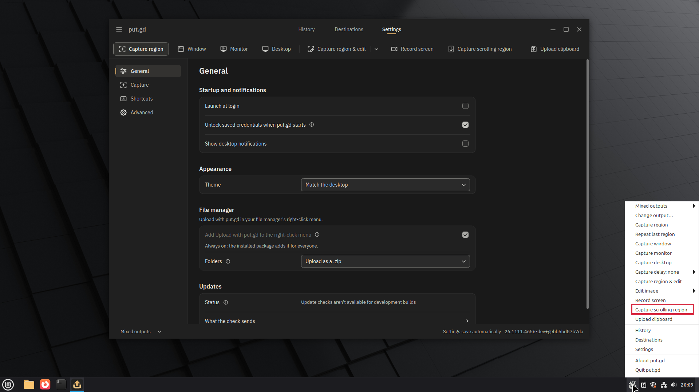
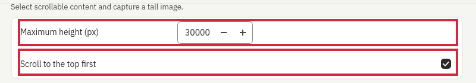
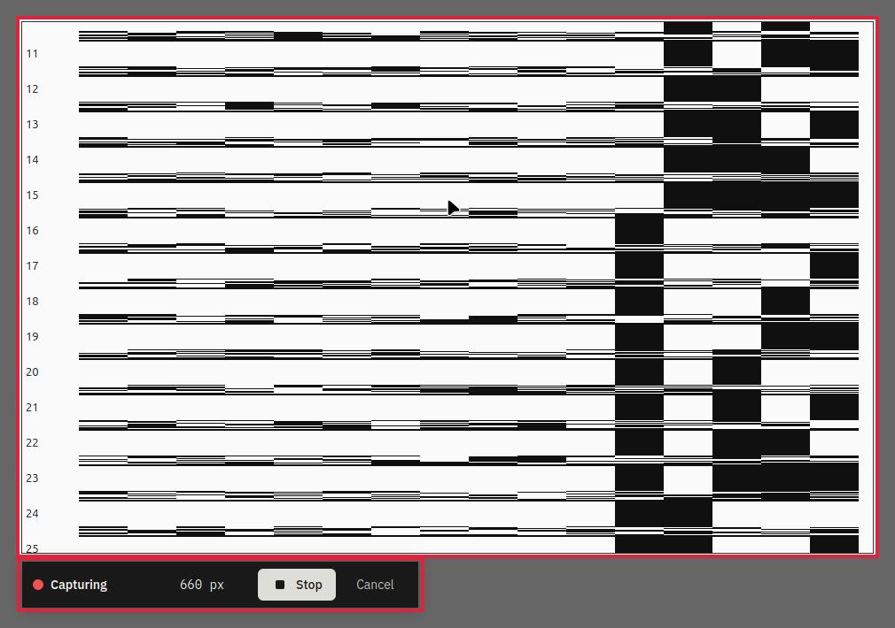
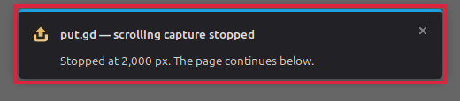

Part of #1376

Select a scrollable region and put.gd captures it as one tall PNG, then sends it through the usual save, upload and history flow. It scrolls to the top first by default; Settings control that choice and the maximum height. Stop keeps the image so far, Cancel discards it, and the same controls are available through the CLI and MCP. An unproved top is reported explicitly rather than silently calling a suffix the whole page.

**Confirmation on `eaa1ba198fa537d3cac58879b676ad34e268b96a`: 140 exact images, seven correct intentional Stop viewports, zero wrong admitted images; all 147 requested cases run. Overall desktop acceptance is still blocked:** GNOME Shell crashed during an additional prepare/cancel/quit teardown operation after its matrix completed. Its backtrace starts in Mutter window placement through GJS; regression status is unproven. [Trigger and operation ID](https://github.com/patrick-hudson/put.gd-evidence/blob/2c0ceb8411aa4978be06aa5ed3635c6e4ff48a45/records/2026-11-11-scroll-confirm-1398/native/f44/cleanup-crash.json), [backtrace](https://github.com/patrick-hudson/put.gd-evidence/blob/2c0ceb8411aa4978be06aa5ed3635c6e4ff48a45/records/2026-11-11-scroll-confirm-1398/native/f44/gnome-shell-core-info.txt), [full confirmation record](https://github.com/patrick-hudson/put.gd-evidence/blob/2c0ceb8411aa4978be06aa5ed3635c6e4ff48a45/records/2026-11-11-scroll-confirm-1398/README.md). The desktop was restored and every lab lease released. This PR remains a draft.

CI run [42975726725](https://github.com/patrick-hudson/put.gd-desktop/actions/runs/42975726725) passed the required CI summary. The tested CI packages identify GitHub merge `47f90af4ed8bda4630c5865fe82023460f4b4697`, whose second parent is the PR head. Native packages were tested on m74/f44/d69, and the CI AppImage in the four guests; nothing was compiled for this pass. [Every downloaded file's SHA-256](https://github.com/patrick-hudson/put.gd-evidence/blob/2c0ceb8411aa4978be06aa5ed3635c6e4ff48a45/records/2026-11-11-scroll-confirm-1398/artifact-sha256.json).

### Tray entry

### Settings

### During capture

### Height-cap warning

These clean UI pictures are from the permitted physical pass 3. They were annotated and cropped through put.gd's own editor using the current CI build. The 2,000 px warning illustrates a custom cap; the default is 30,000. [Picture provenance and hashes](https://github.com/patrick-hudson/put.gd-evidence/blob/2c0ceb8411aa4978be06aa5ed3635c6e4ff48a45/records/2026-11-11-scroll-confirm-1398/pictures/provenance.json), [editor RPC record](https://github.com/patrick-hudson/put.gd-evidence/blob/2c0ceb8411aa4978be06aa5ed3635c6e4ff48a45/records/2026-11-11-scroll-confirm-1398/pictures/editor.jsonl). All tables below describe this confirmation build.

### Confirmation results

Exact includes the intentionally capped exact prefix. Honest stop is the requested Stop during the way up: the PNG equals the current viewport, has no pointer pixels, and reports `topReached: false`. All completed from-end runs begin at row/line 0, prove the top and end `end_of_content`. Way-up times are the helper's measured milliseconds converted to seconds, in run order. All seven agent-only MCP runs started at the ruler's end; their fetched PNGs were verified. Rulers were checked on every scanline and full barcode cells; text by 1,500 distinct line bands, pitch and background. Harness refusals and supplemental banner probes are kept separate in the record.

### Cinnamon X11 — Mint 22.3

| Case | Exact | Honest stop | Wrong | Way up, seconds (each run) |
|---|---:|---:|---:|---|
| 24,000 px ruler, from end | 3 | 0 | 0 | 3.228 / 3.231 / 3.762 |
| Qt text, 1,500 lines, from end | 3 | 0 | 0 | 4.585 / 4.448 / 4.595 |
| GTK 4 text, 1,500 lines, from end | 2 | 0 | 0 | 4.698 / 4.699 |
| Browser ruler, from end | 3 | 0 | 0 | 2.657 / 2.668 / 2.653 |
| Halfway, fromTop off | 1 | 0 | 0 | — |
| Plain native ruler, from top | 3 | 0 | 0 | — |
| Browser ruler, from top | 2 | 0 | 0 | — |
| Stop on way up | 0 | 1 | 0 | — |
| Height cap 2,000; warning + loopback | 1 | 0 | 0 | — |
| Immediate next capture | 1 | 0 | 0 | — |
| Agent-only MCP, from end; fetched PNG | 1 | 0 | 0 | 3.406 |
| **Total** | **20** | **1** | **0** | |

### GNOME 50.6 Wayland — Fedora 44

| Case | Exact | Honest stop | Wrong | Way up, seconds (each run) |
|---|---:|---:|---:|---|
| 24,000 px ruler, from end | 3 | 0 | 0 | 4.871 / 5.597 / 4.996 |
| Qt text, 1,500 lines, from end | 3 | 0 | 0 | 5.105 / 5.041 / 5.062 |
| GTK 4 text, 1,500 lines, from end | 2 | 0 | 0 | 5.439 / 4.741 |
| Browser ruler, from end | 3 | 0 | 0 | 2.671 / 2.690 / 2.724 |
| Halfway, fromTop off | 1 | 0 | 0 | — |
| Plain native ruler, from top | 3 | 0 | 0 | — |
| Browser ruler, from top | 2 | 0 | 0 | — |
| Stop on way up | 0 | 1 | 0 | — |
| Height cap 2,000; warning + loopback | 1 | 0 | 0 | — |
| Immediate next capture | 1 | 0 | 0 | — |
| Agent-only MCP, from end; fetched PNG | 1 | 0 | 0 | 5.043 |
| **Total** | **20** | **1** | **0** | |

### Plasma 6.3.6 Wayland — Debian 13

| Case | Exact | Honest stop | Wrong | Way up, seconds (each run) |
|---|---:|---:|---:|---|
| 24,000 px ruler, from end | 3 | 0 | 0 | 5.060 / 3.631 / 3.520 |
| Qt text, 1,500 lines, from end | 3 | 0 | 0 | 17.505 / 17.602 / 15.853 |
| GTK 4 text, 1,500 lines, from end | 2 | 0 | 0 | 6.603 / 20.316 |
| Browser ruler, from end | 3 | 0 | 0 | 3.306 / 3.460 / 3.462 |
| Halfway, fromTop off | 1 | 0 | 0 | — |
| Plain native ruler, from top | 3 | 0 | 0 | — |
| Browser ruler, from top | 2 | 0 | 0 | — |
| Stop on way up | 0 | 1 | 0 | — |
| Height cap 2,000; warning + loopback | 1 | 0 | 0 | — |
| Immediate next capture | 1 | 0 | 0 | — |
| Agent-only MCP, from end; fetched PNG | 1 | 0 | 0 | 5.054 |
| **Total** | **20** | **1** | **0** | |

### Hyprland 0.56.2 — Omarchy

| Case | Exact | Honest stop | Wrong | Way up, seconds (each run) |
|---|---:|---:|---:|---|
| 24,000 px ruler, from end | 3 | 0 | 0 | 15.612 / 13.316 / 14.214 |
| Qt text, 1,500 lines, from end | 3 | 0 | 0 | 8.739 / 9.238 / 9.347 |
| GTK 4 text, 1,500 lines, from end | 2 | 0 | 0 | 9.212 / 9.073 |
| Browser ruler, from end | 3 | 0 | 0 | 2.505 / 2.458 / 2.064 |
| Halfway, fromTop off | 1 | 0 | 0 | — |
| Plain native ruler, from top | 3 | 0 | 0 | — |
| Browser ruler, from top | 2 | 0 | 0 | — |
| Stop on way up | 0 | 1 | 0 | — |
| Height cap 2,000; warning + loopback | 1 | 0 | 0 | — |
| Immediate next capture | 1 | 0 | 0 | — |
| Agent-only MCP, from end; fetched PNG | 1 | 0 | 0 | 20.172 |
| **Total** | **20** | **1** | **0** | |

### Budgie / labwc 0.20.2 — Fedora 45

| Case | Exact | Honest stop | Wrong | Way up, seconds (each run) |
|---|---:|---:|---:|---|
| 24,000 px ruler, from end | 3 | 0 | 0 | 6.915 / 8.462 / 8.698 |
| Qt text, 1,500 lines, from end | 3 | 0 | 0 | 7.395 / 7.597 / 7.402 |
| GTK 4 text, 1,500 lines, from end | 2 | 0 | 0 | 6.273 / 5.325 |
| Browser ruler, from end | 3 | 0 | 0 | 3.033 / 2.996 / 2.996 |
| Halfway, fromTop off | 1 | 0 | 0 | — |
| Plain native ruler, from top | 3 | 0 | 0 | — |
| Browser ruler, from top | 2 | 0 | 0 | — |
| Stop on way up | 0 | 1 | 0 | — |
| Height cap 2,000; warning + loopback | 1 | 0 | 0 | — |
| Immediate next capture | 1 | 0 | 0 | — |
| Agent-only MCP, from end; fetched PNG | 1 | 0 | 0 | 8.269 |
| **Total** | **20** | **1** | **0** | |

### KWin 6.8.1 Wayland — KDE neon

| Case | Exact | Honest stop | Wrong | Way up, seconds (each run) |
|---|---:|---:|---:|---|
| 24,000 px ruler, from end | 3 | 0 | 0 | 9.437 / 8.520 / 6.811 |
| Qt text, 1,500 lines, from end | 3 | 0 | 0 | 5.772 / 6.088 / 6.033 |
| GTK 4 text, 1,500 lines, from end | 2 | 0 | 0 | 6.774 / 5.805 |
| Browser ruler, from end | 3 | 0 | 0 | 3.549 / 3.529 / 3.515 |
| Halfway, fromTop off | 1 | 0 | 0 | — |
| Plain native ruler, from top | 3 | 0 | 0 | — |
| Browser ruler, from top | 2 | 0 | 0 | — |
| Stop on way up | 0 | 1 | 0 | — |
| Height cap 2,000; warning + loopback | 1 | 0 | 0 | — |
| Immediate next capture | 1 | 0 | 0 | — |
| Agent-only MCP, from end; fetched PNG | 1 | 0 | 0 | 7.040 |
| **Total** | **20** | **1** | **0** | |

### KWin 6.6.6 Wayland — Kubuntu 26.04

| Case | Exact | Honest stop | Wrong | Way up, seconds (each run) |
|---|---:|---:|---:|---|
| 24,000 px ruler, from end | 3 | 0 | 0 | 4.197 / 3.350 / 3.354 |
| Qt text, 1,500 lines, from end | 3 | 0 | 0 | 3.950 / 4.039 / 4.026 |
| GTK 4 text, 1,500 lines, from end | 2 | 0 | 0 | 4.823 / 4.582 |
| Browser ruler, from end | 3 | 0 | 0 | 3.720 / 3.693 / 3.826 |
| Halfway, fromTop off | 1 | 0 | 0 | — |
| Plain native ruler, from top | 3 | 0 | 0 | — |
| Browser ruler, from top | 2 | 0 | 0 | — |
| Stop on way up | 0 | 1 | 0 | — |
| Height cap 2,000; warning + loopback | 1 | 0 | 0 | — |
| Immediate next capture | 1 | 0 | 0 | — |
| Agent-only MCP, from end; fetched PNG | 1 | 0 | 0 | 3.389 |
| **Total** | **20** | **1** | **0** | |

### Known limits and outstanding finding

- Lazy-loaded content and video can stop capture early or prevent a reliable match.
- Strictly periodic content can look unchanged or give ambiguous matches.
- Foreign overlays inside the selected region can be stitched into the image.
- The Ubuntu 24.04 build has no region selector on KDE Wayland; an explicit rectangle through the agent/CLI surface remains available.
- A GNOME extension loaded before an update needs a re-login to load the updated copy.
- Hyprland notification dismissal goes by title.
- The additional GNOME teardown crash above remains unresolved; the completed capture matrix does not establish clean overall desktop acceptance.

### Evidence from every pass

- [2026-11-10-scroll-capture-vm-1398](https://github.com/patrick-hudson/put.gd-evidence/blob/5fe42600c7bcc27f14b6645bd8e010dcc1a732b6/records/2026-11-10-scroll-capture-vm-1398/README.md) ([PR comment](https://github.com/patrick-hudson/put.gd-desktop/pull/1398#issuecomment-6779610399))
- [2026-11-10-scroll-physical-1398](https://github.com/patrick-hudson/put.gd-evidence/blob/2a72b2c2c2ae4901fad463633e93131659dd0fc2/records/2026-11-10-scroll-physical-1398/README.md) ([PR comment](https://github.com/patrick-hudson/put.gd-desktop/pull/1398#issuecomment-6779696938))
- [2026-11-10-scroll-physical-pass2-1398](https://github.com/patrick-hudson/put.gd-evidence/blob/fa76685a018fa4e9876f729a055eb640100815c5/records/2026-11-10-scroll-physical-pass2-1398/README.md) ([PR comment](https://github.com/patrick-hudson/put.gd-desktop/pull/1398#issuecomment-6782733107))
- [2026-11-10-scroll-capture-vm2-1398](https://github.com/patrick-hudson/put.gd-evidence/blob/38d3a372d0776d6e31bfd519379702c839244ff0/records/2026-11-10-scroll-capture-vm2-1398/README.md) ([PR comment](https://github.com/patrick-hudson/put.gd-desktop/pull/1398#issuecomment-6783157865))
- [2026-11-11-scroll-physical-pass3-1398](https://github.com/patrick-hudson/put.gd-evidence/blob/0ee7b8cd8e7e191ce77bc25fccec643bb602c0aa/records/2026-11-11-scroll-physical-pass3-1398/README.md) ([PR comment](https://github.com/patrick-hudson/put.gd-desktop/pull/1398#issuecomment-6784958469))
- [2026-11-11-scroll-capture-vm3-1398](https://github.com/patrick-hudson/put.gd-evidence/blob/00eacc38bee0952529a4884e755bde2be56b293d/records/2026-11-11-scroll-capture-vm3-1398/README.md) ([PR comment](https://github.com/patrick-hudson/put.gd-desktop/pull/1398#issuecomment-6785467609))
- [2026-11-11-scroll-final-1398](https://github.com/patrick-hudson/put.gd-evidence/blob/90c4a278aa7547d46f2efcaa9fac6043c3107e71/records/2026-11-11-scroll-final-1398/README.md) ([PR comment](https://github.com/patrick-hudson/put.gd-desktop/pull/1398#issuecomment-6788096306))
- [This confirmation: 2026-11-11-scroll-confirm-1398](https://github.com/patrick-hudson/put.gd-evidence/blob/2c0ceb8411aa4978be06aa5ed3635c6e4ff48a45/records/2026-11-11-scroll-confirm-1398/README.md)
