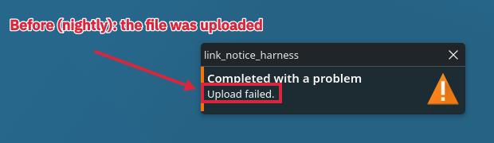
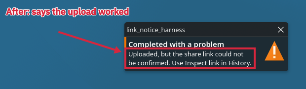

# Notification for an uploaded file whose link step did not finish (#1399 follow-up)

Before and after pictures of the completion notification when every file was
uploaded and only the share-link step did not finish, for put.gd-desktop branch
`fix/link-step-after-upload` (commit `c061f01ea`).

- **Host:** d69, Debian 13, KDE Plasma on Wayland. One frame each from the desktop's
  own VNC (`tools/lab/rfb.py 5900`), taken under the d69 desktop lock, which was
  released after the cleanup check.
- **What ran:** a scratch harness, `tools/link_notice.cpp`, not part of the product.
  It runs the real `OperationService` and `TrayController` of the tree against an
  offline fixture destination. The upload succeeds, and the fixture's link step
  answers `unknown`. One clipboard upload is made, with no network. The
  notification's header shows the harness's process name (`link_notice_harness`);
  the resident shows put.gd there.
- **After:** built from commit `c061f01ea`
  (`git archive` of the branch, `cmake --preset dev`).
- **Before:** the same tree and build with only `src/ui/TrayController.cpp` taken
  from `origin/nightly` `8610002bd`. That build's `test_gui_tray` fails the new rows
  with "Upload failed.". The branch file was then restored and rebuilt, and the
  harness binary matched the first "after" build byte for byte.
- **Notifications:** both were closed by their server ids (39 and 40) after the
  frame, and no harness process was left.
- **Annotation:** put.gd's own editor in a private headless resident of the same
  build (`editor.open`, `editor.apply`, `editor.saveCopy`), with the shapes in
  `tools/spec.json` and the scripts in `tools/`. The uncropped frames are in
  `frames/`.
