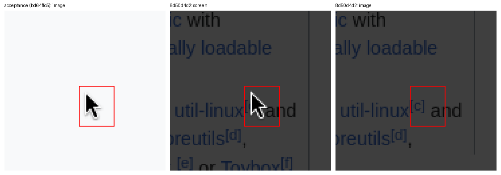
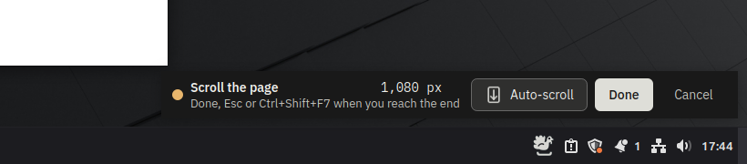
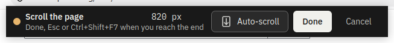

# Scrolling capture: the acceptance findings in the capture's wiring (PR #1548)

PR #1548 into `feat/scroll-follow` (Part of #1515) fixes what the five-desktop acceptance found
(record `2026-11-15-scroll-follow-acceptance`, `FAILURES.md`). These are the desktop checks of the
fixes, on the desktops that failed, with the branch's own CI AppImages (no lab builds). Every
destination was local: a lab resident with its own config, data, cache and runtime directory
(`tools/lres.py`), every action saving to a local archive. Relative input only: a uinput mouse and
keyboard (`tools/umouse.py`, `tools/ukey.py`), flat acceleration.

| Build | Commit | Tree | Used on |
| --- | --- | --- | --- |
| CI run 43714532174 | f8d5912a5 | 0f40f041 | k72 (item 4), f44 (item 5) |
| CI run 43721254144 | 8d50d4d2d | 1796c5ff | Omarchy guest (items 1, 4), m74 (items 2, 3, 4) |
| CI run 43975892044 | d606e5774 | e272a81d | m74 (item 2, Auto-scroll) |

Each run's `diagnostics.json` holds `build.gitTree`. 8d50d4d2d changes only auto-scroll's first frame
against f8d5912a5, and d606e5774 only X11's raw-event queue at a resume; k72's pause tries and f44's keys
do not go through either.

## 1. Hyprland: the pointer painted into the image (Omarchy guest)

The acceptance's controlled case: the real relative pointer at 1840,960 in a full-screen region,
Auto-scroll, no motion, Done after 3 s (`tools/arrow.py`), scanned with the acceptance's own
template and rule (`tools/arrowscan.py`: the cursor from its magenta control at 1836,957, 97% of dark
core and light outline).

- f8d5912a5 (first fix): the arrow was still in the image at 1836,957. The session moved the pointer
  to its rest at t=174156 and then took the frame already waiting in the stream, stamped t=174072.
  The guest's stream sends 3 to 5 frames a second.
- 8d50d4d2d: no match anywhere in the image; both positive controls match at 1836,957 (the
  acceptance's candidate image and this run's own screen). The session passed over frames stamped
  72984 and 73116 after its move at 73112; the first frame placed is 73338.

Other Wayland desktops, "you scroll" with the pointer left over the page (the case where the pointer
is never moved): k72 (KWin stream) no cursor in the image, only the page's own hover of the link under
it; f44 (Mutter) no cursor. Not rechecked: Budgie (passed in the acceptance).

## 2. Cinnamon: the inside bar over the panel (m74)

With the region filling the screen the bar sits at 1277,978 633x52, inside the work area: its bottom
is 1030, the panel starts at 1040 (acceptance: 1288,1018, over the panel). Real relative clicks,
"you scroll" driver, 8d50d4d2d (`tools/insideclick.py`, `m74/inside-user-results.json`):

- Done: ended `done` at the first click (104 hidden rows, no bar pixel in the image).
- Cancel: ended `cancelled` at the first click.
- Auto-scroll: turned on, then paused "by the pointer" 62 ms later, both times. The click's own button
  press stayed in the XInput 2 raw queue: the Gate does not check the hand before the first motion after
  Resume or Auto-scroll, and that check is what emptied the queue. Fixed in d606e5774
  (`X11ScrollInjector::movePointer` empties it while the pointer is not placed).

With d606e5774, both drivers (`m74/inside-*-results-d606.json`): every press acted at the first real
click. Auto-scroll turned auto-scroll on; a second press turned it off (the press counts as the hand, as
reaching for the button does in real use: "paused by the pointer"); Done ended `done` with the image;
Cancel ended `cancelled`.

## 3. Cinnamon: the caption names both keys (m74, 8d50d4d2d)

With a `scroll` hotkey bound (Ctrl+Shift+F7), on the real desktop:

The bar keeps one size for every state with a given key (633 px with these two keys, 622 px without a
bound key). UI catalog shot `scroll-bar-following-x11-keys`.

## 4. The pause by the mouse

10 tries from a fixed start (2 s) and 10 from a random one (1 to 6 s): Firefox on Wikipedia "Linux",
region 240,200 1440x820, Auto-scroll from the start, a real relative mouse from wherever the pointer is
to Done at 600 px/s, then a click (`tools/ptrial.py`, `tools/tries.sh`). Counted: the first click ends
the capture with its image; every `scroll inject:` line after the hand's first motion; put-backs.

| Desktop | Build | Fixed | Random | Injections after the hand | Put-backs | Pause after the first motion |
| --- | --- | --- | --- | --- | --- | --- |
| k72 Plasma 6.6 | f8d5912a5 | 10/10 | 10/10 | none | 0 | 1-14 ms |
| m74 Cinnamon X11 | 8d50d4d2d | 10/10 | 10/10 | none | 0 | 1-39 ms |
| Omarchy guest (Hyprland 0.56, software rendering) | 8d50d4d2d | 6/10 | 2/10 | in 14 of 20 | 0 | 1-260 ms; 4 never |

Acceptance on the same desktops: k72 19/20, m74 19/20, guest 17/20 (with late put-backs).

The guest is the floor the brief asked about. It delivers the hand's events 100 to 260 ms late, and in
that time auto-scroll's visit to a wheel point (every 130 to 500 ms) moves the pointer. When the event
is seen with its own time more than 40 ms old the put-back is skipped (`the hand was seen N ms late`,
3 tries: 213, 232, 256 ms), as agreed, and the click lands where the capture left the pointer.
Without a time of its own, an event seen on the watch is decided the same way (3 misses at 207 to
222 ms). Two misses (random 1 and 6) started from a pointer position read just before a visit moved it.
Four tries (random 2, 3, 7, 8) never paused: the bar, where the pointer rests, got no pointer event
after the capture's move to the rest (no `pointer at rest, watching` line, `hyprland/trial-random-2.log`),
and the hand's path from the rest to Done runs along the bar, above the watch. Why the bar got no event
in those four is not known: it needs the guest's event log.

## 5. GNOME: keys during a capture (f44, extension 25 as the user's copy, f8d5912a5)

`tools/keyprobe.py`: a local page reports every keydown, focus and blur, with its scroll position, to
its own server (no browser automation, so `document.hasFocus()` is the real focus). End, Ctrl+End and
Home reach the page during the capture in both drivers, and again after a click on the bar's label;
a click on Done still ends the capture with its image. At the capture's start, at the click on the
label and at the click on Done the page logged a blur and its focus back: Mutter gives the bar the
focus when it is shown or clicked, and extension 25 gives it back (`f44/keys-*-result.json`).
Both extension lists and the acceleration were restored and compared (`f44/*-before.txt`,
`*-after.txt`), the user copy removed with a last re-login.

## Not desktop items

6. A toggle while the capture stops is `scroll_state` (service test `toggleWhileStoppingIsState`).
7. The synthetic stream's foreign picture on a damage-only stream (session test
   `testFixtureForeignOnDamageOnly`).

## Clean-up

Every lock was released `--verified-clean` after: no put.gd process, no lab Firefox, no lab input
device, lab desktop entries (k72) and the user extension (f44) removed, acceleration restored, a
picture of each desktop. Both Omarchy guests were retired with completion manifests (the first booted
while d69's disk was full; the second sat idle 32 hours under an expired lock before it was retired).
