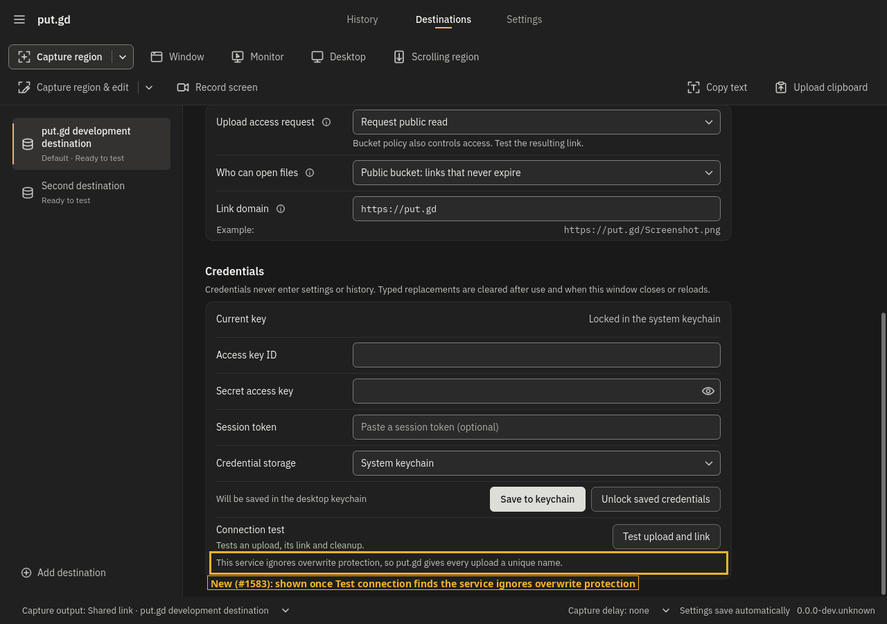

# S3 services that ignore overwrite protection (#1583, #1589, #1601)

Run on f44 (Fedora 44), headless resident under a private `dbus-run-session`, local containers only:
Garage v2.1.0 (`docker.io/dxflrs/garage:v2.1.0`), Zenko CloudServer (`docker.io/zenko/cloudserver`), MinIO
(`cgr.dev/chainguard/minio`). Build: integration of `fix/s3-ignored-conditional-writes`,
`fix/s3-versionless-ignored-version-id` and `fix/s3-garage-reserved-characters` on nightly, release preset.

## Settings note (#1583)

Offscreen render from `gui_settings_destinations` (`ignoredOverwriteProtectionShowsANoteOnThatDestination`): the
destination whose service ignores overwrite protection shows the note under Connection test; the second destination
does not. Unannotated: `settings-overwrite-note-plain.png`.

## Raw server behaviour (signed requests, outside put.gd)

| server | PUT `If-None-Match: *` on existing key | PUT `If-Match: "wrong"` | Complete multipart `If-None-Match: *` on existing key | DELETE `If-Match: "wrong"` |
| --- | --- | --- | --- | --- |
| Garage v2.1.0 | 200, replaced | 200, replaced | 200, replaced | 204, deleted |
| Zenko CloudServer | 200, replaced | 200, replaced | 200, replaced | 204, deleted |
| MinIO | 412 | 412 | 412 | 204, deleted |

## Race through put.gd (`tools/lab/s3_differential.py` from #1593 plus two lab cases)

The competitor file appears at `race.txt` with the first request after put.gd's name check (HEAD) of `race.txt`.

| server | before Test connection | after Test connection (rename policy) | after Test connection (replace policy) |
| --- | --- | --- | --- |
| Garage | competitor overwritten (`race` case flags `overwrote_foreign_object`) | flagged; uploaded as `race-<uuid>.txt`, competitor kept | `race.txt` replaced by intent |
| Zenko | competitor overwritten | flagged; uploaded as `race-<uuid>.txt`, competitor kept | `race.txt` replaced by intent |
| MinIO | 412, renamed (unchanged) | not flagged; 412, renamed (unchanged) | `precondition_changed` (unchanged) |

Test connection itself ended `public_url_unreachable` on all three, because the local test buckets are not public;
the overwrite check runs before the link check and was recorded in every case.

## History deletion on Garage (#1581, #1589)

`delete-paths` case: Garage got 0 DELETE requests and both deletions ended `unsupported_safe_removal`; the files stay.
Zenko and MinIO each got 2 DELETEs and removed the files as before.

## Reserved characters on Garage (#1601)

`names-special` case: `colon:.txt`, `at@dollar$comma,.txt` and `amp&eq=semi;.txt` upload on Garage (before: 403 at
the name check, shown as `s3_permission_denied`); every name uploads on Zenko and MinIO.
