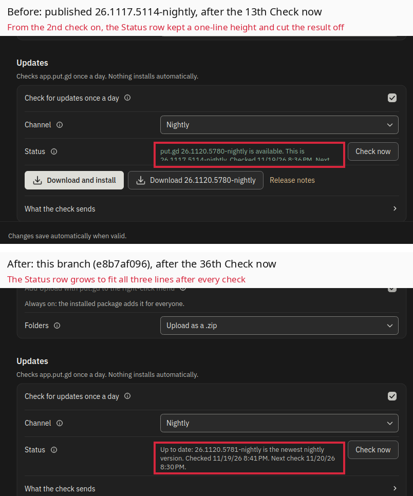

# #1721: the update Status row grows back to fit its text after Check now

Issue: [#1721](https://github.com/patrick-hudson/put.gd-desktop/issues/1721). In Settings → General →
Updates, after Check now was pressed a few times, the Status row kept the one-line height it had
for "Checking…" and cut off the three-line result.

## Result

| Build | Desktop | Check now presses | Status row |
| --- | --- | --- | --- |
| Published `v26.1117.5114-nightly` AppImage (the build in the report) | aurora-amd, Plasma 6.8.2 Wayland | 13 | Whole after the 1st check; cut off in its second line after checks 2 to 13 |
| This branch, commit `e8b7af096` | aurora-amd, Plasma 6.8.2 Wayland | 36 | Whole after every check |



`before-sequence.png` and `after-sequence.png` show five checks from each run.
`before-13th-check-full.png` and `after-36th-check-full.png` are the full desktop frames of the last
check in each run.

## Cause

`boxPreferenceRows` (`src/ui/SettingsWindow.cpp`) moves each widget of a setting row into a new
value layout. It added the widget to the new layout before deleting its old layout item:

```cpp
while(auto* part=column->takeAt(0)){if(auto* widget=part->widget()){... values->addWidget(widget);delete part;} ...}
```

In Qt, `QWidgetItemV2` registers itself as the widget's `widgetItem` only when the widget has none
yet. When an item is deleted, it clears the widget's `widgetItem` if it is the registered one.
`QWidget::updateGeometry()` clears a widget's layout-item caches only through that `widgetItem`.
`QWidgetItemV2::heightForWidth` caches up to four width → height answers even when the item isn't
registered. Sources, Qt 6.11.0 and unchanged in 6.12.0: `src/widgets/kernel/qlayoutitem.cpp`, the
constructor at line 765, the destructor at line 773 and `heightForWidth` at line 832.

So the new item never registered, and deleting the old one left the widget with no registered item.
The new item's height-for-width cache for the Status row's inner widget (the label plus Check now)
was never cleared again. It answered with whatever height was computed first at that width. Once
that was the one-line "Checking…" height, every later result at the same width was laid out one line
tall. Because the row reads its own width on every pass, that entry stayed in the cache.

The fix deletes the old item before adding the widget to the new layout. The Proton folder picker
moved its widgets the same way and gets the same change.

## Offscreen reproduction (f44, Fedora 44, Qt 6.11.2)

`tools/offscreen_probe_test.cpp` is a throwaway QtTest put in place of
`tests/gui/test_settings_general.cpp` on f44. It opens Settings with a synthetic update status,
presses Check now 20 times, and has the fixture's `update.check` reply arrive after a delay. Each
time it checks that the label is as tall as its height-for-width.

| Source | Reply delay | Cut-off results out of 20 |
| --- | --- | --- |
| nightly `cd33d3059` | 0 ms | 0 |
| nightly `cd33d3059` | 300 ms, 1000 ms | 1 each (the first check) |
| nightly, with a plain uncached `QWidgetItem` for the moved inner widget | 300 ms, 1000 ms | 0 |
| nightly, with a plain `QWidgetItem` for the label instead | 300 ms, 1000 ms | 1 each |
| this branch | 0, 100, 300, 1000 ms, and with window resizes | 0 |

A debug print inside `FormRow::event` showed the stale cache directly. The value row's item for the
inner widget answered 36 px at width 464, while that widget's layout answered 60 px.

## Desktop run (aurora-amd)

- Host: Aurora `testing-45.20261101.2`, KWin 6.8.2, Plasma Wayland, one 1920x1080 output. Taken
  under the desktop lock (`fix-1721`, 02:32 to 02:42 UTC on 2026-11-20).
- Before: `putgd-26.1117.5114-nightly-x86_64.AppImage` from the GitHub release, SHA-256
  `923dccaedfde8a67e331c95a3d28daba96c90edaa6d44ded1f73306ba228771f` (matches `SHA256SUMS`),
  bundled Qt 6.12.0.
- After: commit `e8b7af096e7daf1330874d4ab666d60a4d796135`, tree
  `804d1a1ea7bc7808565842fad0954df53a5517ad`. Built with the `release` preset in the `putgd-build`
  Toolbx (Fedora 45, Qt 6.11.2), with `PUTGD_PACKAGE_TARGET=fedora45`. A development build has no
  update channel and hides Check now, so the throwaway clone was tagged locally as
  `v26.1120.5781-nightly`, as in `docs/release/versioning.md`. The tag was never pushed.
  `build-info.json`: version `26.1120.5781-nightly`, `dirty: false`, `sourceProvenance: git`.
- Each build ran as a private resident with its own `XDG_*` folders and runtime directory on the
  real Plasma session (`tools/drv.py`, `tools/drv_lib.py`). `putgd-cli ui.show {"view":"updates"}`
  opened Settings at Updates. `tools/press2.py` found Check now in the wall frame
  (w0vncserver, 127.0.0.1:5900), clicked it through RFB, and saved a frame 5 s later. Every check
  reached app.put.gd: `update.status` `checkedAt` advanced each time.
- The texts differ because the before build is older than the latest nightly (`26.1120.5780`)
  and the after build is newer ("Up to date"). Both are three lines at this width.
- The after build first followed the desktop's light colours. Its last 12 presses ran after
  `settings.patch` set Theme to Dark (`tools/theme.py`), so the pair matches. All 36 after checks
  were whole in either theme.
- Cleanup: both residents quit through `ui.quit`. No put.gd process, AppImage mount or private
  runtime directory remained. The lock was released `--verified-clean`.

## Tests

- f44 (Fedora 44, dev preset, this branch): `ctest -R "gui_|catalog|settings"`, 15 of 15 passed,
  including `gui_settings_general`, `gui_settings_capture`, `gui_settings_destinations`,
  `gui_settings_credentials` and `gui_settings_advanced`. Then `gui_application`,
  `gui_theme_contrast`, `gui_tray`, `gui_history_view`, `gui_editor_window`,
  `ui_control_integration`, `ui_endpoints_integration`, `ui_process_integration`,
  `ui_split_services_integration` and `http_uploader_integration`, 10 of 10 passed.
  `putgd-ui-catalog` rendered all 520 pictures, exit 0.
- CI contract groups: `release`, `proton`, `lab`, `observer` and `evidence` on the workstation. In
  `release`, only `tests/releases/test_verify_tag.py` failed there, because the workstation has no
  `cmake`; it passed on d69. The surface step passed on d69, 468 passed, the same as the base tree.
- No regression test was added. A clipped label is a layout fault, and the repository's test bar
  keeps only tests whose failure is silent and costly.
