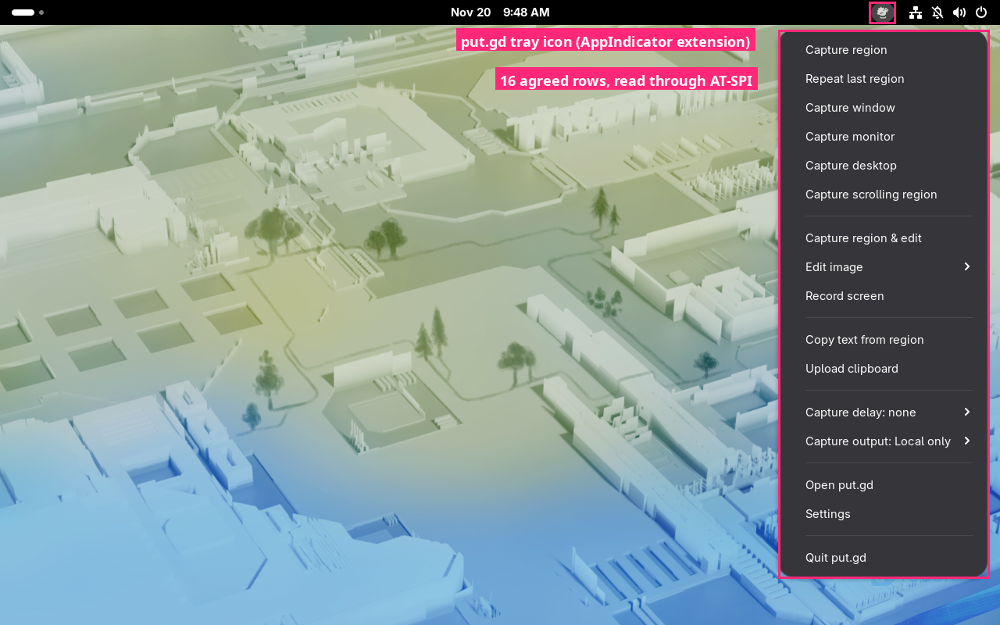

# Fedora GNOME guest: AppIndicator tray set up, Tray menu cell green twice

Stock Fedora GNOME has no tray host, so the nightly's Fedora GNOME guest reported "Resident reports
no desktop tray host" and its Tray menu cell was never run. A Fedora user gets put.gd's tray by
installing and enabling Fedora's AppIndicator extension; the guest's per-run setup now does the same.

- Host: f44 builder, nightly golden `fedora-gnome-wayland` (GNOME 50.0, Wayland), disposable overlay.
- Build: CI run 44763819056 of `c5babe1ad` (`putgd-26.1120.5892~dev+gc5babe1adcad-1.fc44.x86_64.rpm`).
- Setup: `sudo -n dnf install gnome-shell-extension-appindicator` (64-1.fc44, plus libappindicator-gtk3,
  libdbusmenu and libdbusmenu-gtk3, all new packages; gnome-shell, mutter, gdm and the portals
  unchanged), then the existing witness reboot, then `gnome-extensions enable
  appindicatorsupport@rgcjonas.gmail.com`: State ACTIVE, `IsStatusNotifierHostRegistered` true before
  the resident started (`tray-host.json.txt`).
- Result: `outcomes.tray_menu` passed twice in a row (both interactions `tray.context-menu` and
  `tray.menu-capture-region`): a real right-click on put.gd's icon showed the 16 agreed rows in order,
  read through AT-SPI, and Capture region from the menu uploaded a 400×240 region whose link was
  auto-copied.

