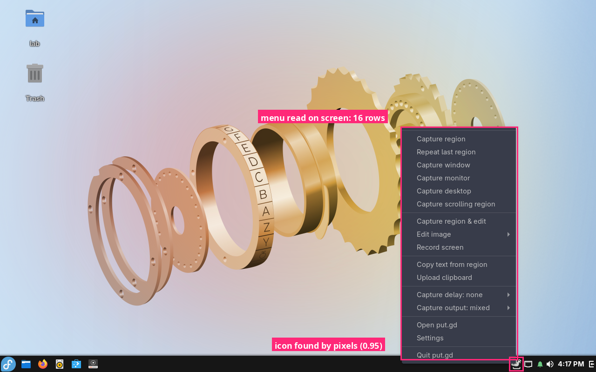
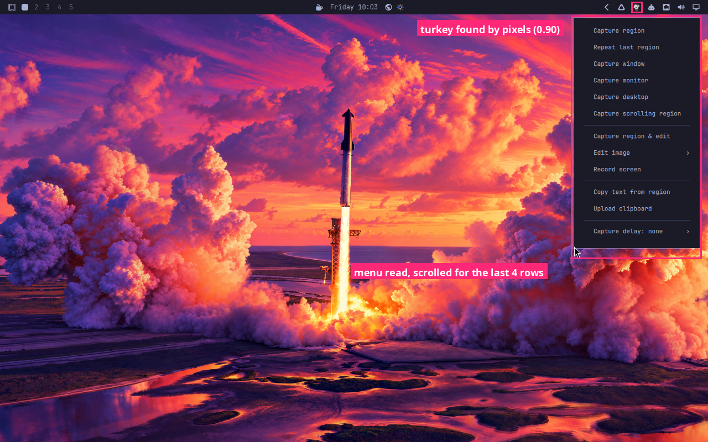

# Nightly Tray menu cell by pixels: Cinnamon, Budgie and Omarchy green

The nightly's Tray menu cell was not run on Mint Cinnamon, Fedora 45 Budgie and Omarchy Hyprland
because their trays give put.gd's icon no accessible name. The cell now finds the icon by the
shape of the IconPixmap the running resident publishes, right-clicks it with guarded real input,
checks put.gd's `diagnostics.trayMenu` (the host asked for the menu and was served the 16 agreed
rows), reads the drawn popup with tesseract as a cross-check, clicks the drawn Capture region row
and checks put.gd recorded that row clicked, then captures and uploads a 400×240 region whose link
is auto-copied.

- Build: CI run 44763819056 of `c5babe1ad` (the PR's resident change), DEB, RPM (fc45) and AppImage.
- Guests: fresh nightly-style overlays of the nightly goldens. Mint 22.3 Cinnamon X11 and Omarchy
  Hyprland on m74; `fedora45-budgie` (SHA-256 a6749512…, the same golden d69 uses) on f44.
- Results, `outcomes.tray_menu`, both interactions passed:
  - Cinnamon: twice in a row; icon score 0.94, runner-up 0.47 and 0.57; host asked with `AboutToShowGroup`.
  - Omarchy: twice in a row; icon score 0.90 (12×12 px), runner-up 0.43; host sent `AboutToShow` and
    `opened`; put.gd's item pinned on the bar for the cell; the menu card scrolled for its last rows.
  - Omarchy seasons with `PUTGD_TRAY_CALENDAR_NOW`: 2026-12-15 tree (0.86) and 2026-06-15 mark
    (0.95) green; November turkey above.
  - Budgie: twice in a row; icon score 0.95, runner-up 0.46; host sent `opened`.
- Pictures: the frame the cell keeps with the menu open, annotated with the icon it found and the
  popup it read.

