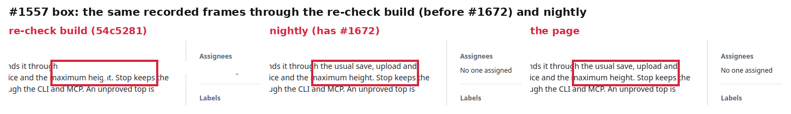
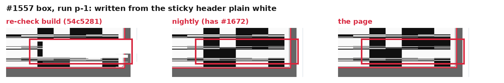
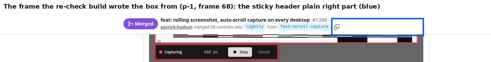
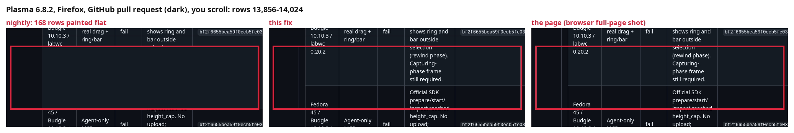
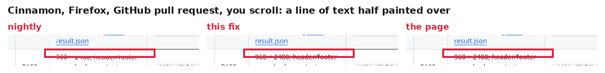
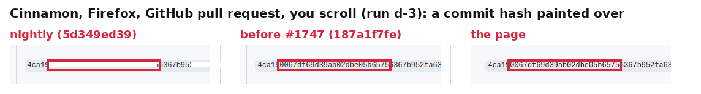
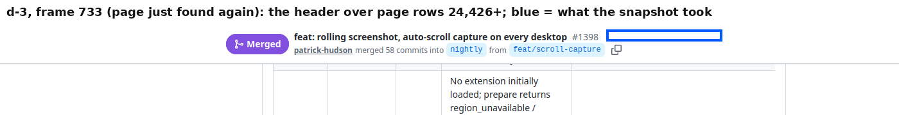

# Scrolling capture: white boxes over page content (#1557), round 1 — 2026-11-21

**Status: interim.** The boxes #1557 reported are gone from nightly (fixed by #1672). Two more
ways the tracker paints page text a flat colour were found on current nightly. One is fixed on
branch `fix/scroll-white-boxes-1557` (commit 6d50e245e, "fix F"). The other is a regression
from #1747 and is reported separately, because the safe fixes tried broke #1537's video tests
or added wrong placements. Live acceptance of fix F has not been run yet.

## Method

- Real pages on physical desktops, harness `~/work/w1557` on m74 (Linux Mint 22.3, Cinnamon X11)
  and aurora-amd (Aurora Fedora 45, Plasma 6.8.2 Wayland). Firefox, GitHub pull request #1398,
  "you scroll" (relative uinput wheel at a person's pace), with the lab frame tee (`LAB_TEE=1`).
  Every frame fed to the tracker is kept, and a run replays offline through any tracker build.
  Replays reproduce the live capture to the pixel (0 differing pixels in every run checked).
- Lab-only patches (never committed, in `tools/`): the frame tee (`labtee2.py`, from
  `~/work/strj`), `drvwait.py` (the lab driver keeps the helper 40 s after the result, so the
  tee writes its queue; without it the last ~100 frames were lost), `repack.py` (lossless
  PNG re-compression of tee frames, 35x smaller), `fastpace.py` (`LAB_FAST=1`).
- Tracers on scratch copies of `ScrollTracker.cpp`: `filltrace.py` (every span `finish()`
  writes, by phase), `celltrace.py` (every write to one pixel column, by frame), `whytrace.py`
  (for one page cell: the proof test, the pending capture, flushPending, dynamic marks, the
  bars hold, snapshots).
- Detectors: `fills.py` (flat-colour fill boxes), `cutscan.py` (white or flat over ink against
  the browser's full-page reference), `vcheck.sh` (a variant against nightly per run).
- Corpus: d69 `~/work/pc1538` (160 recorded sequences, both browsers), `tools/cmp.py`.

Builds: nightly `5d349ed39`; the re-check build's tracker `54c5281ac` (before #1672); the #1672
tracker `187a1f7fe` (before #1747); fix F = nightly + commit 6d50e245e (ScrollTracker.cpp
sha256 prefix `4b4698cf6557f5d2`).

## 1. The boxes #1557 reported: fixed by #1672

Eight tee'd m74 runs (n-1, p-1..3, q-1..4) replayed through the re-check's tracker paint the
boxes in 5 of 8, as in the re-check (5 of 11). Nightly paints none of them, on the same frames.

| Run | Re-check tracker (54c5281) | Nightly |
| --- | --- | --- |
| n-1 | x 944-1168, rows 560-584 | none |
| p-1 | x 944-1176, rows 2080-2144 | none |
| p-3 | x 992-1168, rows 440-480 | none |
| q-1 | x 992-1168, rows 440-464 | none |
| q-4 | x 976-1168, rows 488-504 and 536-560 | none |
| p-2, q-2, q-3 | none | none |

Cause, from the cell trace: the old tracker wrote the plain white right side of GitHub's sticky
pull-request header (shown at the top of the region) as page content, over rows an earlier frame
had written with their text. #1672 made a plain cell only a vote and never writes what stays on
the screen from a frame.

## 2. Fixed here: rows under a held-back header bar painted flat (since #1672)

`learn()`'s `bars()` holds back a header's whole rectangle, also measured with what stood still
joined to it. On slow steps a page's table rules stand still, so the bar grew to 37 block rows
(296 px) at full width. Page rows a jump brought into it, then covered by the header, were never
offered to the image, and `finish()` painted them flat. Plasma a-2: 168 full-width rows; a-3:
88 and 32 rows; m74 q-4: a 224x24 patch (with #1747's dynamic marks, below). The #1672 tracker
does the same on these frames.

Fix F keeps a frame's pixels for cells held back only by that rectangle, once two placed frames
(the page moved between them) showed them alike. Anything proved, seen or voted later replaces
them. A part of the header the rectangle rightly held never agrees, so it keeps the plain fill.
A first version without the two-frame check painted the grey search field of the put.gd guide's
header into the page (corpus `chrome/guide/continuous+every3`), and was dropped.

Results of fix F against nightly:

- Replays of all 17 tee'd runs (m74 n-1, p-1..3, q-1..4, d-1..6; aurora a-1..3): a-2, a-3 and
  q-4 change, only in the flat areas. The other 14 are pixel-identical to nightly. a-2's band
  matches the reference (4,837 → 0 pixels off). In q-4 the text is restored (1,597 → 1,216).
  a-3's second band (rows 21,672-21,760) stays partly flat: it is where the page was lost and
  found again with 215 rows missing, and the result already warns there (foundAgain 2).
  `data/replay-F-vs-nightly.txt`.
- Corpus, 160 sequences: identical to nightly in every count and score (bandsEqual 26,678, wrong
  0, 0 sequences differ). `data/corpus-compare.txt`.
- `test_scroll_tracker`: 83 passed, 0 failed.

Variants tried and dropped (`data/corpus-compare.txt`):
- fix1: undo a skipped frame's dynamic marks; +3 wrong placements in the corpus.
- B: one block row limit on the joined bar; lost text under Stack Overflow's header.
- C and I: undo marks and hits; break 2 of #1537's video tests.
- D and E: no two-frame check, or texture only; header pieces painted into the page.
- G: no flat cell over verified texture; breaks 7 video tests.
- H: skip a pinned bar's rows in snapshots; no effect on d-3.

## 3. Reported, not fixed: #1747 paints a sticky header over verified text after a lost stretch

Run d-3 (m74, live build D, identical under nightly and fix F): the middle of a commit hash at
x 944-1120, rows 24,432-24,448, is the code chip's flat grey. The #1672 tracker writes it right.
While the page was lost, #1747's retry for a playing video that lowered the frame's match (site
2, `pick < 0 && noMatch && unexplainedPick >= 0`) compared skipped frames at guessed places
(24,228 and 23,968 for the same row) and marked the row's bands dynamic. When the page was found
again (frame 732, +561), the sticky header lay over those rows, and `snapshotDynamic` replaced
the verified text with frame 733's picture: the header's plain right side. q-4 had the same
marks (frames 811, 830). Fix F happens to cure q-4, because the rows were also held back by the
bar, but not d-3.

## Also seen

- A 1-px dark line at the bottom row of every m74 frame is written into the image above its
  end (p-1, p-3) and in the middle (q-4 row 24,795).
- Synthetic: one jump of more than a frame over near-identical tables places the next frame one
  table period short, and every frame after it (nightly; `tools/` search harness on m74
  `~/work/w1557/search/jump1.cpp`).

## Data kept

Tee'd runs with replays: m74 `~/work/w1557/lab/runs/` (14 runs, frames re-compressed losslessly)
and aurora `~/work/w1557/alab/runs/` (3 runs). Variant sources: `~/work/w1557/v*/` on m74,
aurora and d69. Corpus runs: d69 `~/work/pc1538/runs/w1557*`.
