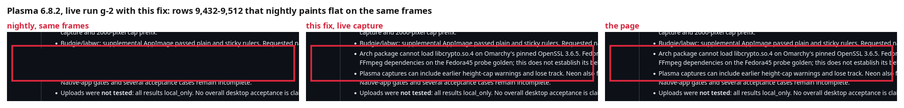

# Closing runs, 2026-11-21 (fix F lab build)

Lab helper builds: nightly `5d349ed39` + branch `fix/scroll-white-boxes-1557` commit `6d50e245e`
(ScrollTracker.cpp sha256 prefix `4b4698cf6557f5d2`), with the lab-only frame tee and driver
wait. Firefox, GitHub pull request #1398 (45,348-45,351 rows tall), you scroll at a person's
pace, `LAB_TEE=1`. One desktop lock at a time: m74 19:41-20:23Z, aurora-amd 19:43-20:05Z.

## m74, Linux Mint 22.3, Cinnamon X11: 11 runs

| Runs | End | Height | Found again | White box over content |
| --- | --- | --- | --- | --- |
| f-1 .. f-6 | done (6) | full page (6) | 1, 0, 1, 1, 0, 0 | none |
| h-1 .. h-5 | done (5) | full page (5) | 1, 1, 1, 1, 2 | none |

How each was checked. For f-1 to f-6, each live capture was compared with its replay through
fix F (0 differing pixels) and with nightly on the same frames (0 differing). There are no flat
fills outside the scrollbar. For h-1 to h-5, the live capture was scanned without a replay (the
replays were stopped to save m74's disk). The scan (`tools/cutscan.py`: white or flat over ink
against Firefox's full-page shot) finds only three small spots that every run has, in rows
1,848-1,952 (121-168 pixels each). The re-check's good runs and the nightly replays have them
too; they are the reference's own rendering. f-4 also has 163 pixels near the page's end, the
bottom-edge line in #1796. `data/acceptance-m74-f-runs.txt`.

The re-check build painted boxes in 5 of 11 such runs (records `2026-11-17-scroll-follow-recheck-2`);
nightly and fix F paint none in 11 (and none in the 14 earlier tee'd runs of this record).

## aurora-amd, Aurora Fedora 45, Plasma 6.8.2 Wayland: 3 runs

g-1, g-2 and g-3: done, full page, found again 1, 0 and 1. The live capture equals the fix-F
replay (0 differing pixels), there are no flat fills outside the scrollbar, and the scan finds
no boxes. In g-2, nightly on the same frames paints image rows 9,432-9,512 flat at full width
(two bullet lines of text gone); the live capture with fix F has them, 8,892 → 0 pixels off the
reference. Nightly paints such a band in 3 of the 6 Plasma runs recorded today (a-2, a-3, g-2).

## Kept for the follow-up issues

m74 `~/work/w1557/lab/runs/firefox-github-user-{d-1,d-2,d-3,d-4,p-1,p-3,q-4}` and aurora
`~/work/w1557/alab/runs/firefox-github-user-{a-2,a-3,g-2}`: every frame (losslessly
re-compressed), `tee/run0/list.txt`, the live `capture.png`, `reference.png` and `result.json`.
The other runs were deleted by exact-file manifest after scoring, to free m74's disk.
