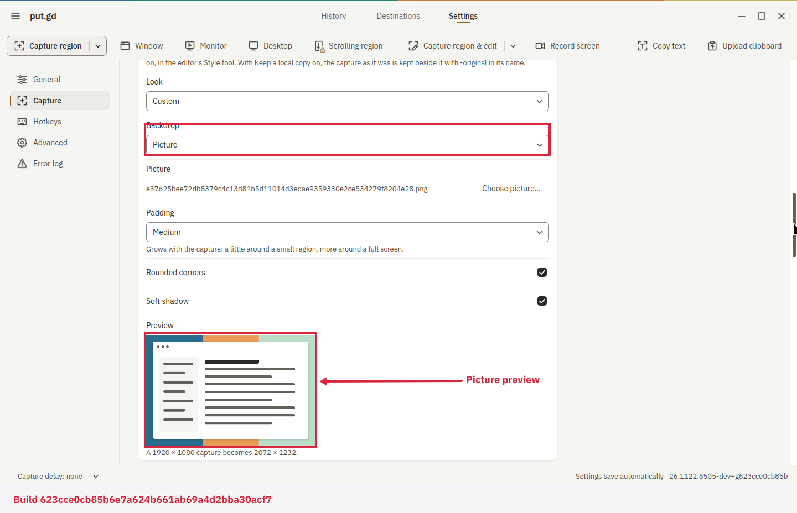
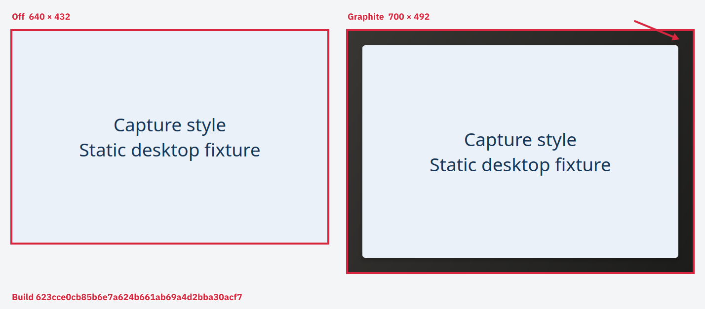
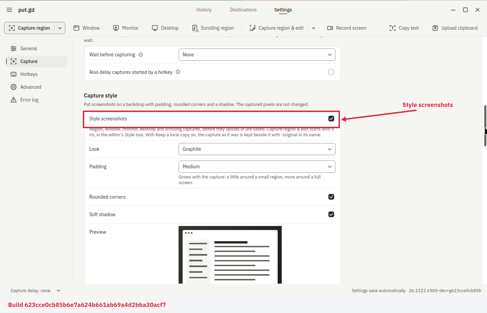
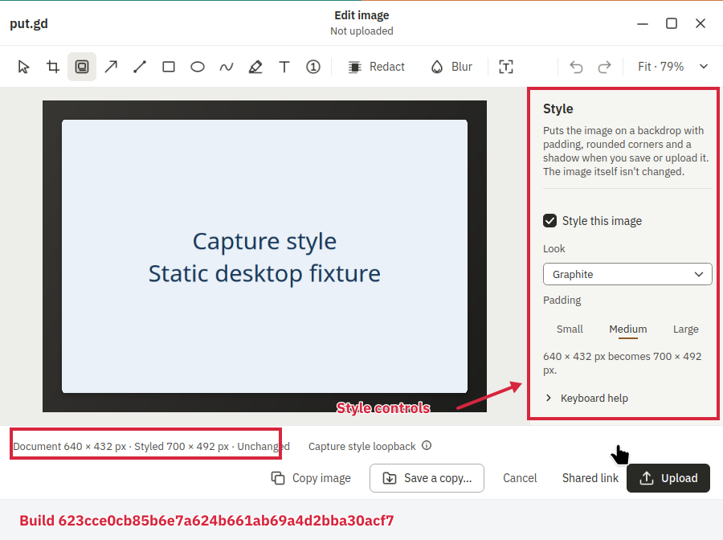

# Capture style desktop acceptance for PR #1899

Candidate source commit `623cce0cb85b6e7a624b661ab69a4d2bba30acf7` and tree `1bab5bb19228b6f14ce8292634fe035b6ff0363a`.

[GitHub Actions candidate run](https://github.com/patrick-hudson/put.gd-desktop/actions/runs/45057968620) · [PR #1899](https://github.com/patrick-hudson/put.gd-desktop/pull/1899) · [Issue #1893](https://github.com/patrick-hudson/put.gd-desktop/issues/1893)

Region and monitor captures used a fullscreen synthetic fixture. Editor uploads went to a loopback HTTP receiver that stored their PNG bytes. Times in the matrix are completion times in UTC.

## Desktop matrix

| Desktop | 1 | 2 | 3 | 4 | 5 | 6 | 7 | 8 |
| --- | --- | --- | --- | --- | --- | --- | --- | --- |
| m74 · Mint 22.3 / Cinnamon X11 | Pass 19:19:10 | Pass 19:19:46 | Pass 19:22:34 | Pass 19:25:34 | Pass 19:26:59 | Pass 19:34:06 | — | Pass 19:34:50 |
| k72 · Kubuntu 26.04 / Plasma Wayland | Pass 19:11:08 | Pass 19:11:22 | Pass 19:13:52 | Pass 19:15:37 | Pass 19:17:15 | Pass 19:22:31 | Pass 19:24:14 | Pass 19:25:54 |
| f44 · Fedora 44 / GNOME Wayland | Pass 19:11:52 | Pass 19:12:03 | Pass 19:13:00 | Pass 19:14:17 | Pass 19:16:11 | — | — | Pass 19:16:50 |
| d69 guest · Omarchy / Hyprland Wayland | Pass 19:19:09 | Pass 19:19:49 | Pass 19:28:33 | Pass 19:30:37 | Pass 19:33:22 | — | — | Pass 19:34:32 |
| d69 guest · Fedora 45 / Budgie labwc Wayland | Pass 19:19:56 | Pass 19:20:16 | Pass 19:23:03 | Pass 19:25:31 | Pass 19:28:10 | — | — | Pass 19:29:07 |

### Checks

1. Absent style settings
2. Explicitly disabled
3. Graphite region and monitor, with original
4. Styled editor, Paper, undo padding, Upload
5. History Edit again with and without original
6. Custom picture and missing-picture fallback
7. MCP style and configuration controls
8. Disable in Settings

### Off-state PNG SHA-256

| Desktop | Row | PNG dimensions | SHA-256 |
| --- | --- | --- | --- |
| m74 | 1 | 640 × 432 | `d633f1103ad9108de9652b462abbcee7d8d379a8c233ec229120869882aa4938` |
| m74 | 2 | 640 × 432 | `d633f1103ad9108de9652b462abbcee7d8d379a8c233ec229120869882aa4938` |
| k72 | 1 | 640 × 432 | `94d0cfeeb21937660e35fde9c52d213aedb03eb135b239d28cadcea844bf8ff4` |
| k72 | 2 | 640 × 432 | `94d0cfeeb21937660e35fde9c52d213aedb03eb135b239d28cadcea844bf8ff4` |
| f44 | 1 | 640 × 432 | `c02f86a1e8980369407796c0c4e23f319c821a4c3a173b9d5c1c006658ea0fa9` |
| f44 | 2 | 640 × 432 | `2c7edbc9d1e96199a4fe359202e774ced8391995ab0ed1ebebf4d9062177d2ff` |
| om1899 | 1 | 426 × 320 | `c2d16f51cffaeecb1873ae57d0ec1742c076692fa7386ee58398ad66eefd6387` |
| om1899 | 2 | 426 × 320 | `c2d16f51cffaeecb1873ae57d0ec1742c076692fa7386ee58398ad66eefd6387` |
| bg1899 | 1 | 426 × 320 | `7f8105249a6689b09ca0cd14a35d8437d15d60256114ce0c171cdac689313060` |
| bg1899 | 2 | 426 × 320 | `7f8105249a6689b09ca0cd14a35d8437d15d60256114ce0c171cdac689313060` |

## Desktop sessions

| Lab session | Desktop | Package used |
| --- | --- | --- |
| `codex-lab-1899-m74` | Linux Mint 22.3, Cinnamon 6.6.9, X11 | Ubuntu 24.04-base DEB |
| `codex-lab-1899-k72` | Kubuntu 26.04, Plasma and KWin 6.6.6, Wayland | Ubuntu 26.04 DEB |
| `codex-lab-1899-f44` | Fedora 44, GNOME Shell 50.6, Wayland | Fedora 44 RPM |
| `om1899` on `codex-lab-1899-d69` | Omarchy 4.5.0, Hyprland, Wayland | AppImage |
| `bg1899` on `codex-lab-1899-d69` | Fedora 45, Budgie 10.10.3 and labwc 0.20.2, Wayland | AppImage |

Each session reported version `26.1122.6505-dev+g623cce0cb85b` and the exact Git tree in [the build receipts](receipts/). The two guests ran on fresh overlays from the d69 goldens and were visible on the lab wall.

## Acceptance notes

- Row 1 used the put.gd region hotkey with a synthetic fullscreen fixture. The lab assigned Ctrl+Shift+F9 to avoid compositor-specific interpretations of digit shortcuts. Rows 2 and 8 repeated the region.
- GNOME writes a PNG `Creation Time` text chunk for each capture. Rows 1 and 2 had identical decoded pixels and matched byte for byte with only that chunk removed. Both had no style inspection field or archived original. Published nightly `26.1122.6439-nightly` reproduced the timestamp-only difference. The other four desktops had identical raw SHA-256 values for rows 1 and 2.
- Row 5 verified that disabling Keep a local copy produced no archived original. To exercise History with a styled file still available, the test then removed the single named original of the earlier retained Graphite item. Reopening that item selected the already-styled file with style disabled, and submitting preserved its dimensions.
- The Omarchy 4.5.0 golden has OpenSSL 3. Running the candidate pacman package's `putgd-cli --help` exited 127 because `libcrypto.so.4` was missing. The published nightly pacman executable exited the same way on the same guest. The Arch install smoke job passed in the candidate run. Omarchy desktop acceptance used the documented AppImage fallback with the same candidate Git tree.
- This record covers commit `623cce0cb85b6e7a624b661ab69a4d2bba30acf7`. The earlier `4af2af6f` editor Upload blocker was superseded. Real editor Uploads completed on the selected build in all five sessions.

- Mint’s existing GTK portal service could not open the stale X display `:2`. The test used a temporary GTK backend on Cinnamon’s active `:0`, selected a new synthetic picture through the portal, and observed the preview and archived capture. It stopped the temporary backend after selection and left the original service configuration in place.

## Lab restoration

| Builder | Final package state |
| --- | --- |
| m74 | Restored DEB `26.1122.6373~dev+gaa202c7a634c`. |
| k72 | Restored DEB `26.1122.6374~dev+gffeead0fc1f3`. |
| f44 | Acquired with no put.gd package after #1892. Left the published nightly RPM `26.1122.6439~nightly-1.fc44` as directed, with the native put.gd GNOME extension and AppIndicator both active and the tray item registered. |
| d69 | No put.gd package was installed on the host at acquisition or release. Both disposable overlays were retired after exporting and verifying their evidence. |

- Omarchy run `00a2a643-467d-4f61-966e-006577432b08` retired at 19:34:39 UTC.
- Fedora 45 Budgie run `398e2444-c92f-4f62-9e40-cf46c0c42ea9` retired at 19:29:57 UTC.
- All four builder locks passed cleanup and were released. See the [package and lock receipts](restoration.json) and [overlay retirement receipts](overlay-retirement.json).

## Pictures

Capture style custom picture · build `623cce0cb85b6e7a624b661ab69a4d2bba30acf7`.

Capture style off on · build `623cce0cb85b6e7a624b661ab69a4d2bba30acf7`.

Capture style settings · build `623cce0cb85b6e7a624b661ab69a4d2bba30acf7`.

Editor style panel · build `623cce0cb85b6e7a624b661ab69a4d2bba30acf7`.

## Package checksums

- `7c66b9302c0cb211b0fe6eaabb712a07aa8398cbde3df2789972f46f570b0585` · release-appimage · `putgd-26.1122.6505-dev+g623cce0cb85b-x86_64.AppImage`
- `082af7173272e9ce2fe88b2345405cd691f70f66d25638175a48a185d6357109` · release-native-archlinux · `putgd-26.1122.6505dev.g623cce0cb85b-1-x86_64.pkg.tar.zst`
- `72eab4a33e644a16d76b23021a9865d26a15793b522aa2178903e1b38f49ff8b` · release-native-fedora44 · `putgd-26.1122.6505~dev+g623cce0cb85b-1.fc44.x86_64.rpm`
- `0380eb7345793d7d708e3bd53db1a2e5fef26f86a1cf2b233043e4cc7258dcd7` · release-native-ubuntu24.04 · `putgd_26.1122.6505~dev+g623cce0cb85b_amd64.deb`
- `992c9f34ad0957864037e5d5b5edf34cbf50728a57bf37f00ef4441f4ccb4787` · release-native-ubuntu26.04 · `putgd_26.1122.6505~dev+g623cce0cb85b_amd64.deb`
