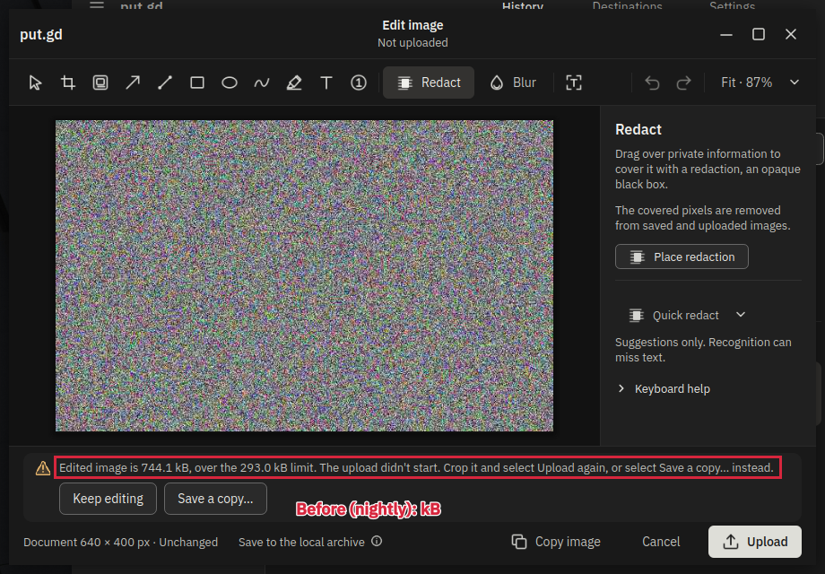
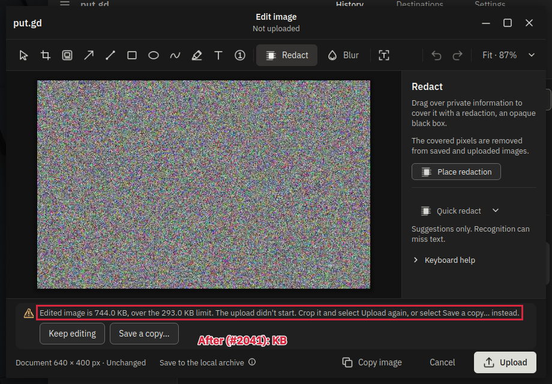
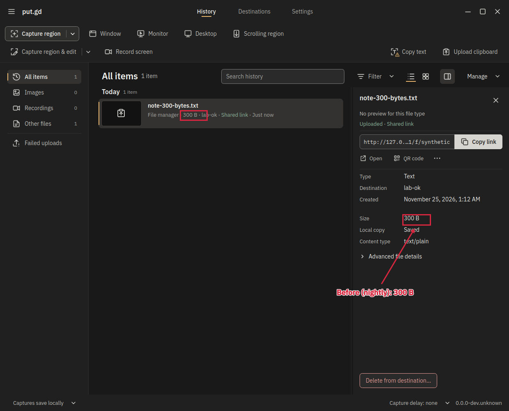
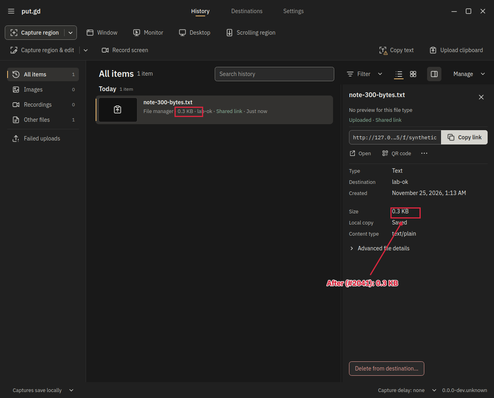

# Sizes show as KB (#2041): before and after pictures

Annotated before/after pictures of put.gd-desktop pull request #2041, "show sizes as KB, never raw bytes or Qt's kB",
taken on a real desktop, with the scripts and uncropped frames they came from.

## What was tested

- **Host:** m74, Linux Mint 22.3, Cinnamon 6.6.4 on X11 (1920x1080), the physical desktop, under the desktop lock
  (owner `copy-2041`; session `copy-2041-build` held the quiet lease for the build, session `copy-2041-pics` the desktop
  lock for the two capture runs). The lock was released after its cleanup check (`release --verified-clean`, receipt
  `~/putgd-lab/locks/history/2026-11-25T07-13-39Z-release.json` on m74). The `putgd` 26.1122.6439~nightly package that was
  already installed on m74 was left as it was found.
- **Before:** `6daf285ca7845a1b78f1b93d1d0f223ddb3c2b14`, the merge base of the PR head and `origin/nightly`.
- **After:** the PR head, `e9303aafc76841a7ec5ddbfb52c7bfee15bc0a98` (`fix/byte-size-kb-units`).
- Both trees were sent to m74 with `git archive` and built with `cmake --preset dev` (targets `putgd`, `putgd-ui`,
  `putgd-cli`, `putgd-http-worker`, `putgd-clipboard-keeper`, `putgd-capture`; `tools/build.sh`), so each build reports
  `0.0.0-dev.unknown`.
- **Run:** a private resident of each build (own `XDG_*` folders, own `XDG_RUNTIME_DIR=/run/user/1000/pg2041`, socket path
  well under 107 bytes) on the real display and session bus, driven with `putgd-cli` (`tools/capture2041.py`, run by
  `tools/run-capture.sh`; runs `before-1` and `after-1`). The only destination is a loopback receiver that answers with a
  link; the files are synthetic and no credentials were used. Both residents were quit and their runtime folders removed.
  Before the real runs, the steps were checked in a headless resident (`--offscreen`, no frames; not published).
- **Annotation:** put.gd's own editor in a private headless resident of the "after" build (`editor.open`, `editor.apply`
  with rectangle, arrow and text in `#D7263D`, `editor.saveCopy`), driven by `tools/annotate2028.py` with `tools/spec.json`
  (written by `tools/mkspec2041.py`). The crops to put.gd's windows come from `tools/crop2041.py`.

## Pictures

| Scene | Before (nightly) | After (PR head) |
| --- | --- | --- |
| 1. Editor, edited image over the Largest file limit |  |  |
| 2. History file details, a 300-byte file |  |  |

1. **Editor size-limit warning, kB to KB.** A noisy JPEG opens in the editor with Largest file at 300,000 bytes; Upload
   then exports a PNG over that limit and the editor shows its warning. Before: `Edited image is 744.1 kB, over the
   293.0 kB limit.` After: `Edited image is 744.0 KB, over the 293.0 KB limit.` The two runs generate their own random
   pixels, so the exported size differs by a tenth of a unit between the runs; the limit, 300,000 bytes shown as 293.0 in 1024s, is the same.
2. **History file details for a file under 1 KB.** A 300-byte text file (`note-300-bytes.txt`) is uploaded to the loopback
   receiver and its History item is selected with the details pane open. Before: `300 B` in the row and in the Size row of
   the details. After: `0.3 KB` in both.

## Files

- `1-…` and `2-…` `-before.png` / `-after.png`: the annotated pictures. `crops-unannotated/`: the same crops before annotation.
- `frames/`: the uncropped 1920x1080 desktop frames (`before-` and `after-`, one per scene).
- `results/`: `facts.json` and the log of each run.
- `tools/`: `build.sh`, `capture2041.py` and `run-capture.sh` (run on m74 under the lock), `crop2041.py`,
  `mkspec2041.py` with `spec.json`, `annotate2028.py` and `annotate-run.sh`.
