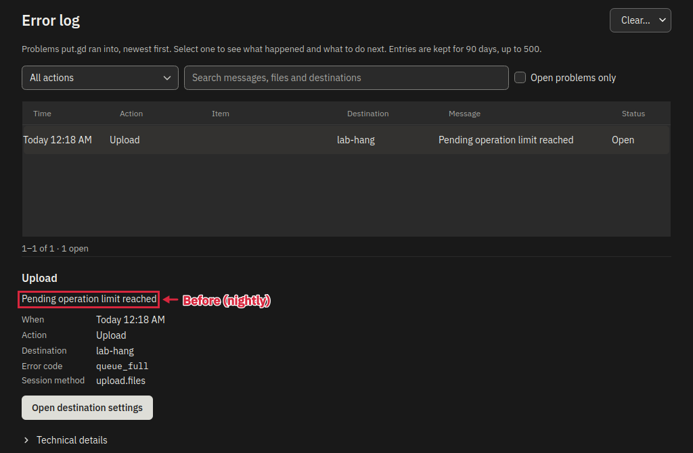
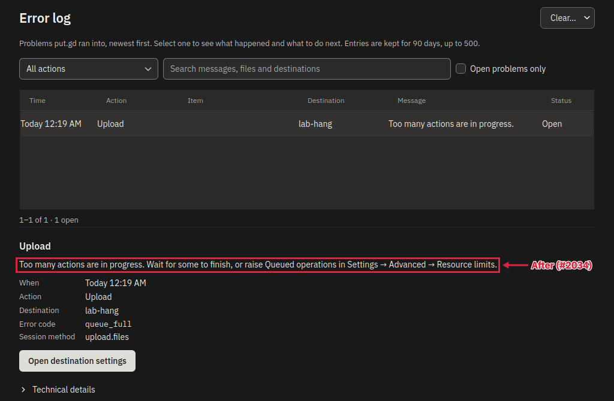
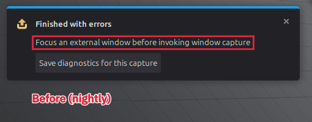
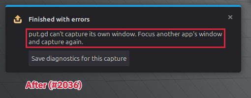
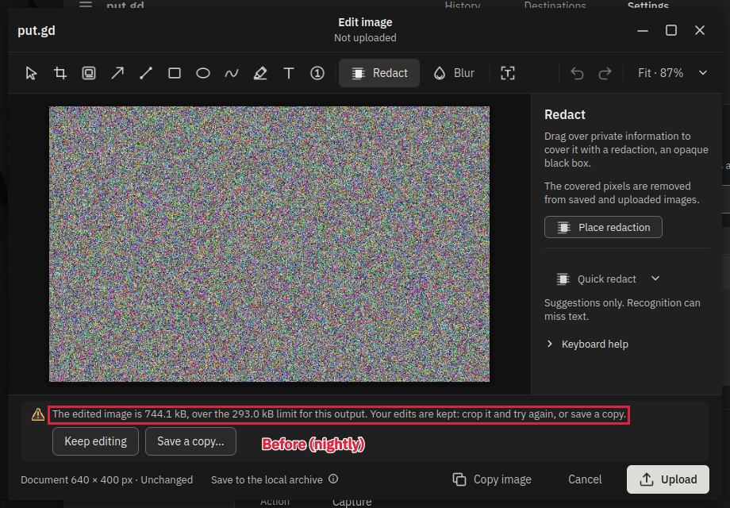
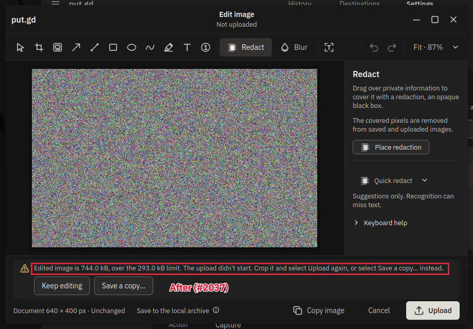

# Error message wording (#2028): before and after pictures for PRs #2034, #2036 and #2037

Annotated before/after pictures of three put.gd-desktop pull requests that reword error messages, taken on a real
desktop, with the scripts and uncropped frames they came from. One picture pair per PR.

## What was tested

- **Host:** m74, Linux Mint 22.3, Cinnamon 6.6.4 on X11 (1920x1080), the physical desktop, under the desktop lock
  (owner `copy-pr2`; session `copy-pr2-build` held the quiet lease for the build, session `copy-pr2-pics` the desktop
  lock for the captures). The lock was released after its cleanup check (`release --verified-clean`, receipt
  `~/putgd-lab/locks/history/2026-11-25T06-21-54Z-release.json` on m74). The `putgd` 26.1122.6439~nightly package that
  was already installed on m74 was left as it was found.
- **Before:** nightly `259d0aacc67ce95c59bb4ba1f1a736981c1a7179`, `cmake --preset dev` on m74.
- **After:** one tree that merges all three PR heads onto that same nightly commit with `git merge --no-edit` in a
  scratch checkout (an octopus merge, no conflicts; the PRs touch different files):
  - #2034 `6388d48fc1a202fedccd61d6184ef6f15a8f645c` (`copy/errors-app-2028`, app/core)
  - #2036 `6ed3392c75b58d93217552242aa12cb93e6fe260` (`copy/errors-platform-2028`, platform/record)
  - #2037 `6817a86ab5ba3ecb7ac460bab5ddc91653aac47f` (`copy/errors-ui-2028`, ui)

  The merge commit exists only in the scratch checkout (`f41e47ab7fc47d7dd28b5bf2568808f20b47a755`, tree
  `214587e2e984138dfadd561b7e6d200326c2a6a1`); nothing was pushed and no branch was changed. Both trees were sent to m74
  with `git archive`, so each build reports `0.0.0-dev.unknown`. Targets: `putgd`, `putgd-ui`, `putgd-cli`,
  `putgd-http-worker`, `putgd-clipboard-keeper`, `putgd-capture` (`tools/build.sh`).
- **Run:** a private resident of each build (own `XDG_*` folders, own `XDG_RUNTIME_DIR=/run/user/1000/pg2028`, socket path
  well under 107 bytes) on the real display and session bus, driven with `putgd-cli` (`tools/capture2028.py`, run by
  `tools/run-capture.sh`; runs `before-6` and `after-1`). The only destination is a loopback receiver that accepts a
  connection and never answers; images are synthetic. No credentials were used. Both residents were quit and their
  runtime folders removed.
- **Annotation:** put.gd's own editor in a private headless resident of the "after" build (`editor.open`, `editor.apply`
  with rectangle, arrow and text in `#D7263D`, `editor.saveCopy`), driven by `tools/annotate2028.py`, `tools/mkspec2028.py`
  and `tools/spec.json`.
- Earlier capture attempts (queue still full when the next scene started, no output route, a limit that stopped the
  editor from opening the file, a rejected `settings.patch` for a route) are not published. `tools/capture2028.py` is the
  final script.

## Pictures

| PR | Before (nightly) | After (PR head) |
| --- | --- | --- |
| #2034, app/core: Error log, `queue_full` |  |  |
| #2036, platform: notification when window capture runs from put.gd's own window |  |  |
| #2037, ui: editor, edited image over the Largest file limit |  |  |

1. **#2034, `queue_full`.** Queued operations and Simultaneous uploads are both 1, two uploads to a receiver that never
   answers fill the queue, and `upload.files` for a third is refused. The refusal is in the Error log page
   (Settings, Error log) with the entry selected. Before: `Pending operation limit reached`. After: `Too many actions are
   in progress. Wait for some to finish, or raise Queued operations in Settings → Advanced → Resource limits.` The Error log row shows
   the first sentence only, with the full text in the details below it.
2. **#2036, `capture_target`.** `action.invoke window` while put.gd's own window is the active window. Cinnamon's
   notification (title `Finished with errors`, the same in both builds) and the Error log entry carry the message. Before:
   `Focus an external window before invoking window capture`. After: `put.gd can't capture its own window. Focus another
   app's window and capture again.` The full frames show the Error log row behind the toast.
3. **#2037, `input_excessive` in the editor.** A noisy JPEG of about 200 KB opens in the editor with Largest file at
   300,000 bytes; Upload then exports a PNG of about 744 kB, over the 293.0 kB limit the editor shows (300,000 bytes is 293.0 in 1024s). Before: `The edited
   image is 744.1 kB, over the 293.0 kB limit for this output. Your edits are kept: crop it and try again, or save a
   copy.` After: `Edited image is 744.0 kB, over the 293.0 kB limit. The upload didn't start. Crop it and select Upload again, or
   select Save a copy... instead.` The two runs generate their own random pixels, so the byte counts differ by a few
   tenths of a kB between the before and after captures.

## Not captured, and what was seen

- No pictures for the History "Retry" error `operation_settling`: it needs a race, so a reliable offline trigger wasn't
  available. `queue_full` was used for #2034 instead.
- For #2034 `queue_full` raised through `upload.files` shows no notification in either build, only the Error log entry.
- The editor's sizes read `744.0 kB` and `293.0 kB` in both builds. The wording guide asks for KB with 1 KB = 1024 bytes.
  The editor formats them with `ByteSize::localized` (Qt's traditional data-size format for the system locale), which
  none of the three PRs changes, so it still prints `kB` here.

## Files

- `1-…` to `3-…` `-before.png` / `-after.png`: the annotated pictures. `crops-unannotated/`: the same crops before annotation.
- `frames/`: the uncropped 1920x1080 desktop frames (`before-` and `after-`, one per scene).
- `results/`: `facts.json` and the log of each run.
- `tools/`: `build.sh`, `capture2028.py` and `run-capture.sh` (run on m74 under the lock), `crop2028.py`,
  `mkspec2028.py` with `spec.json`, `annotate2028.py` and `annotate-run.sh`.
