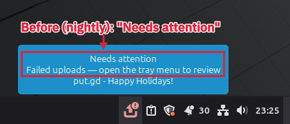
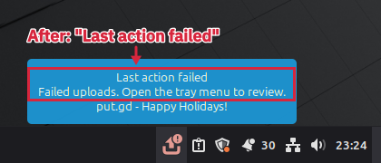
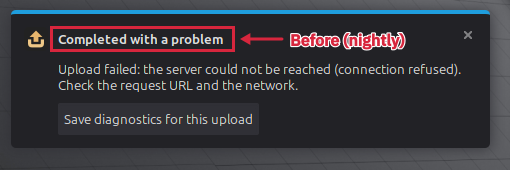
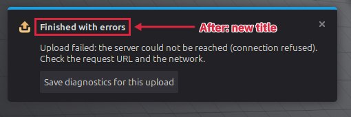
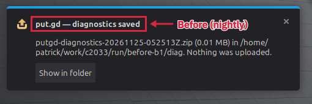
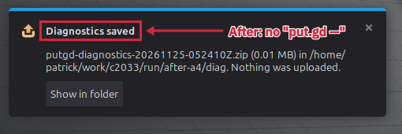
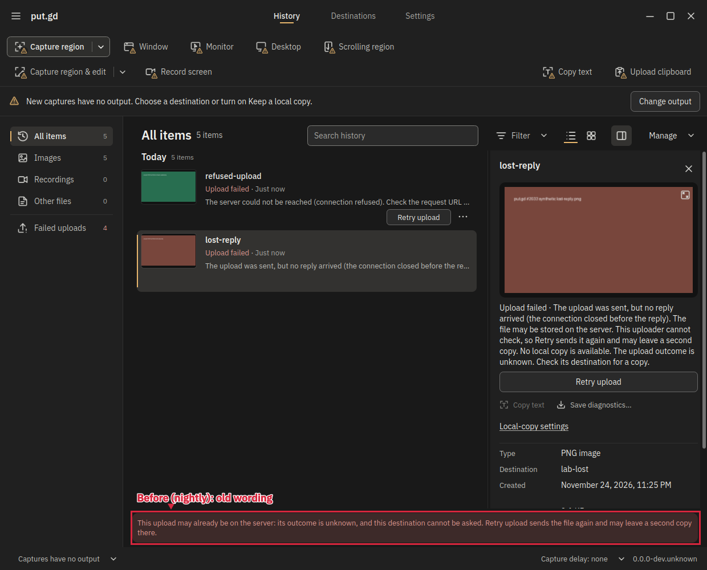
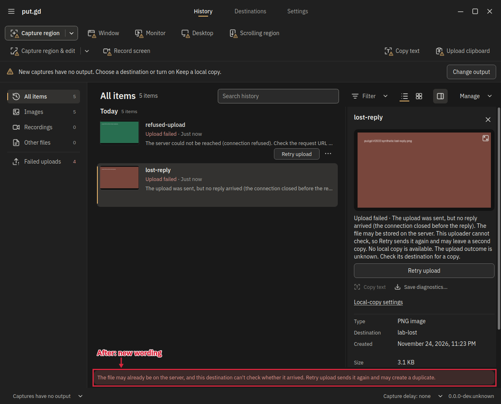

# Tray, status and notification wording (#2028): before and after pictures for PR #2033

Annotated before/after pictures of put.gd-desktop PR #2033 (`copy/tray-status-notifications-2028`) on a real
desktop, and the scripts and uncropped frames they came from.

## What was tested

- **Host:** m74, Linux Mint 22.3, Cinnamon 6.6.4 on X11 (1920x1080), the physical desktop, under the desktop lock
  (owner `copy-2033`, sessions `copy-2033-build` for the quiet-lease build and `copy-2033-pics` for the desktop work).
  The lock was released after its cleanup check (`release --verified-clean`, receipt
  `~/putgd-lab/locks/history/2026-11-25T05-25-52Z-release.json` on m74). The `putgd` 26.1122.6439~nightly package that
  was already installed on m74 was left as it was found.
- **After:** PR head `9825a14854b308ca72bb83a003555dc0399b25bf`, `cmake --preset dev` on m74, targets `putgd`,
  `putgd-ui`, `putgd-cli`, `putgd-http-worker`, `putgd-clipboard-keeper`, `putgd-capture`.
- **Before:** the PR's base, `git merge-base HEAD origin/nightly` = `5a135a485eee8129c833789be747bb357ce65d50`, built the same
  way. Both trees were sent with `git archive`, so each window's version reads `0.0.0-dev.unknown`.
- **Run:** a private resident of each build (own `XDG_*` folders, own `XDG_RUNTIME_DIR=/run/user/1000/pg2033`) on the real
  display and the real session bus, driven with `putgd-cli`, one run per build (`before-b1`, `after-a4`). Uploads are
  synthetic 480x270 PNGs to loopback receivers only: a port nothing listens on (the failed upload), a receiver that
  accepts and never answers (cancelled uploads), and `tests/fixtures/http_uploader_server.py` stored-then-dropped
  (the lost reply). No credentials were used. Both residents were quit and their runtime folders removed.
- **Annotation:** put.gd's own editor in a private headless resident of the "after" build (`editor.open`, `editor.apply`
  with rectangle, arrow and text in `#D7263D`, `editor.saveCopy`), driven by `tools/annotate2033.py` and `tools/spec.json`.
- Earlier capture attempts on the same host (a stale Cinnamon toast hid the new ones; the tooltip was hovered after its
  8 second failure badge had ended) are not published. `tools/capture2033.py` is the final script.

## Pictures

| Picture | Before (nightly) | After (PR head) |
| --- | --- | --- |
| 1. Tray tooltip after a failed upload |  |  |
| 2. Notification for the failed upload |  |  |
| 3. "Diagnostics saved" notification |  |  |
| 4. History, lost-reply upload selected |  |  |

1. The tooltip of put.gd's tray icon, hovered 2 seconds after an upload to a refused port failed. Before: title
   `Needs attention`, body `Failed uploads — open the tray menu to review`. After: title `Last action failed`, body
   `Failed uploads. Open the tray menu to review.` The tooltip body does not show a count at this head; the `(1)` is in the
   tray menu row, which these pictures do not show. The third line, `put.gd - Happy Holidays!`, is the seasonal line
   and is the same in both.
2. Cinnamon's toast for the same failed upload (`operation_partial`). The title is `Completed with a problem` before
   and `Finished with errors` after.
3. The toast from `diagnostics.bundle` with `notify: true`, the same notification the tray's "Save diagnostics for this
   upload" shows. The title is `put.gd — diagnostics saved` before and `Diagnostics saved` after.
4. The History window with the `lost-reply` item selected (a reply lost after the file was stored, an unknown upload
   state). The red banner at the bottom changed from "This upload may already be on the server: its outcome is unknown, and
   this destination cannot be asked. Retry upload sends the file again and may leave a second copy there." to "The file may
   already be on the server, and this destination can't check whether it arrived. Retry upload sends it again and may
   create a duplicate."

## Not captured

- **A "Cancelled" History row.** The three cancelled uploads (one cancelled after the request was sent, one a moment after
  it started, one at once) are counted in History ("All items 5") but no row is drawn for them in the list, in either
  build, so the `Canceled` to `Cancelled` status could not be shown. The same list also showed 2 of its 5 rows
  in the "before" build, so this is not caused by the PR. Cancelling after the request was sent recorded the upload as
  `unknown`; cancelling at once recorded it as `stored`, so no `cancelled` status came up either. Picture 4 is the
  substitute.
- The tray menu was not opened (only its tooltip was hovered), so the `Failed uploads (1)`
  menu row is not pictured.

## Files

- `1-…` to `4-…` `-before.png` / `-after.png`: the annotated pictures. `crops-unannotated/`: the same crops before annotation.
- `frames/`: the uncropped 1920x1080 desktop frames (`before-` and `after-`, one per scene, plus the panel before the
  resident started and while idle).
- `results/`: `facts.json` and the log of each run.
- `tools/`: `capture2033.py` and `run-capture.sh` (run on m74 under the lock), `crop2033.py`, `annotate2033.py`,
  `annotate-run.sh` and `spec.json`.
