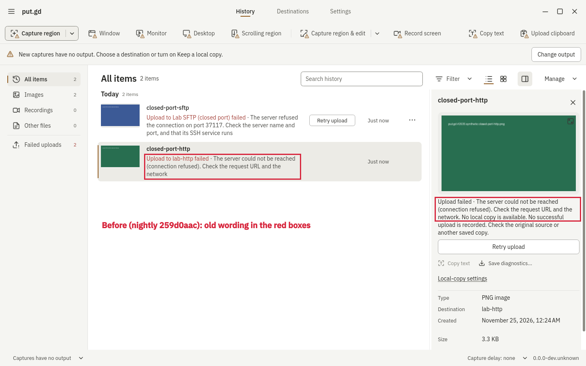
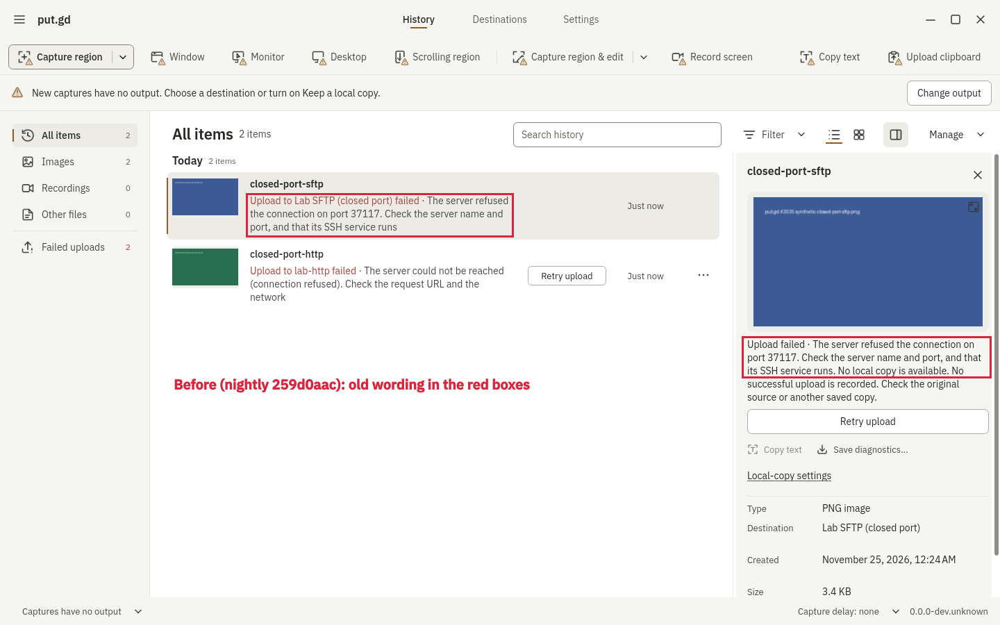
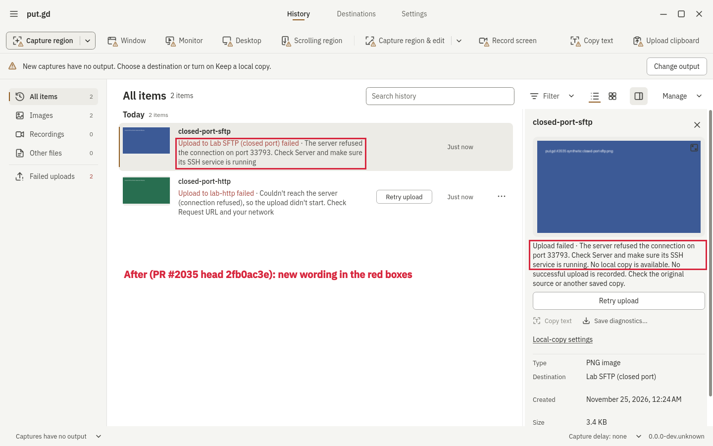

# Storage error wording (#2028): before and after pictures for PR #2035

Annotated before/after pictures of put.gd-desktop PR #2035 (`fix(storage): say what failed and how to fix it in upload
destination errors`) on a real desktop, with the scripts and the uncropped frames they came from.

## What was tested

- **Host:** d69, Debian 13, KDE Plasma on Wayland, 1920x1080, the physical desktop, under the desktop lock (owner
  `copy-2035`; session `copy-2035-build` held the quiet lease for the build, session `copy-2035-pics` the desktop lock
  for the captures and annotation). m74, the host of the #2033 recipe, was busy: another session (`copy-pr2`) held its
  quiet lease for a build. The lock was released after its cleanup check (`release --verified-clean`, receipt
  `~/putgd-lab/locks/history/2026-11-25T06-27-07Z-release.json` on d69). No putgd package is installed on d69 and none was
  added. The two items that were already there (a `gpg-agent` of the host's package signer and `~/.cache/putgd`) were
  left alone. The builds stay in `~/work/c2035/{before,after}` on d69 for a re-check.
- **After:** PR head `2fb0ac3e285ba5e92b6b24bd052a7285e84f98ed`. **Before:** nightly `259d0aacc67ce95c59bb4ba1f1a736981c1a7179`,
  the PR's base (`git merge-base` of the two is that commit). Both trees were sent with `git archive`, so each window's
  version reads `0.0.0-dev.unknown`. Each was built with `cmake --preset dev` on d69 against `sdk-1.11.937`, targets
  `putgd putgd-ui putgd-cli putgd-http-worker putgd-sftp-worker putgd-sftp-askpass putgd-clipboard-keeper putgd-capture`,
  `nice -n 10 -j2`. The build was started a few seconds before its quiet lease was taken.
- **Run:** a private resident of each build (own `XDG_*` folders and `XDG_RUNTIME_DIR=/run/user/1000/pg2035`, so the session
  socket path is 40 bytes) on the real Wayland display and the real session bus, driven with `putgd-cli`, one run per
  build (`before-a3`, `after-a2`; earlier attempts are in `frames/attempts/`). Everything is offline and synthetic: 480x270
  PNGs, ports on 127.0.0.1 that nothing listens on, session-only credentials mode, no credentials and no keychain.
  Both residents were quit and their runtime folder removed.
  - **Custom HTTP uploader** (an imported `.sxcu` with `RequestURL` `http://127.0.0.1:<unused port>/upload`):
    `http_connect_failed`.
  - **SFTP destination** (`server` `127.0.0.1:<unused port>`, user `lab`): `ssh_connection_refused`.
- **Frames:** the whole desktop from the host's own loopback VNC (`tools/rfb.py`), after the pointer was moved off put.gd's
  window with real pointer input through that tile. KWin placed put.gd's window at 40,60 (1440x900) with a temporary
  script (`tools/capture2035.py`, `kwin` lines in `results/*-capture.log`); the pictures are cropped to exactly that window.
  The dark Plasma notifications at the right of the uncropped frames are put.gd notifications for failed uploads of this and earlier runs, outside the crop.
- **Annotation:** put.gd's own editor in a private headless resident of the "after" build (`editor.open`, `editor.apply`
  with rectangles and text in `#D7263D`, `editor.saveCopy`), driven by `tools/annotate2035.py` and `tools/spec.json`.

## Pictures

| Picture | Before (nightly `259d0aac`) | After (PR head `2fb0ac3e`) |
| --- | --- | --- |
| 1. Custom HTTP uploader at a closed port, History |  |  |
| 2. SFTP destination at a closed port, History |  |  |

History shows the same message twice: in the item's row and in the details panel to the right (both boxed).

1. `http_connect_failed`, the upload to `lab-http`. Before: `The server could not be reached (connection refused). Check
   the request URL and the network.` After: `Couldn't reach the server (connection refused), so the upload didn't start. Check
   Request URL and your network.` The fix now names the real field, `Request URL`, and says the upload didn't start.
2. `ssh_connection_refused`, the upload to `Lab SFTP (closed port)`. Before: `The server refused the connection on port N.
   Check the server name and port, and that its SSH service runs.` After: `The server refused the connection on port N.
   Check Server and make sure its SSH service is running.` The port number is a different unused port in each run.

## Not captured

- The custom uploader's `{secret:x}` refusal ("isn't stored by this destination") and an S3 destination at an invalid
  endpoint were not pictured. SFTP at a closed port was the second offline message. The Destinations tab's Test connection
  was not driven either; both pictures show History.
- The window's own title bar reads `put.gd` in both builds (the PR does not change it).

## Files

- `1-…` and `2-…` `-before.png` / `-after.png`: the annotated pictures. `crops-unannotated/`: the same crops before annotation.
- `frames/`: the uncropped 1920x1080 desktop frames of the final runs (`before-` and `after-`: the desktop before the
  resident started and History with each failed upload selected). `frames/attempts/`: the earlier runs, where the
  KWin placement script failed (`Qt is not defined`) and the window stayed at 240,78 with notifications over the
  details panel.
- `results/`: `facts.json` (the build identity, the unused ports, each upload's error code and message from
  `operation.inspect`) and the log of every run.
- `tools/`: `capture2035.py` and `run-capture.sh` (run on d69 under the lock), `rfb.py`, `crop2035.py`,
  `annotate2035.py`, `annotate-run.sh` and `spec.json`.
