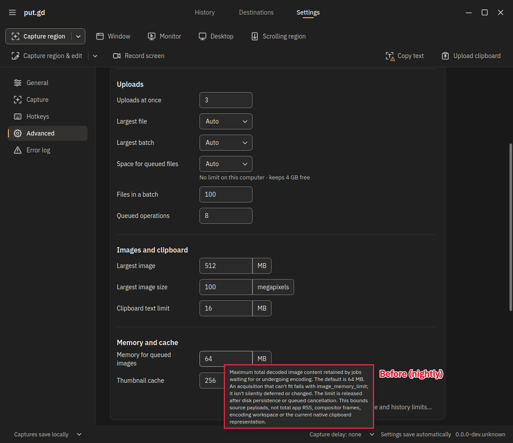
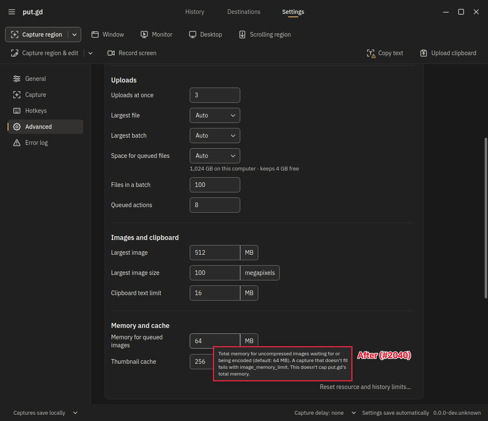
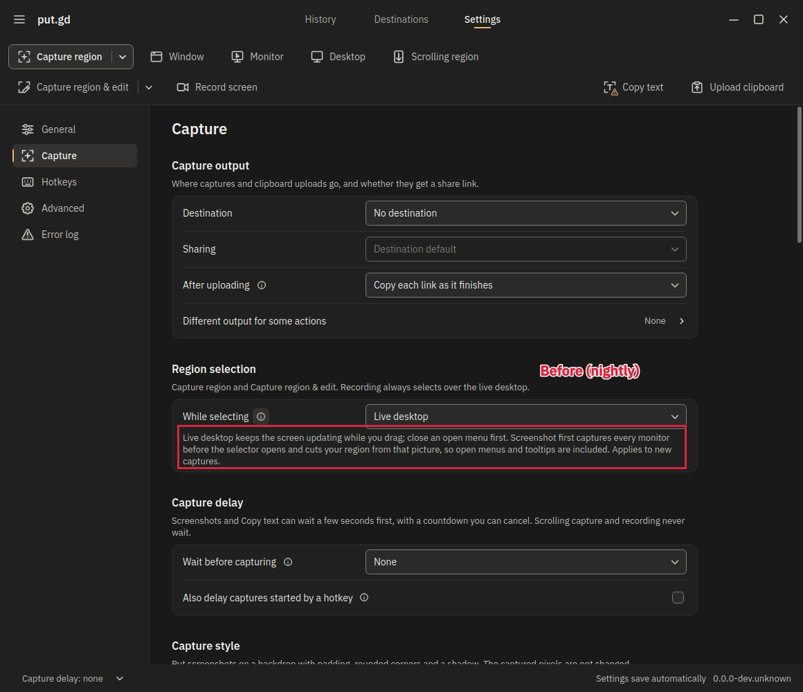
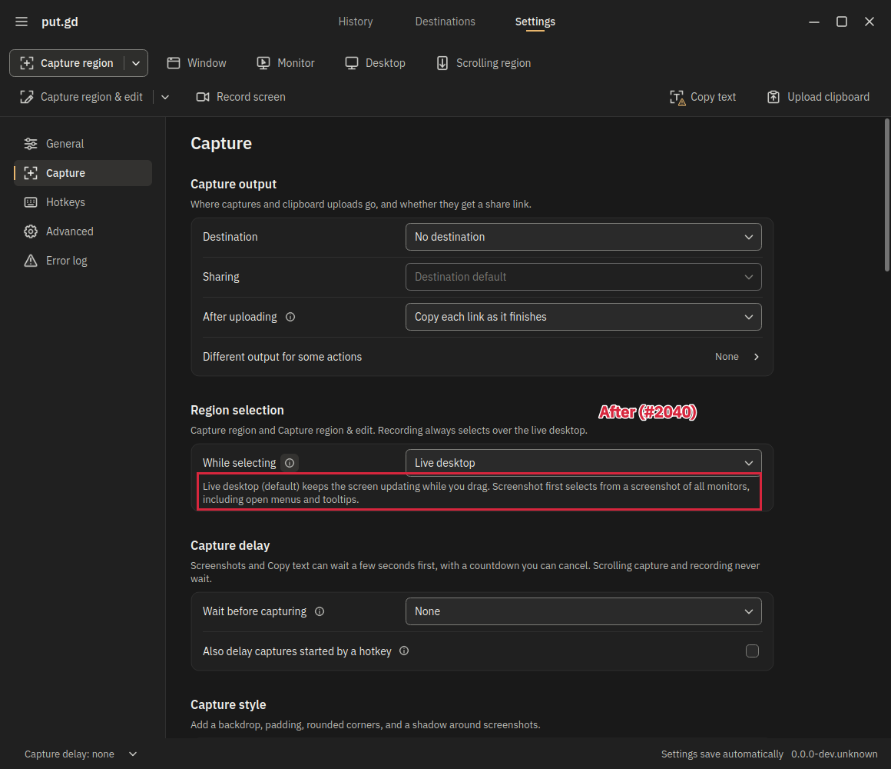
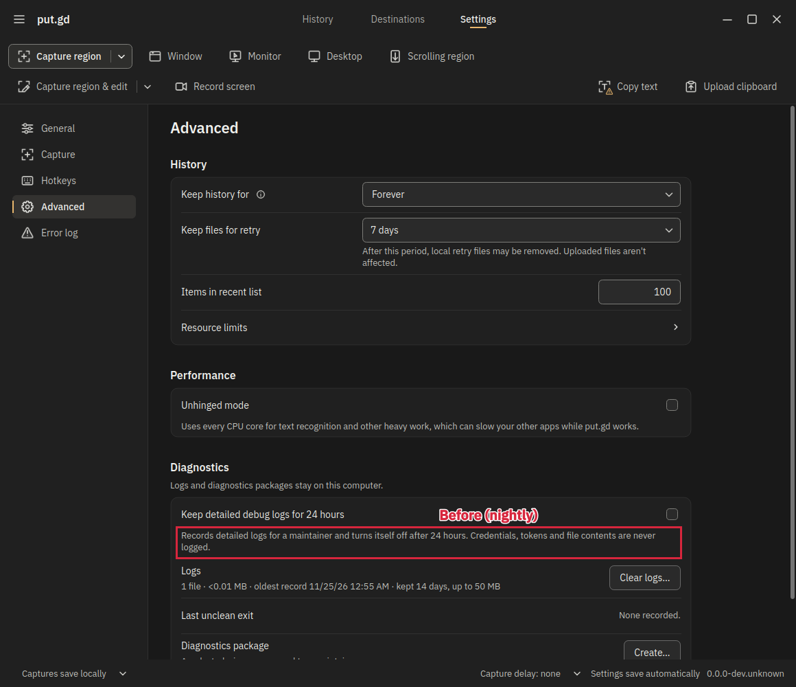
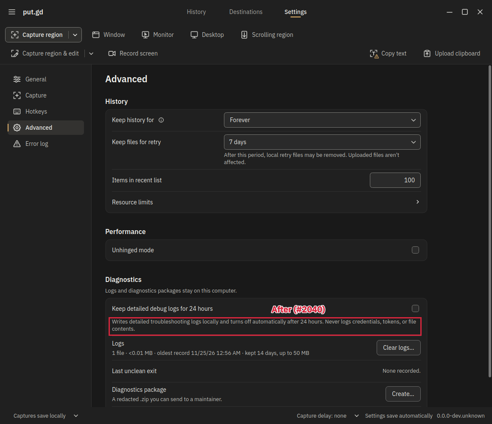
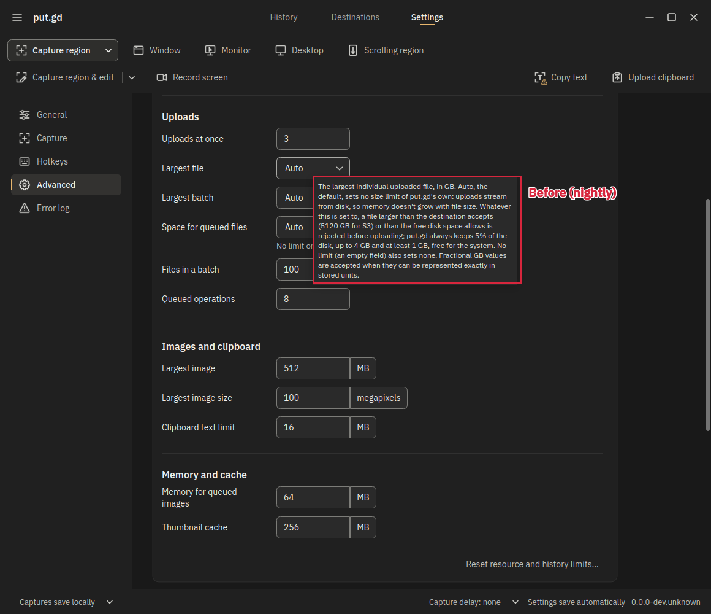
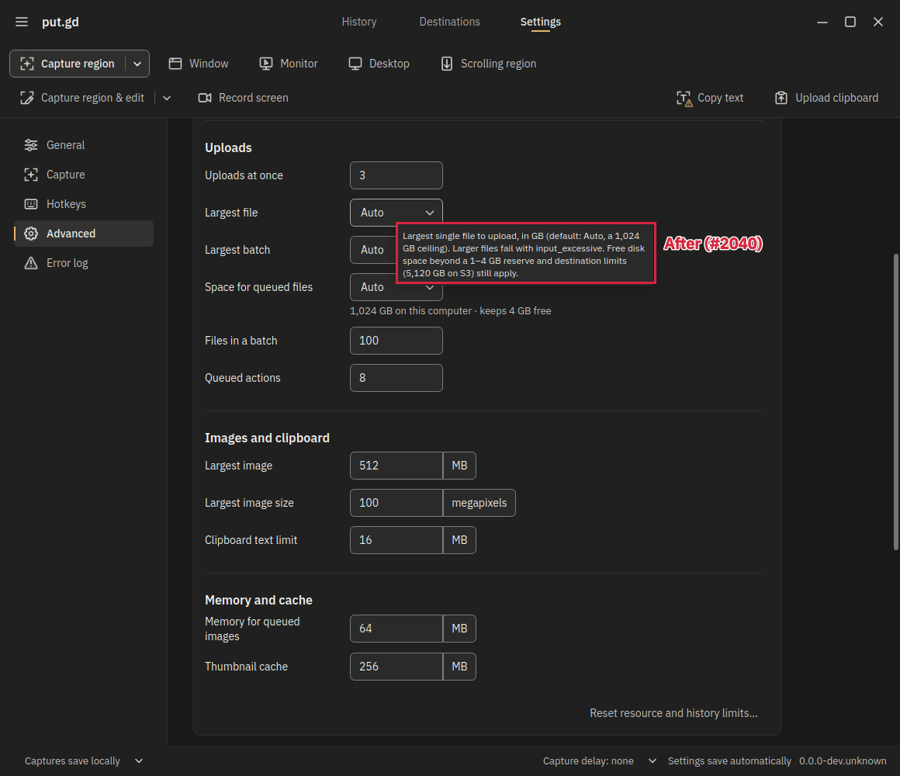
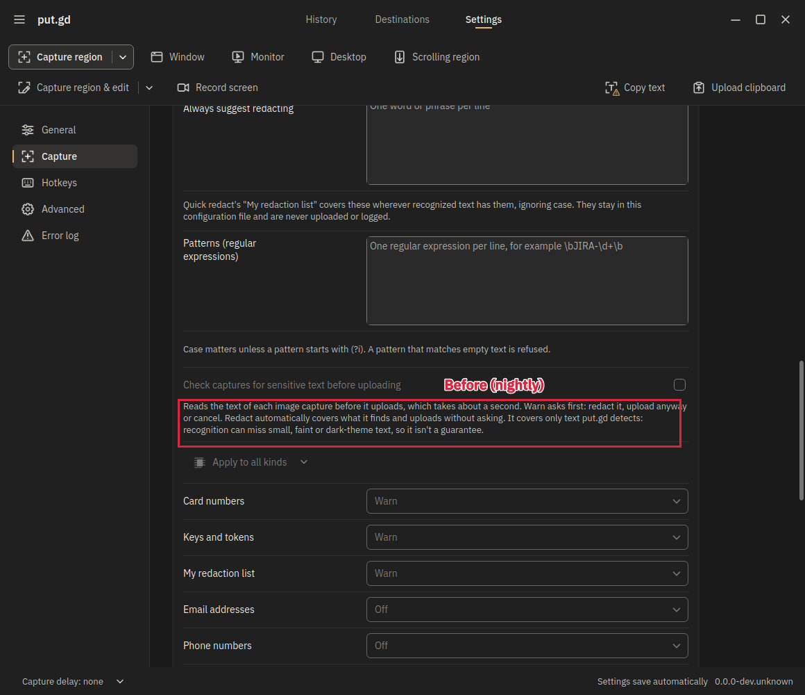
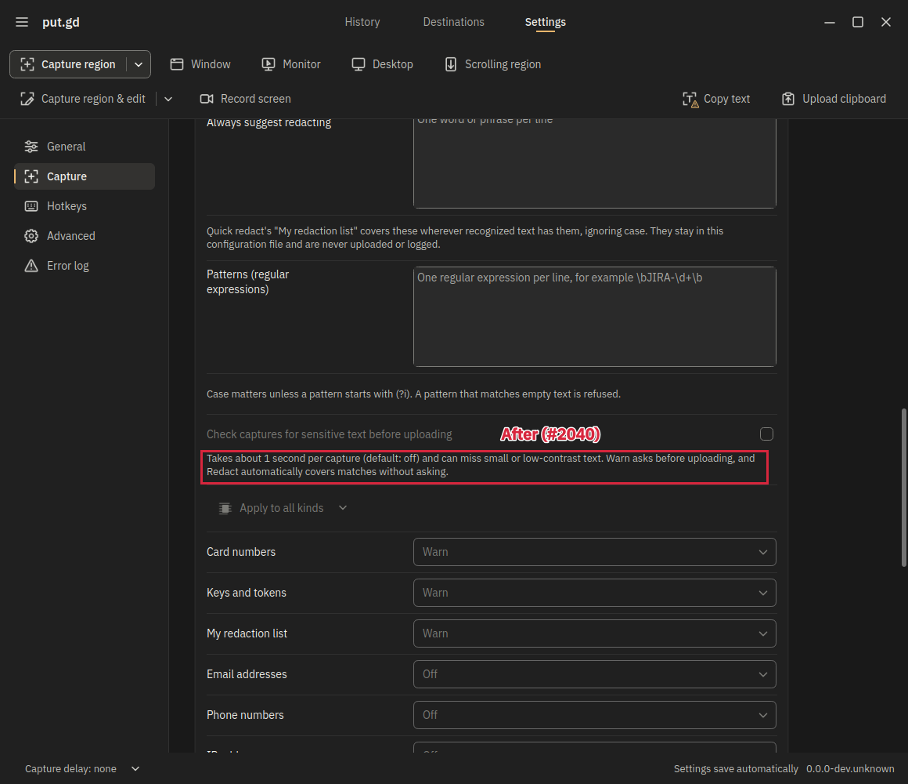

# Shortened Settings descriptions (#2028): before and after pictures for PR #2040

Annotated before/after pictures of the Settings pages changed by put.gd-desktop pull request #2040
("keep Settings descriptions to what matters at the control"), taken on a real desktop, with the scripts and the
uncropped frames they came from. Pictures 1 to 3 are the three requested pairs; 4 and 5 are two more pairs from the same run.

## What was tested

- **Host:** m74, Linux Mint 22.3, Cinnamon 6.6.4 on X11 (1920x1080), the physical desktop, under the desktop lock
  (owner `copy-2040`). Session `copy-2040-build` held the quiet lease for the build; session `copy-2040-pics` held the
  desktop lock for the captures. Both were released after the cleanup check (`release --verified-clean`; receipts on m74:
  `~/putgd-lab/locks/history/2026-11-25T06-59-27Z-release.json` for the desktop lock and
  `~/putgd-lab/locks/history/2026-11-25T06-59-30Z-quiet-release.json` for the quiet lease). No put.gd process of this
  run was left, and `/run/user/1000/pg2040` was gone. The `putgd` 26.1122.6439~nightly package that was already installed
  on m74 was left as it was found.
- **Before:** `c4e32b2c9210a1c77de880673abae26b19b88a84`, the merge base of `9430e0eeb` and `origin/nightly` (nightly was at
  `6daf285ca7845a1b78f1b93d1d0f223ddb3c2b14` when it was taken). Tree `214587e2e984138dfadd561b7e6d200326c2a6a1`.
- **After:** `9430e0eebdf8356e9f8fda2918eee4a5c582e825`, the head of #2040 (`fix(ui): keep Settings descriptions to what
  matters at the control`). Tree `cfa8d113a011d76199bf8bff0861c13911687352`. It differs from the merge base only in
  `src/app/OperationService.cpp`, `src/ui/CustomUploaderPanel.cpp`, `DavDestinationPanel.cpp`, `SettingsDav.cpp`,
  `SettingsWindow.cpp` and `SftpPanel.cpp`.
- **Builds:** each tree went to m74 with `git archive` (so each build reports `0.0.0-dev.unknown`) and was built there with
  `cmake --preset dev` (targets `putgd`, `putgd-ui`, `putgd-cli`, `putgd-http-worker`, `putgd-clipboard-keeper`,
  `putgd-capture`; `tools/build.sh`). Nothing was pushed and no branch or PR was changed.
- **Run:** a private resident of each build (own `XDG_*` folders, own `XDG_RUNTIME_DIR=/run/user/1000/pg2040`, socket path well
  under 107 bytes) on the real display and session bus. `ui.show settings` opens the Settings window, which the script
  places at 100,20 and sizes 1160x1000. It is driven with `xdotool` (rail clicks, wheel over the empty page margin,
  hover, a click on the help button) and each scene is saved as an uncropped 1920x1080 frame with ImageMagick `import`
  (`tools/capture2040.py`, `tools/lib2040.py`, run by `tools/run-capture.sh`; runs `before-1` and `after-1`). The settings are
  the defaults except two changes made the same way in both runs: the daily update check is off, and a local copy is kept so
  that the "new captures have no output" banner doesn't move the page. No destination exists, nothing was uploaded and no
  credentials were used.
- **Annotation:** put.gd's own editor in a private headless resident of the "after" build (`editor.open`, `editor.apply`
  with a rectangle and a text label in `#D7263D`, `editor.saveCopy`), driven by `tools/annotate2040.py`, `tools/mkspec2040.py`
  and `tools/spec.json`. The crops are the Settings window only (`tools/crop2040.py`).
- Layout probing (finding the rail and control positions) used the Settings window of an existing build in another
  session's folder on m74; those frames are not published.

## Pictures

| # | Page and control | Before (merge base) | After (#2040 head) |
| --- | --- | --- | --- |
| 1 | Settings → Advanced → Resource limits, **Memory for queued images** (tooltip) |  |  |
| 2 | Settings → Capture → Region selection, **While selecting** (help opened) |  |  |
| 3 | Settings → Advanced → Diagnostics, **Keep detailed debug logs for 24 hours** |  |  |
| 4 | Settings → Advanced → Resource limits, **Largest file** (tooltip) |  |  |
| 5 | Settings → Capture → Text recognition, **Check captures for sensitive text before uploading** |  |  |

1. **Memory for queued images.** The pointer rests on the field and its tooltip shows. Before, it is eight sentences of
   accounting ("Maximum total decoded image content retained by jobs waiting for or undergoing encoding…"). After, it is
   two facts and a limit: "Total memory for uncompressed images waiting for or being encoded (default: 64 MB). A capture
   that doesn't fit fails with image_memory_limit. This doesn't cap put.gd's total memory."
2. **While selecting.** The help button next to the label is clicked and the text opens under the control. Before, four
   sentences ("Live desktop keeps the screen updating while you drag; close an open menu first…"). After, two: "Live desktop
   (default) keeps the screen updating while you drag. Screenshot first selects from a screenshot of all monitors, including
   open menus and tooltips."
3. **Debug logging.** The description sits under the checkbox and needs no interaction. Before: "Records detailed logs for
   a maintainer and turns itself off after 24 hours. Credentials, tokens and file contents are never logged." After:
   "Writes detailed troubleshooting logs locally and turns off automatically after 24 hours. Never logs credentials,
   tokens, or file contents."
4. **Largest file.** The pointer rests on the field and its tooltip shows. Before, a long paragraph with the 5120 GB S3 limit,
   the 5% reserve and fractional-GB rules. After: "Largest single file to upload, in GB (default: Auto, a 1,024 GB ceiling).
   Larger files fail with input_excessive. Free disk space beyond a 1–4 GB reserve and destination limits (5,120 GB on S3)
   still apply." The same pictures also show the label changes in that card ("Queued operations" became "Queued actions") and
   the new line "1,024 GB on this computer · keeps 4 GB free" under Space for queued files.
5. **Check for sensitive text.** Before, five sentences; after, "Takes about 1 second per capture (default: off) and can
   miss small or low-contrast text. Warn asks before uploading, and Redact automatically covers matches without asking."
   The checkbox and the rows under it are greyed out in both builds because these dev builds have no `putgd-ocr` helper
   (text recognition unavailable); the description text is the same widget either way.

## Not captured, and what was seen

- **Settings → General → Updates, "Check for updates once a day".** The row isn't shown on this source build: the Updates card
  says "This build wasn't made by a put.gd package (for example, a build from source), so it doesn't check for updates." Debug
  logging (picture 3) was used instead, as the task allowed.
- Routine controls on the Advanced page (the Resource limits fields) have no visible help text, only the tooltip and the
  accessible description, so pictures 1 and 4 are tooltips. Controls with a help button (picture 2) open the text inline.

## Files

- `1-…` to `5-…` `-before.png` / `-after.png`: the annotated pictures. `crops-unannotated/`: the same crops before annotation.
- `frames/`: the uncropped 1920x1080 desktop frames (`before-` and `after-`, one per scene; `-pre` frames are the scene
  before the pointer moved onto the control).
- `results/`: `facts.json` and the log of each run (window geometry of every frame).
- `tools/`: `build.sh`, `capture2040.py`, `lib2040.py` and `run-capture.sh` (run on m74 under the lock), `crop2040.py`,
  `mkspec2040.py` with `spec.json`, `annotate2040.py` and `annotate-run.sh`.
