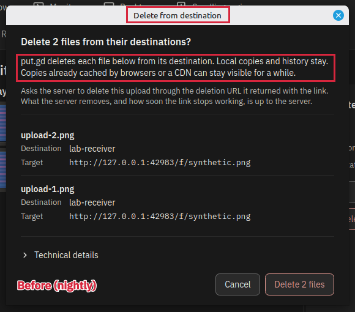
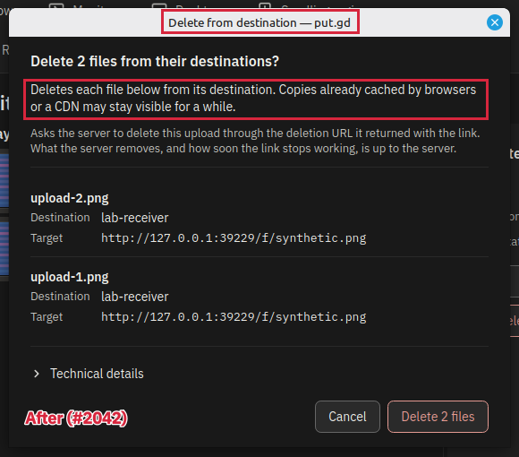
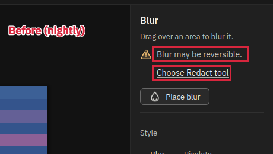
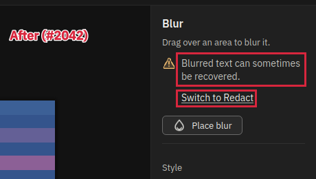
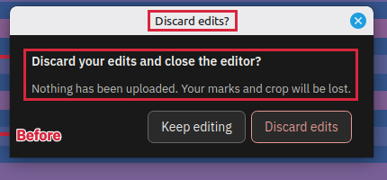
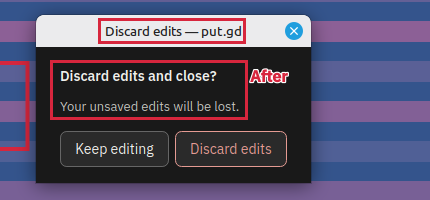
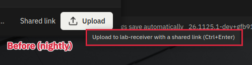
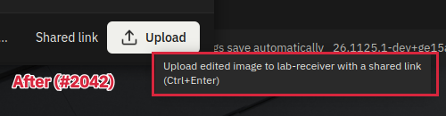
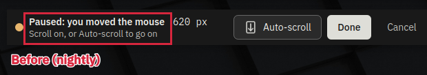
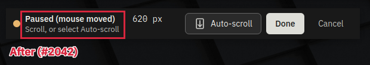

# UI wording (#2028): before and after pictures for PR #2042

Annotated before/after pictures of put.gd-desktop pull request #2042 ("rewords titles, tooltips, hints, dialogs and the
editor, recording and scroll bar text"), taken on a real desktop, with the scripts and the uncropped frames they came
from. Pictures 1 to 4 are the four requested pairs (2 has a second pair, 2b).

## What was tested

- **Host:** m74, Linux Mint 22.3, Cinnamon 6.6.4 on X11 (1920x1080), the physical desktop, under the desktop lock
  (owner `copy-2042`). Session `copy-2042-build` held the quiet lease for the build; session `copy-2042-pics` held the
  desktop lock for the captures. **The locks were released after the cleanup check** (`release --verified-clean`; receipts
  on m74 under `~/putgd-lab/locks/history/`: `2026-11-25T07-23-47Z-quiet-release.json` for the quiet lease,
  `2026-11-25T07-30-55Z-release.json` and `2026-11-25T07-32-32Z-release.json` for the two desktop-lock periods (the
  second was a re-capture of the editor scene)). No put.gd or xed process of this run was left, and
  `/run/user/1000/pg2042` was gone. The `putgd` 26.1122.6439~nightly package that was already installed on m74 was left
  as it was found.
- **Before:** `566de6ffcc2226547db61c8b9d24c05a4400670c`, the merge base of the PR head and `origin/nightly` (nightly was at
  `ef984ff62508966ca80da5e49cd1105e3b92d48d`). Tree `6aafca75bae0a6b1310f91ab7fdb46c20064c502`.
- **After:** `42edcee49d38cfd3a08797891cd38f40eb406180`, the head of #2042 (`copy/editor-recording-ui-2028`). Tree
  `ba9b5e03bc6fc480c2337ccb5c1d2d622bbcf0ac`.
- **Builds:** each tree went to m74 with `git archive` and was committed there as a one-commit scratch repository (so the
  build identity is a real, clean git one and `putgd-record` accepts the resident; the scratch commits are
  `fb9184ce12aa` (before) and `e15a08ea632f` (after), same trees as above). Built with `cmake --preset dev`, targets
  `putgd`, `putgd-ui`, `putgd-cli`, `putgd-http-worker`, `putgd-clipboard-keeper`, `putgd-capture`, `putgd-record`
  (`tools/build.sh`). Nothing was pushed and no branch or PR was changed.
- **Run:** a private resident of each build (own `XDG_*` folders, own `XDG_RUNTIME_DIR=/run/user/1000/pg2042`, socket path
  well under 107 bytes) on the real display and session bus, driven with `putgd-cli` and `xdotool`, with uncropped
  1920x1080 frames from ImageMagick `import` (`tools/capture2042.py`, `tools/lib2042.py`, run by `tools/run-capture.sh`).
  The only destination is a loopback receiver that answers every upload with a JSON link and deletion URL; images are
  synthetic, no credentials were used, and the scroll-capture fixture is a text file of synthetic lines opened in
  `xed --standalone` by the run itself (auto-scroll only ever touched that window). Frames come from runs `before-1` and
  `after-4` (history and scroll scenes) and `before-5` and `after-5` (editor scene; see below).
- **Annotation:** put.gd's own editor in a private headless resident of the "after" build (`editor.open`, `editor.apply`
  with rectangles and text in `#D7263D`, `editor.saveCopy`), driven by `tools/annotate2042.py`, `tools/mkspec2042.py`
  and `tools/spec.json`. The crops are `tools/crop2042.py`; the unannotated crops are in `crops-unannotated/`.
- The editor scene was run twice. In `before-1`/`after-4` the edit action had no destination, so the Upload tooltip named
  "Save to the local archive" (see Findings; those two frames are kept in `frames/local-archive-destination/`). In
  `before-5`/`after-5` the edit action's destination is the loopback receiver, so the tooltip names a real destination.
  The editor pictures use run 5. The `results/` logs of runs 1 and 4 therefore also contain superseded editor-scene lines.

## Pictures

| # | What | Before (nightly) | After (PR head) |
| --- | --- | --- | --- |
| 1 | History: Delete from destination dialog, title and body |  |  |
| 2 | Editor, Blur tool: warning and the **Switch to Redact** button |  |  |
| 2b | Editor: Discard edits dialog |  |  |
| 3 | Editor: Upload button tooltip |  |  |
| 4 | Scrolling-capture bar after auto-scroll paused because the mouse moved |  |  |

1. **History, Delete from destination.** Two synthetic uploads to the loopback receiver, both selected in History, then
   `ui.history deleteSelected`. Title: `Delete from destination` becomes `Delete from destination — put.gd`. Body:
   `put.gd deletes each file below from its destination. Local copies and history stay. Copies already cached by browsers
   or a CDN can stay visible for a while.` becomes `Deletes each file below from its destination. Copies already cached by
   browsers or a CDN may stay visible for a while.` The dialog's second paragraph and its buttons are the same in both builds.
2. **Editor, Blur tool.** `editor.open` on a synthetic image, a rectangle mark, then `editor.view tool=blur`. Warning:
   `Blur may be reversible.` becomes `Blurred text can sometimes be recovered.`; the button
   `Choose Redact tool` becomes `Switch to Redact`.
   **2b**, `editor.view discard`: title `Discard edits?` becomes `Discard edits — put.gd`; heading `Discard your edits and close the
   editor?` becomes `Discard edits and close?`; body `Nothing has been uploaded. Your marks and crop will be lost.` becomes
   `Your unsaved edits will be lost.` (that is what the head's code says; the PR body's table gives "Your marks and crop will
   be lost. Copies you saved stay." for the same dialog).
3. **Editor, Upload tooltip.** The pointer rests on **Upload** with the edit action's destination set to the loopback
   receiver: `Upload to lab-receiver with a shared link (Ctrl+Enter)` becomes `Upload edited image to lab-receiver with a
   shared link (Ctrl+Enter)`. Note this is longer than before, not shorter (the PR table lists the new text as
   "Upload edited image (Ctrl+Enter)", which the destination suffix does not match).
4. **Scrolling-capture bar.** A scrolling capture of the text file in xed (`scroll.prepare`, `scroll.start`,
   `scroll.autoScroll on`, then the pointer moved with `xdotool`; `scroll.inspect` says `paused: true, pausedBy: pointer`).
   `Paused: you moved the mouse` / `Scroll on, or Auto-scroll to go on` becomes `Paused (mouse moved)` / `Scroll, or select
   Auto-scroll`. The capture was cancelled afterwards (`scroll.cancel`; nothing saved).

## Findings

- **History's own title is not on screen.** `HistoryWindow` is a page of the main window (`MainWindow.cpp`: `history_ = new
  HistoryWindow(session_, pages_)`), so `setWindowTitle("History — put.gd")` is never a title bar: after `ui.show history`
  the only put.gd window in either build is the main window titled `put.gd` (`results/*-capture.log`, "main window" lines;
  `frames/*-history-list-full.png`). The request's first picture is therefore the dialog titles instead
  (`Delete from destination` to `Delete from destination — put.gd`, `Discard edits?` to `Discard edits — put.gd`), which
  are real title bars.
- **Tooltip grammar with no destination.** With the edit action at its default (nothing configured, "Save to the local
  archive") the Upload tooltip reads `Upload to Save to the local archive (Ctrl+Enter)` before and `Upload edited image to
  Save to the local archive (Ctrl+Enter)` after: the destination summary is pasted after "to". Both builds do it; the PR
  keeps it. Frames: `frames/local-archive-destination/`.
- **Not captured:** the Auto-scroll button's tooltip (`Scroll automatically. Move the mouse to pause.`). The pointer rested
  on the button for 2.6 s and no tooltip appeared on the helper's bar window in either build
  (`frames/*-scroll-autoscroll-tooltip-full.png`). The recording bar and the dashboard's Record screen tooltip were not
  captured: pair 4 uses the scroll bar instead.

## Files

- `1-…` to `4-…` `-before.png` / `-after.png`: the annotated pictures. `crops-unannotated/`: the same crops before annotation.
- `frames/`: the uncropped 1920x1080 desktop frames (`before-` and `after-`, one per scene).
- `results/`: `capture.log` and `facts.json` of each run.
- `tools/`: `build.sh`, `capture2042.py`, `lib2042.py`, `hover.json` and `run-capture.sh` (run on m74 under the desktop
  lock), `crop2042.py`, `mkspec2042.py` with `spec.json`, `annotate2042.py` and `annotate-run.sh`.
