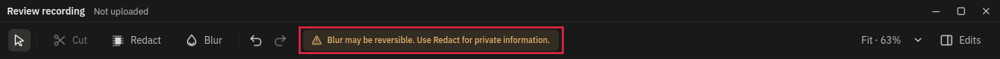
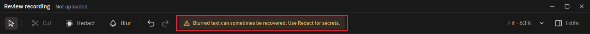
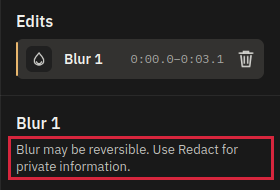
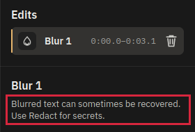
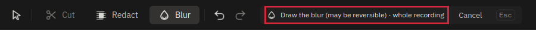
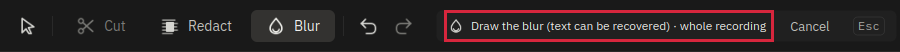

# Recording review blur warning (#2044): before and after pictures

Pictures for put.gd-desktop issue #2044 and its pull request. They show the recording review window's blur messages before
and after the rewording, taken on a real desktop. The record also has the scripts and the uncropped frames they came from.

## What was tested

- **Host:** m74, Linux Mint 22.3, Cinnamon 6.6.4 on X11 (1920x1080). This is the physical desktop shown on the lab wall.
  The run held the desktop lock (owner `copy-2044`, session `copy-2044-pics`, through `desktop_lock.py run`). The lock was
  released with `--verified-clean`; the receipt is `results/m74-lock-release.json`. The installed `putgd`
  26.1122.6439~nightly package was left as it was.
- **Before:** nightly `a194ea26cd4b222d8d0d63e6b617cc1b4292cdd0`, committed on m74 as the one-commit scratch repository
  `8950799fd0c0`. Its build reads `26.1125.1-dev+g8950799fd0c0`.
- **After:** the PR head `088096f47` (tree `6a1412e7d8eb6e513e36f4c991105ea17d31c29d`), applied with `git am` on top of
  the scratch commit, giving `27c64053baed` (same tree). Its build reads `26.1125.3-dev+g27c64053baed`.
- **Builds:** `cmake --preset dev` on m74 (Qt 6.4), targets `putgd`, `putgd-ui`, `putgd-cli`, `putgd-http-worker`,
  `putgd-clipboard-keeper`, `putgd-capture` and `putgd-record`. The "after" build also ran `test_review_window_actions`,
  which passed (1/1).
- **Run (`tools/capture2044.py`):** each build started a private resident with its own `XDG_*` folders and
  `XDG_RUNTIME_DIR=/run/user/1000/pg2044`, on the real display and session bus, driven with `putgd-cli`. It recorded
  3 s of a desktop region (no audio) and opened private review. Then it took three frames with ImageMagick `import`:
  Blur armed (`recording.review armBlur`), a whole-recording blur placed with Return and selected (wide window, side panel
  shown), and the same window at 1440x700, below the 720 px fold height, so the panel folds and the toolbar banner shows. The
  recording was cancelled and the resident quit. Nothing was uploaded and no credentials were used. Frames come from runs
  `before-5` and `after-1` (`results/`).
- **Annotation:** put.gd's own editor in a private headless resident of the "after" build drew the red boxes
  (`tools/annotate-run.sh`, `tools/annotate2044.py`, `tools/spec.json`). The crops come from `tools/crop2044.py`, and the
  unannotated crops are in `crops-unannotated/`.

## Pictures

| # | What | Before (nightly) | After (PR head) |
| --- | --- | --- | --- |
| 1 | Toolbar blur banner, folded window |  |  |
| 2 | Side panel sentence for a selected blur |  |  |
| 3 | Placement prompt while Blur is armed |  |  |

1. and 2. `Blur may be reversible. Use Redact for private information.` becomes
   `Blurred text can sometimes be recovered. Use Redact for secrets.`, the same warning as the image editor's.
3. `Draw the blur (may be reversible)` becomes `Draw the blur (text can be recovered)`.

## Findings

- At 1440 px wide the new banner fits. At 900 px wide (an earlier run) the old banner was already elided ("Blur may be
  reversible. Use Red…"), and the new one, five characters longer, elides there too. The full text is in the side panel
  and in `recording.review inspect` (`blurGuidance.text`).
- The toolbar banner shows only when the window is folded, so the frames are taken at 1440x700.
