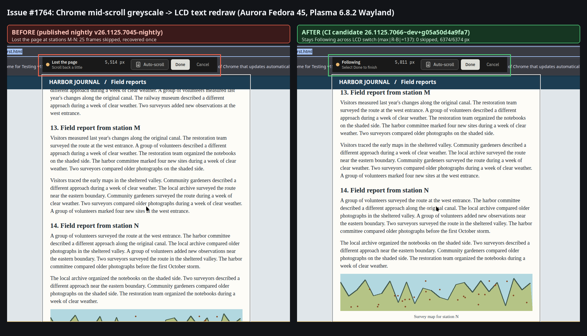
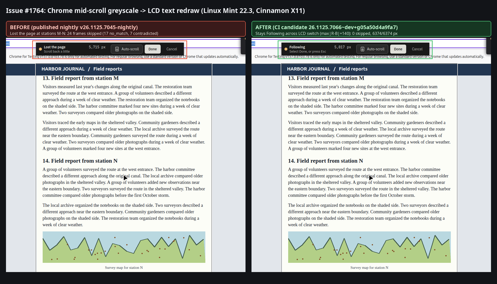

# Scrolling capture across Chrome mid-scroll greyscale-to-LCD text redraw (#1764)

Live physical-desktop before/after verification of the fix for [issue #1764](https://github.com/patrick-hudson/put.gd-desktop/issues/1764) (scrolling capture losing the page when Chrome switches text antialiasing from greyscale to subpixel LCD while the page is moving).

## Packages tested

- **Before:** published nightly `v26.1125.7045-nightly` (`9d9f65eb8f7c4e9a7eddaf8b0c7938b95e805d40`): AppImage on Aurora Fedora 45 (Plasma 6.8.2 Wayland), Ubuntu 24.04 DEB on Linux Mint 22.3 (Cinnamon X11).
- **After:** CI candidate `26.1125.7066~dev+g05a50d4a9fa7` (`05a50d4a9fa79ece90e48c7bda81b2920355f6a6`, CI run `45672892430`): AppImage (`sha256:c515b18579e27d413c7c9397eb3a2dbc01bc7380e1e021de5b87a8c9c580a33a`) on Aurora Fedora 45, Ubuntu 24.04 DEB (`sha256:06809d4ae1d628dae3c2074daa94327ae21ed99837fc356ae40d59430a401313`) on Linux Mint 22.3.

## Live desktop results (Chrome for Testing 157.0.8103.78)

| Host / Desktop | Trial | Before (`v26.1125.7045-nightly`) | After (`05a50d4a9fa7`) |
| --- | --- | --- | --- |
| Aurora Fedora 45 (Plasma 6.8.2 Wayland) | `afirst-midscroll` (mid-scroll greyscale→LCD switch, `max|R-B|`: 20 → 137) | **Lost the page**, 25 frames skipped, recovered 1, 6374/6374 px | **Following throughout**, 0 frames skipped, 0 lost, 6374/6374 px |
| Linux Mint 22.3 (Cinnamon X11) | `afirst-midscroll` (mid-scroll greyscale→LCD switch at frame 332→333, `max|R-B|`: 19 → 140) | **Lost the page**, 24 frames skipped (17 `no_match`, 7 `contradicted`), recovered 1, 6374/6374 px | **Following throughout**, 0 frames skipped, 0 lost, 6374/6374 px |
| Aurora Fedora 45 (Plasma Wayland) | `afirst-t1`, `mdn-ctrl` | — | 0 skipped (`6374/6374`, `18629/18629`) |
| Linux Mint 22.3 (Cinnamon X11) | `afirst-t1`, `mdn-ctrl`, `wiki-ctrl`, `github-ctrl` | `mdn-ctrl` lost (461 skipped); `github-ctrl` 11 skipped (height cap 30000) | `afirst-t1` 0 skipped (6374/6374), `mdn-ctrl` 0 skipped (18629/18629), `wiki-ctrl` 0 skipped (23300/23300), `github-ctrl` 11 skipped (height cap 30000, unchanged) |

## Before and after pictures

