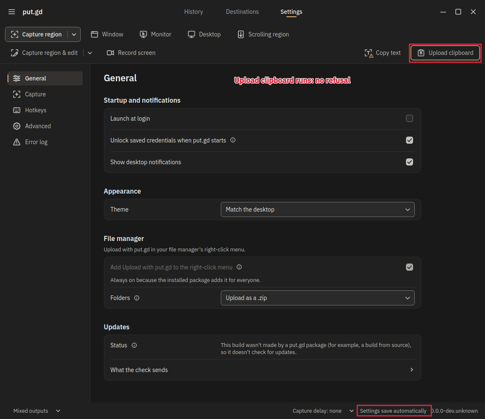
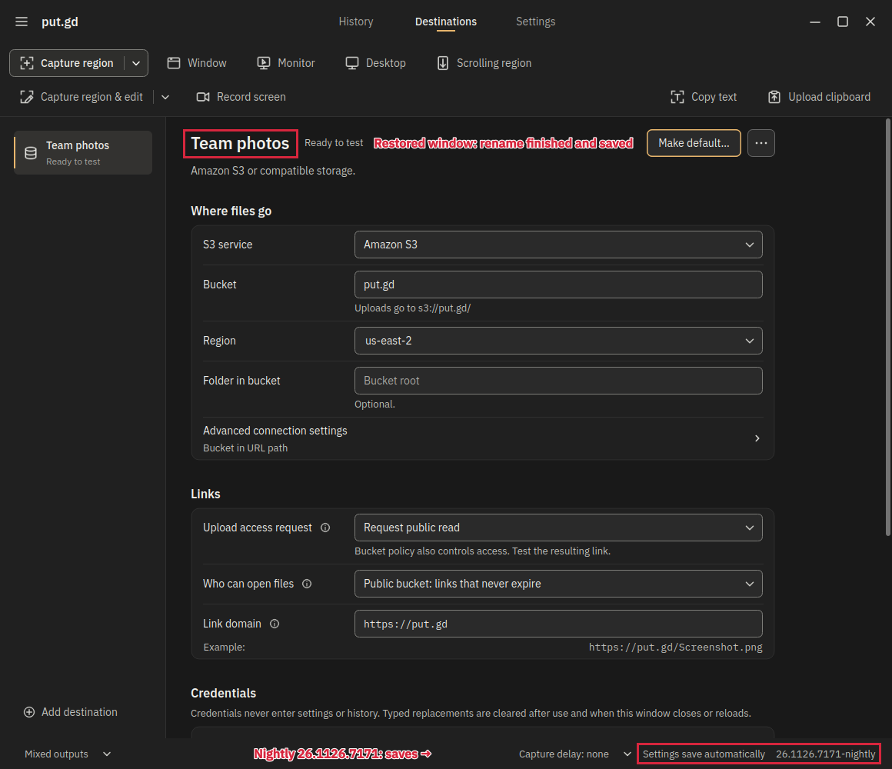
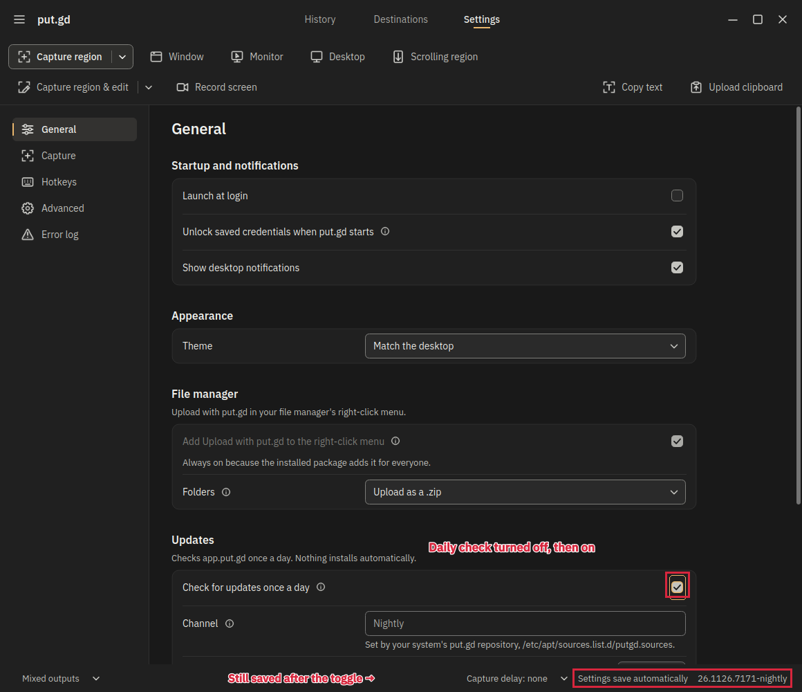
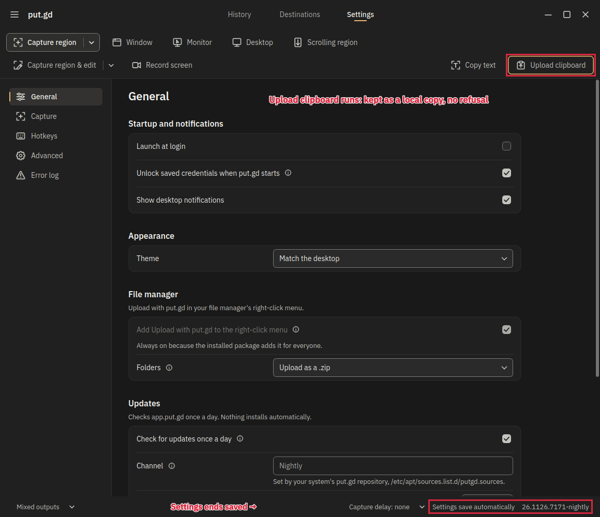

# Settings stays unsaved after a restored checkpoint, a finished rename and a daily-check toggle (#1735)

Annotated before/after pictures for put.gd-desktop issue #1735 and its fix pull request, taken on a real desktop, with
the scripts, the unannotated crops and the run logs.

## What was tested

- **Host:** m74, Linux Mint 22.3, Cinnamon on X11 (1920x1080), the physical desktop, under the desktop lock (owner
  `fix1735`, session `mcp-fix1735`); the build and the annotation held the quiet lease. Every lock was released with the
  cleanup check. No process of these runs was left and `/run/user/1000/pg1735` was gone after each run.
- **Before:** the `putgd` 26.1125.7045~nightly package already installed on m74 (commit
  `9d9f65eb8f7c4e9a7eddaf8b0c7938b95e805d40`), run from `/usr/bin` and left as it was found. It contains #2040 and has the
  same `src/ui` as the fix branch's base.
- **After:** the fix branch `fix/settings-unsaved-1735` at `ce38caefd39e6b1d6704c5a4907463e95d172c90` (tree
  `c89164aeb26ae512f01e6664ac20670c0785e01f`), copied to m74 without `.git` and built with `cmake --preset dev` (targets
  `putgd`, `putgd-ui`, `putgd-cli`), so it reports `0.0.0-dev.unknown`.
- **Run** (`tools/capture1735.py`): a private resident of the build (own `XDG_*` folders and runtime folder) on the real
  display. The development template adds one S3 destination (nothing is uploaded; no credentials). Upload clipboard
  goes to no destination and a local copy is kept. The configuration file is edited to have no Updates object, then
  reloaded. Steps:
  1. Destinations: the destination's name is retyped as "Team photo". 0.4 s later, before the 600 ms typing pause
     would send it, this run's own `putgd-ui` process is killed, so the resident keeps the checkpoint taken mid-rename.
     The configuration's revision is unchanged (`after kill ... sameRevision: True` in the logs).
  2. Settings opens again and restores the checkpoint. The rename is finished with one more letter and Tab, and is
     saved as "Team photos".
  3. Settings → General: daily update checks are turned off, then on again.
  4. Upload clipboard in the command band.
- **Annotation:** put.gd's own editor in a private headless resident of the "after" build (`tools/annotate-run.sh`,
  `tools/annotate1735.py`, `tools/spec.json`). The crops are the put.gd window only (`tools/crop1735.py`).

## Result

| # | Build | Picture |
| --- | --- | --- |
| 1 | Before (nightly 7045) |  |
| 2 | Before (nightly 7045) |  |
| 3 | After (fix build) |  |
| 4 | After (fix build) |  |

1. The restored window shows the name typed before the window process ended.
2. Nightly 7045: after the rename and the daily check off and on, the file holds `"updates": {}`
   (`updates after click {}` in `before-capture.log`). Upload clipboard is refused with "Some changes in Settings aren't
   saved yet. Finish or undo them, then try again.", while the window's status line still says "Settings save
   automatically".
3. Fix build: the same checkpoint is restored and the finished rename is saved.
4. Fix build: Upload clipboard runs. The text is kept as a local copy and a History record is written.

**Limit:** the daily-check control exists only in tagged package builds. An untagged build shows "This build wasn't
made by a put.gd package" instead, so the fix build couldn't run step 3 on the desktop. The offscreen test
`gui_settings_destinations` → `restoredRenameThenUpdatesToggleEndsSaved` covers that step: it fails without the fix at
"daily check back on" and passes with it. The follow-up below adds step 3 on the desktop from the first nightly that
contains the fix.

The "Action failed: The window could not be opened" banner in the uncropped frames comes from killing `putgd-ui` in
step 1. It is outside the crops.

## Follow-up: nightly 26.1126.7171 with the daily-check toggle (2026-11-26)

- **Build:** the published `putgd` 26.1126.7171~nightly DEB for Ubuntu 24.04 (commit
  `a544d193f3e227d2ce9a2b0e32f4726952731c53`, tree `681cba5868fa1a6d68923ce9e7813a2af448fc86`, `dirty: false`), which
  contains the fix. It was installed on m74 from pkg.put.gd with `apt-get install --only-upgrade putgd=26.1126.7171~nightly`
  (only `putgd` was upgraded). The downloaded DEB's SHA-256, `366c86bf4a06767021704011800398814c7e178c5bf568d77ce4443b91379894`,
  matches the release's `SHA256SUMS`. It is a tagged package build, so Settings → General shows the daily-check control.
- **Host and lock:** m74, Linux Mint 22.3, Cinnamon on X11, the physical desktop, under the desktop lock (owner `i1735`,
  session `i1735-pics`), released with the cleanup check at the end.
- **Run:** the same `tools/capture1735.py` and `tools/lib1735.py` (unchanged), run as
  `capture1735.py --build /usr/bin --run ~/work/r1735/run/after-7171 --label after`. This time it ran all four steps,
  including step 3 (daily check off, then on). Log: `nightly-7171-capture.log`; facts: `nightly-7171-facts.json`.
- **Annotation:** put.gd's own editor in a private headless resident of the same installed nightly
  (`tools/annotate-run-7171.sh`, `tools/annotate1735.py`, `tools/spec-7171.json`). The unannotated crops are in
  `crops-unannotated/`.

| # | Build | Picture |
| --- | --- | --- |
| 5 | Nightly 26.1126.7171 |  |
| 6 | Nightly 26.1126.7171 |  |
| 7 | Nightly 26.1126.7171 |  |

5. The checkpoint taken mid-rename is restored ("Team photo", same configuration revision), and the finished rename is
   saved as "Team photos".
6. Daily update checks turned off, then on again: the saved configuration goes from no Updates object to
   `{'check': False}`, then `{'check': True}` (`updates after click` in the log). The status line still says "Settings
   save automatically".
7. Upload clipboard runs with no refusal. The text is kept as a local copy and a History record is written
   (`history` in the facts: `uploadStatus: local_only`, `local.status: saved`).

**Result:** with the fix in the published nightly, Settings ends saved after the issue's whole sequence and Upload
clipboard runs. On 26.1125.7045 the same sequence left `"updates": {}` and refused Upload clipboard (pictures 1 and 2).

The "Action failed: The window could not be opened" banner was already in the top-right corner of the first frame of
this run, before step 1. It was left over from the 2026-11-25 runs and is outside the crops.
